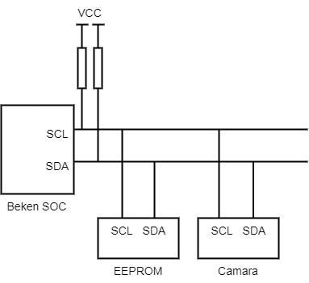
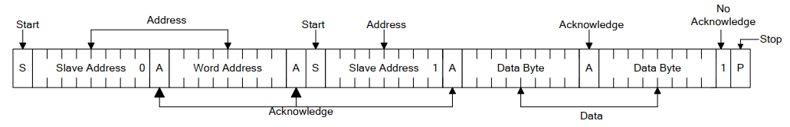

# I2C 使用指南

## 概述

I2C 是一种串行同步半双工通信协议，总线上可以同时挂载多个主机和从机。I2C 总线由串行数据线 (SDA) 和串行时钟线 (SCL) 线构成。这些线都需要上拉电阻。

I2C 具有简单且制造成本低廉等优点，主要用于低速外围设备的短距离通信（一英尺以内）。

I2C Connection

上图为 I2C 硬件连接，其中：

> - SCL：时钟信号, 提供传输数据的时钟，用来同步数据传输；
> - SDA：用于传输数据。

Beken 芯片通常具有 2 个 I2C 控制器，BK7258 支持 2 个 I2C (I2C0和I2C1)。

## I2C 使用方法

Beken I2C 既可工作在主机模式下，也可工作在从机模式下。无论主机还是从机，读写之前需要先调用 bk\_i2c\_init() 配置 I2C。
bk\_i2c\_init() 主要配置 I2C SCL 的时钟频率，如果工作在从机模式下，还需要配置 Beken I2C 的器件地址。

### I2C 主机模式下通信

调用 bk\_i2c\_master\_write() 写入数据到从设备，bk\_i2c\_master\_read() 读取数据。
针对 eeprom 这类内存设备，Beken 提供 bk\_i2c\_memory\_write()/bk\_i2c\_memory\_read() 接口，可以指定到从设备内部的地址去执行读写操作。

I2C memory write

I2C memory read

### I2C 从机模式下通信

针对从机模式下，Beken 提供 bk\_i2c\_slave\_write()/bk\_i2c\_slave\_read()，用于发送/接收数据。

## 模块导航

- [简介](../../introduction.md)
- [快速入门](../../get-started.md)
- [H/W 参考手册](../../hw-reference.md)
- [API 参考手册](../../api-reference.md)
- [开发者指南](../../developer-guide.md)
- [软件架构与分层](../architecture.md)
- [构建](../build_config.md)
- [配置与工具](../config_tools.md)
- [系统安全](../security.md)
- [低功耗与电源管理](../power_save.md)
- [内存与性能](../memory_perf.md)
- [设备管理框架](../driver_model.md)
- [外设与驱动](../peripheral.md)
- [DMA](bk_dma.md)
- [ICU](bk_interrupt.md)
- [PWM](bk_pwm.md)
- [TRNG](bk_trng.md)
- [SARADC](bk_adc.md)
- [SPI](bk_spi.md)
- [UART](bk_uart.md)
- [WDT](bk_wdt.md)
- [USB](bk_usb.md)
- [I2S](bk_i2s.md)
- [事件机制](../event.md)
- [出错与日志](../error_log.md)
- [系统调试](../debug_trace.md)
- [稳定性问题调试](../debug_stability.md)
- [Wi-Fi](../wifi.md)
- [Bluetooth](../bluetooth.md)
- [HTTP](../http.md)
- [OS 抽象层](../os_abstraction.md)
- [Bootloader与Ota](../bootloader_ota.md)
- [用例编写](../examples.md)
- [文档系统](../documentation.md)
- [OS 相关参考](../../os.md)
- [样例演示](../../examples.md)
- [应用开发](../../application.md)
- [开发与贡献代码流程](../../process.md)
- [云平台](../../cloud.md)
- [工程与示例](../../projects/projects.md)
