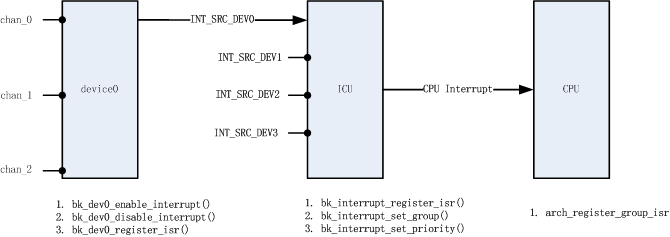

# 中断管理

## 概述

Interrupt Overview

如上图所示，中断管理的核心模块为 ICU (Interrupt Control Unit)。外设通过 ICU 向 CPU 上报中断。

整个中断处理框架可简单划分成三级:

> - 设备通道一级
>
>   设备各个不同的通道能独立的产生中断，一组 API 用于控制设备通道中断：
>
>   > - bk\_dev\_enable\_interrupt() 使能设备特定通道中断
>   > - bk\_dev\_disable\_interrupt() 关闭设备特定通道中断
>   > - bk\_dev\_register\_isr() 注册设备特定通道中断处理程序
>
>   通常设备通道 API 由具体设备实现，可参考具体设备的 API 文档。
> - 设备一级
>
>   也称中断源一级，一组 API 用于配置中断源：
>
>   > - bk\_interrupt\_register\_isr() 注册中断源处理程序
>   > - bk\_interrupt\_set\_group() 设置中断源组优先级
>   > - bk\_interrupt\_set\_priority() 设置中断源优先级
> - CPU 一级
>
>   也称为中断组一级，arch\_register\_group\_isr() 用于注册中断组处理程序，通常应用不关注这级别的中断处理。

中断处理流程可概述如下：

> - 设备通道产生中断
> - CPU/ICU 依据中断组优先级调用中断组处理程序
> - 中断组处理程序处理中断，并调用中断源处理程序
> - 中断源处理程序处理中断，并调用设备通道处理程序

## 中断源

在 ARMINO 中，能产生中断的外设称为中断源，通常一个外设为一个中断源，与一个中断源宏 INT\_SRC\_DEV 对应，
INT\_SRC\_DEV 中 DEV 表示外设名字，例如，GPIO 中断源宏为 INT\_SRC\_GPIO，SDIO 中断源为 INT\_SRC\_SDIO 等。
SoC 支持的全部外设中断源请参考 int\_types.h 中 icu\_int\_src\_t 定义。

备注

中断源与一个外设对应，而不是外设特定通道对应。

## 中断优先级

当两个不同的设备同时发生中断时，硬件依据中断源的优先级决定优先上报哪个中断，软件依据中断源优先级决定优先
处理哪个中断。

ARMINO 提供两级中断优先级配置：

> - 组优先级
>
>   软/硬件会优先处理组优先级较高的中断。在具体的实现中，通常组优先级会映射到 CPU 硬件优先级，例如，ARM9 的
>   FIQ/IRQ 中断被映射到两个不同的组优先级。组优先级可通过 bk\_interrupt\_set\_priority() 进行配置。
> - 组内优先级
>
>   组内优先级也简称优先级，当组优先级相同时，软/硬件会优先处理组内优先级较高的中断。在 ARMINO ARM9 SoC 中，组内优
>   先级是通过软件来实现的。应该注意，当两个组内优先级相同的外设同时产生中断时，ARMINO 不保证这两个设备的中断处理
>   先后顺序，处理的顺序由这两个中断注册的先后顺序决定。

备注

在 ARMINO ARM9 SoC 中，当前仅支持组内优先级配置，暂时不支持组优先级配置。每个中断源的组优先级均已固化。

备注

同一外设的不同通道优先级相同，ARMINO 无法对同一外设的不同通道设置不同的中断优先级。因为优先级是配置在中断源上，
而中断源与一个外设对应，而非与一个外设通道对应。

## 中断处理程序

ARMINO 提供了三个级别的中断处理例程注册：

> - 外设通道中断处理程序注册
>
>   bk\_dev\_register\_isr() 用于注册外设特定通道的中断处理程序，bk\_dev\_register\_isr() 中 dev 表示外设名字，如
>   bk\_gpio\_register\_isr(GPIO\_0, …) 表示注册 GPIO\_0 的中断处理程序。当 GPIO\_0 产生中断时，注册的中断处理程序会
>   被调用。
> - 外设中断处理程序注册
>
>   bk\_interrupt\_register\_isr() 用于注册外设中断处理程序，或者说注册中断源处理程序。如
>   bk\_interrupt\_register\_isr(INT\_SRC\_GPIO, …) 用于注册 GPIO 中断处理程序，当任意 GPIO 产生中断时，该中断
>   处理程序会被调用。
>
>   通常，ARMINO 外设初始化函数会调用 bk\_interrupt\_register\_isr() 注册一个默认的中断源处理程序，
>   这个默认中断源处理程序一般会做下面处理：
>
>   > - 获取外设中断状态寄存器
>   > - 清除外设中断状态寄存器
>   > - 处理外设中断
>   > - **调用 bk\_dev\_register\_isr() 中注册的外设特定通道处理程序**
>
>   一般来说，应用程序不需要注册自己的中断源处理程序，仅当默认的中断源处理程序无法满足要求时才需要注册。应当注意，
>   **当默认中断源处理程序被替换时， bk\_dev\_register\_isr() 注册的通道中断处理程序将不可用，此时设备的中断处理完全由
>   应用实现**。
> - 中断组处理程序注册
>
>   arch\_register\_group\_isr() 用于注册特定中断优先级组的处理程序，当该组中任意设备产生中断时，该处理程序会调用，
>   通常该处理函数会依据组内优先级调用 bk\_interrupt\_register\_isr() 注册的中断源处理程序。通常应用不需要关注这个
>   级别的中断注册。

## 编写中断应用程序

外设中断的应用可分为普通应用与特殊应用两类。

### 普通应用

大多数应用程序使用外设中断的方式如下：

> - 调用 bk\_dev\_register\_isr() 注册设备通道中断处理程序
> - 调用 bk\_dev\_enable\_interrupt() 使能通道中断
> - 调用 bk\_dev\_disable\_interrupt() 关闭通道中断

### 特殊应用

对于需要完全自己控制设备中断的应用，使用中断的方式如下：

> - 调用 bk\_interrupt\_register\_isr() 注册设备中断处理程序
> - 调用 bk\_dev\_enable\_interrupt() 使能通道中断
> - 调用 bk\_dev\_disable\_interrupt() 关闭通道中断

备注

当 bk\_interrupt\_register\_isr() 替换掉默认中断源处理程序后，bk\_dev\_register\_isr() 不可用，但
bk\_dev\_enable\_interrupt() 与 bk\_dev\_disable\_interrupt() 依然可用.
