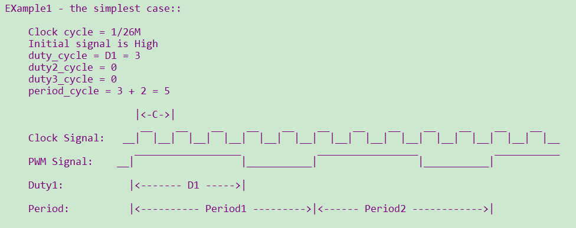

<a id="pwm"></a>

# PWM

<a id="id1"></a>

## 1 功能概述

> > BK7258总共有2组PWM，每1组6个channel。
> >
> > 1、每组 PWM 的 相邻通道只能任选1路独立输出((0,1)相邻、(2,3)相邻、(4,5)相邻)，同时输出会相互干扰。
> >
> > 2、每组 PWM 可实现3个互补输出，如概述中的表格所示，仅可配置 PWMx 的 CH0与CH1, CH2与CH3, CH4与CH5 作为互补输出，
> > 有相应的死区相关的寄存器可配置，较为精准，但通道固定。
> >
> > 3、PWM1 的 CH0, CH2, CH4 与 PWM2 的 CH0, CH2, CH4 任意两通道组成互补输出，软件实现互补功能，较为灵活，但精度不及硬件实现的方式。
> >
> > 4、另外要应用到灯或电机时，P8/P22，p9/P23不建议使用。
> >
> > bk7258具有12路PWM输出，输出时其时钟源选择的是26M，每一路的周期及占空比可以进行配置，channel如下:
> >
> > | channel | GPIO | channel | GPIO |
> > | --- | --- | --- | --- |
> > | 0 | GPIO6/GPIO18 | 6 | GPIO32 |
> > | 1 | GPIO7/GPIO19 | 7 | GPIO33 |
> > | 2 | GPIO8/GPIO22 | 8 | GPIO34 |
> > | 3 | GPIO9/GPIO23 | 9 | GPIO35 |
> > | 4 | GPIO24 | 10 | GPIO36 |
> > | 5 | GPIO25 | 11 | GPIO37 |
>
> 注：支持多个GPIO时，请注意默认PWM 通道对应的GPIO配置，配置文件在gpio\_map.h GPIO\_PWM\_MAP\_TABLE

<a id="id2"></a>

## 2 代码路径

> demo路径：`components\bk_cli\cli_pwm.c`

<a id="cli"></a>

## 3 cli命令简介

> demo运行依赖的宏配置：
>
> | NAME | Description | File | value |
> | --- | --- | --- | --- |
> | CONFIG\_PWM | support PWM | `middleware\soc\bk7258\bk7258.defconfig` | y |
>
> demo支持的命令如下表：
>
> | Command | Param | Description |
> | --- | --- | --- |
> | pwm\_driver init {26M\|DCO} | 26M\|DCO:clk source,default 26M | init the resoure common to all PWM channels |
> | pwm\_driver deinit | none | free all resource related to pwm |
> | pwm {chan} init {period\_v} {duty\_v}  \[duty2\_v\]\[duty3\_v\] | chan: pwm channel | power up and config the pwm channel, set the period and duty cycle  note: this chip supports 3 duty cycle , parameter duty2\_v and duty3\_v are optional |
> | period\_v:pwm periord |
> | duty\_v: duty cycle |
> | duty2\_v: second level reversal |
> | duty3\_v: third level reversal |
> | pwm {chan} duty {period\_v} {duty\_v}  \[duty2\_v\] \[duty3\_v\] | chan: pwm channel | configure the period and duty cycle.  note: parameter duty2\_v and duty3\_v are option. |
> | period\_v:pwm periord |
> | duty\_v: duty cycl |
> | duty2\_v: second level reversal |
> | duty3\_v: third level reversal |
> | pwm {chan} {start\|stop\|deinit} | chan: pwm channel | read data\_size bytes of data from |
> | start\|stop\|deinit: |
> | pwm {chan} signal {low\|high} | chan: pwm channel | set the initial signal to high\|low |
> | low\|high: initial signal level |
> | pwm\_group init {chan1} {chan2}  {period} {chan1\_duty} {chan2\_duty} | chan1: pwm channel | init the PWM group  The PWM group is a channel pair that has following attributes: -The period is same -The initial signal level is opposite -Start and stop at the same time |
> | chan2: pwm channel |
> | period: pwm periord |
> | chan1\_duty: chan1 duty cycle |
> | chan2\_duty: chan2 duty cycle |
> | pwm\_group {start\|stop\|deinit} | chan: pwm channel | start\|stop\|deinit the PWM group |
> | start\|stop\|deinit: |
> | pwm\_group config {group} {period}  {chan1\_duty} {chan2\_duty} | group: pwm channel | Configure the duty and period of a PWM group |
> | period: pwm periord |
> | chan1\_duty: chan1 duty cycle |
> | chan2\_duty: chan2 duty cycle |
> | pwm\_capture {chan} init {pos\|neg\|edge} | chan: pwm channel | calculate the cycles between two different pos-edge\|neg-edge\|edges |
> | pos\|neg\|edge: counting mode |
> | pwm\_capture {chan} {start\|stop\|deinit} | chan: pwm channel | start\|stop\|deinit pwm capture func |
> | start\|stop\|deinit |

<a id="id3"></a>

## 4 演示介绍

> demo执行的步骤如下：

1、准备好逻辑分析仪，连接方式如下：

> ```
> pwm通道0----GPIO18
>
> pwm通道1----GPIO19
> ```

2、PWM独立输出模式

> 对PWM驱动进行初始化：
>
> > ```
> > pwm_driver init
> > ```

2.1 普通输出

> ```
> pwm 0 init 200 100 0 0 25 //占空比50%
> pwm 0 start
> ```

波形如下：

<a id="id4"></a>



Figure 1\. 输出60%占空比的PWM

备注

注意：根据参数的配置，在相同周期内，占空比可以进行调整。但每次调整配置都在下一个周期才会生效；
在PWM进行init和duty设置时，必须 period \> (D1\+D2\+D3)。
