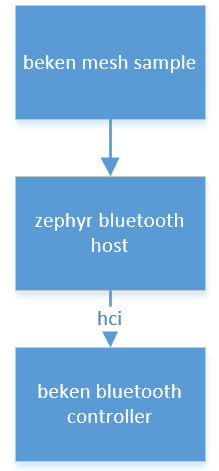

<a id="mesh"></a>

# Mesh

<a id="id1"></a>

## 1 功能概述

> 本工程实现了mesh provisioner/provisionnee角色，主要功能有
>
> 1.作为provisioner发送unprov广播
>
> 2.作为provisionee加入provisioner组网
>
> 3.作为灯设备加入天猫精灵组网

<a id="id2"></a>

### 1.1 软件规格

> - host协议栈：
>   :   - zephyr v2.7.6 bluetooth host
> - 天猫精灵demo:
>   :   - 支持click

<a id="id3"></a>

### 1.2 代码路径及编译命令

> sample: `./components/bk_bluetooth/mesh/sample`
>
> zephyr: `./components/bk_bluetooth/mesh/`
>
> build cmd：`make bk7258 PROJECT=bluetooth/mesh`

<a id="id4"></a>

## 2 测试命令

<a id="demo"></a>

### 2.1 双板demo

> |  |  |
> | --- | --- |
> | ble\_mesh provision init provisionee | Provisionee 初始化并加入组网 |
> | ble\_mesh provision init provisioner | Provisioner 初始化并生成组网 |
> | ble\_mesh provision deprovision \<MAC\> | 退出组网 |
> | ble\_mesh provision send\_count \<time\> | 作为provisioner，定时在组网内发送数据 |

<a id="id5"></a>

### 2.2 天猫精灵demo(灯)

> |  |  |
> | --- | --- |
> | ble\_mesh tmall init \<product\_id\> \<device\_secret\> | 加入天猫精灵组网，参数请参考天猫精灵官方说明 [天猫精灵开放平台](https://www.aligenie.com/doc/357554/gtgprq) |

<a id="id7"></a>

## 3 测试过程

<a id="id8"></a>

### 3.1 多板组网收发

> 1.A板，输入 `ble mesh provision init provisioner`
>
> 2.其他板子输入 `ble mesh provision init provisionee`，最多20块
>
> 3.组网成功，A会有打印: `user_prov_node_added:success, mac xxxxxxxx addr xxx i xxx`
>
> `do_add_appkey_cb:bind success, addr xxx appaddr xxx`
>
> 5.A输入 `ble mesh provision send_count xxx` ，xxx为发送间隔(ms)
>
> 6.正常情况，A会有打印， `remote C8:47:8C:43:2C:A7 mesh 2, we send X, we recv Y, peer recv Z` ，其中包括对方地址，mesh地址，X为A发送次数，Y为A接收（此对方）次数，Z为对端接收次数
>
> 7.其他板子也会有打印 `peer count X server recv count Y` ，其中X为A发送次数，Y为本端接收次数。

<a id="id9"></a>

### 3.2 天猫精灵外设demo(灯)

> 1.令天猫精灵进入配网模式
>
> 2.开发板输入 `ble_mesh tmall init <product_id> <device_secret>`，等待天猫精灵提示配网成功
>
> 3.对着天猫精灵说出“开灯”或在手机天猫精灵app控制开关灯，可以看到开发板的led灯受到控制。

<a id="id10"></a>

## 4 模块图

<a id="id12"></a>



Figure 1\. arch

<a id="id11"></a>

## 5 重要流程说明

<a id="provisionee"></a>

### 5.1 provisionee初始化

```
static void bt_mesh_xxx_ready(int err)
{
    if (err)
    {
        BT_INFO("Bluetooth init failed (err %d)\n", err);
        return;
    }

    BT_INFO("Bluetooth initialized\n");

    //注册prov回调，注册相关服务
    err = bt_mesh_init(&prov, &comp);

    if (err)
    {
        BT_INFO("Initializing mesh failed (err %d)\n", err);
        return;
    }

    ...

    //开启provisionee
    bt_mesh_prov_enable(BT_MESH_PROV_ADV);

    BT_INFO("Mesh initialized\n");
}
```

<a id="provisioner"></a>

### 5.2 provisioner初始化

```
static void bt_mesh_xxx_ready(int err)
{
    if (err)
    {
        BT_INFO("Bluetooth init failed (err %d)\n", err);
        return;
    }

    BT_INFO("Bluetooth initialized\n");

    //注册prov回调，注册相关服务
    err = bt_mesh_init(&prov, &comp);

    if (err)
    {
        BT_INFO("Initializing mesh failed (err %d)\n", err);
        return;
    }

    ...


    bt_rand(net_key, sizeof(net_key));

    BT_WARN("netkey %s", bt_hex(net_key, sizeof(net_key)));

    //根据net key 创建数据库
    err = bt_mesh_cdb_create(net_key);

    if (err == -EALREADY)
    {
        BT_INFO("Using stored CDB");
    }
    else if (err)
    {
        BT_ERR("Failed to create CDB (err %d)", err);
        return;
    }

    s_provision_ctx.local_addr = 1 & BIT_MASK(15);
    //开启provisioner
    err = bt_mesh_provision(net_key, s_netkey_idx, 0, 0, s_provision_ctx.local_addr, dev_key);

    if (err)
    {
        BT_ERR("Provisioning failed (err %d)", err);
        return;
    }

    BT_INFO("Mesh initialized\n");
}
```
