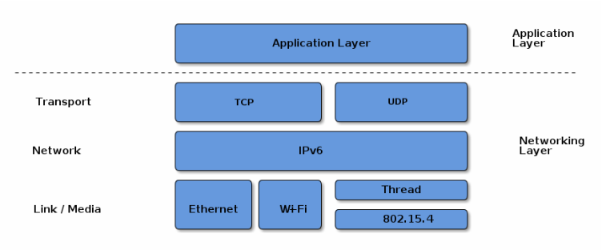
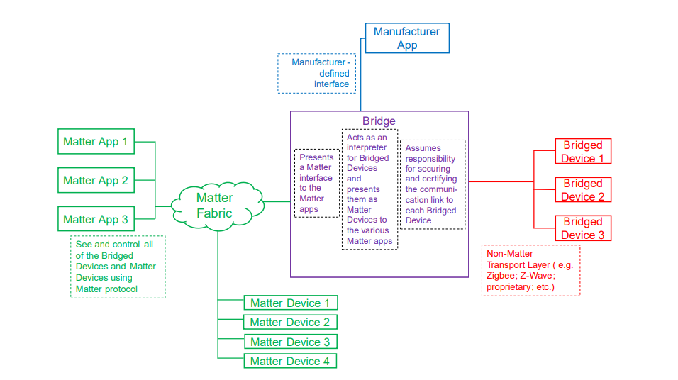
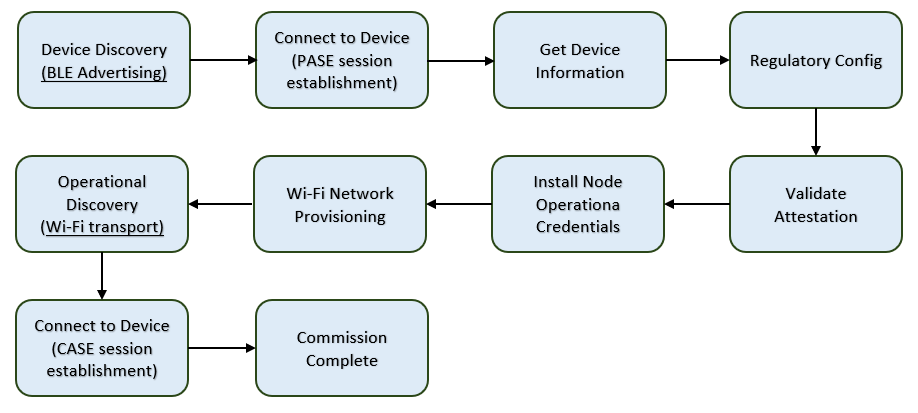
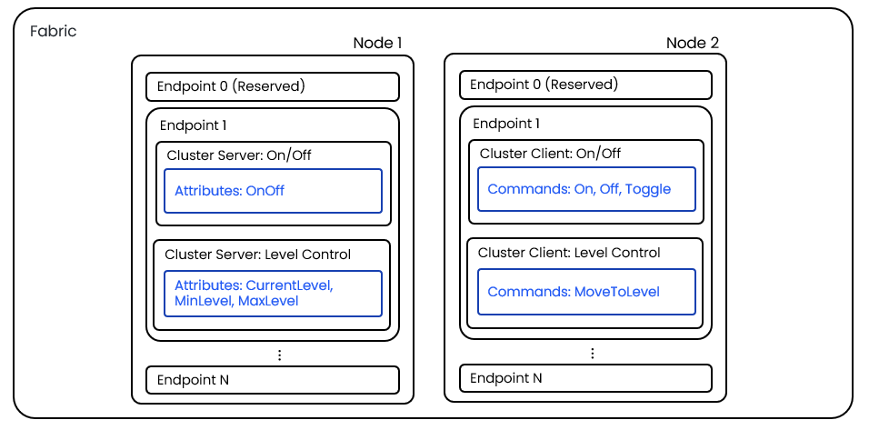

# Matter 简介

当前物联网的智能家居和智能建筑市场因为存在多种技术标准和生态平台构筑的围墙花园而呈现碎片化的状态。消费者在购买智能设备时要考虑多方因素：自己喜欢的产品是否与家中已有系统的兼容、将来的维护和扩展等等；制造厂商为了拓展产品市场逐一打通与各个生态兼容性，不得不对同一款产品进行多次重复开发。

Matter由CSA(连接标准联盟)的工作组开发，是一个统一的开源应用层连接标准，旨在使开发人员和设备制造商能够连接并构建可靠、安全的生态系统，提高联网家庭设备之间的兼容性。它采用经市场验证的技术，使用互联网协议（IP），兼容 Thread 和 Wi-Fi 网络传输。Matter标准旨在提高智能家居产品的兼容性，并将 **安全性** 作为设计的基本原则。智能连接应该 **简单、可靠和具有互操作性** ，这也是促使主要行业参与者共同建立Matter标准的愿景。

Matter技术包含了三份规格书，分别是：

- Matter Core Specification : 核心标准是主要标准，定义了Matter协议架构、安全通信机制、配网流程、数据模型等Matter技术内容。
- Matter Application Cluster Specification : 目前支持的Matter产品应用相关的cluster的详细定义。
- Matter Device Library Specification : 目前支持的Matter设备类型的具体定义，比如设备需要满足的cluter。

它们都可以在 [CSA官网](https://csa-iot.org/developer-resource/specifications-download-request/) 下载。

## Matter 架构

Matter旨在为智能家居设备构建基于IPv6的通信协议。 Matter协议定义了部署在设备上的应用层以及不同的链路层，用于辅助和维护不同层次的互操作性。下图演示了常见操作的调用协议栈:

Application and Network Stack

Matter使用分层架构分离不同的职责，并且在不同的协议栈之间进行了良好的封装。大部分的交互都会经过下面图例的层级。

分层架构

**Application** 层对应于设备的高阶业务逻辑。 如照明应用的开/关灯泡及控制颜色的功能。

**Data Model** 层用来定义应用程序的数据模型及动作。应用程序将使用这些数据与设备进行互操作。

**Interaction Model** 层定义了一系列客户端设备与服务端设备进行的交互(interaction)。例如，读或写服务设备的属性时的设备行为。 这些交互作用于 Data Model 层定义的元素。

一旦使用 Interaction Model 构造了一个动作(action)，动作(action)将被序列化为规定的压缩二进制格式，以便进行编码以用于网络传输。此过程在 **Action Framing** 层中处理。

经过编码的action帧再由 **Security Layer** 层处理:消息被加密并附加消息身份验证码。这些处理确保消息发送方和接收方之间的数据的机密性和真实性。

当交互被序列化、加密和签名时， **Message Layer** 使用必需和可选的头字段构造payload格式，其中头字段规定消息的属性以及逻辑路由信息。

当payload被 Message Layer 层构造后, 会使用基于IP的数据传输协议 (TCP协议或Matter的 MRP 协议)

对方设备收到数据后，数据流则沿着协议栈向上移动，即各个层反转发送方对数据执行的操作，以最终将消息传递给应用程序。

除了上述的数据流之外，Matter还定义了基于操作证书(operational certificates)的安全会话构建协议(CASE),或passcodes (PASE)，组通讯，已经主要用于OTA的大量数据传输的大数据传输协议协议(BDX)，还支持厂商自定义的传输协议。

## Matter 拓扑结构

Matter可以同时支持Wi-Fi/Thread/Ethernet，也就是说Matter可以让不同网络中的设备进行互联互通，通过Thread border router 可以实现Wi-Fi和Thread设备互相通信。不仅如此，Matter还允许接入其他网络设备，比如ZigBee设备，这主要通过一个Matter bridge设备来实现。在Matter拓扑结构中，还有一个节点非常重要：Matter controller，Matter controller用来完成配网和远程控制设备，比如苹果的HomePod mini和Home app就是一个典型的Matter controller节点。如下为一个典型的Matter拓扑结构：

拓扑结构

## Matter网络中的概念

1. Matter Device（Matter设备）

支持 Matter 的智能家居硬件产品，可以连接到 Matter 控制器并由其控制。示例：灯泡、开关、传感器、恒温器、百叶窗、门锁、桥梁和媒体设备。

2. Matter Commissioner（配网者）

用作对Matter设备进行配网的设备或应用程序，配网后将设备引入Matter Fabric。配网者首先验证设备的真实性，然后根据需要分配网络凭据。平台、设备供应商或其他支持Matter的应用程序、移动操作系统、智能扬声器或显示器都可以是Matter配网者。配网者可以是独立的工具，也可以是设备或系统的一部分，包括其他角色，例如管理员或控制器。比如iOS Home app，Google Home，Alexa app。

3. Matter Controller（控制器）

Matter控制器是一个可以控制用户连接到它的Matter设备的实体。Matter Controller功能可以内置到许多类型的硬件设备中，例如手机、提供本地和远程控制的始终供电的智能家居hub、智能开关和按钮，甚至是移动应用程序。一个Fabric上可以有多个Matter控制器。
比如Apple Matter生态的Controller是iOS里面的Home App或者HomePod音箱。

4. Matter Administrator（管理员）

一种为其管理的 Fabric 上的所有设备创建、维护和管理安全性和权限的App或者设备。Matter的多管理员功能允许设备同时连接到多个智能家居平台，指的是将设备连接到多个Matter管理员，从而连接到多个Fabric。比如iOS Home App，Google Home App，Alexa App。

5. Matter Fabric

Matter设备在家庭中称为 Matter Fabric的虚拟网络上连接在一起，这是一个专用虚拟网络，在Fabric内Matter设备、管理员和控制器通过该网络相互通信。Matter Fabric可以跨越家庭内的Wi-Fi、Thread 和以太网物理网络。Matter设备一次可以连接到一个或多个Fabric，每个Fabric都由Matter管理员管理。
在一个Fabric内，每个节点都有一个唯一标识Node ID。

6. Matter bridge

智能家居是一个非常碎片化的市场，除了Matter技术外，还有很多其他技术运用在智能家居市场中，比如蓝牙和ZigBee。为了将这些现有的智能家居产品一揽子接入Matter生态，Matter规范里面提出了Matter Bridge这个设备类型，通过Matter bridge，我们可以把非Matter设备快速接入Matter生态。

如下图所示：非 Matter 设备作为桥接设备暴露给 Fabric 上的节点。Matter 节点既可以与（本地）Matter 设备通信，也可以与桥接设备通信（通过Matter bridge在 Matter 和其他协议之间进行转换）。

Matter Bridge

7. Matter标准OTA

Matter规范要求设备必须支持设备升级功能，虽然Matter定义了一整套设备升级标准，但Matter没有强制规定设备必须采用这套标准的OTA升级方式，也就是说设备也可以采用其他方式来升级，比如使用基于蓝牙或者Wi-Fi的方式进行升级。

Matter标准OTA定义了两个角色：OTA Provider和OTA Requestor，OTA Provider和OTA Requestor都是cluster，因此他们都有client和server角色之分，要升级固件的设备叫OTA requestor，而提供固件的设备（比如controller）叫OTA provider。

8. Distributed Compliance Ledger(DCL)

通俗地说，DCL是CSA运营的一个分布式数据库服务器，既然DCL是一个记账簿，它就会不断地更新和发展的。每当成员公司有新品发布，他们就会把这个新品的认证信息写到DCL中。如果颁发了新的PAA证书，这个信息也会写入DCL中。前面提及的Matter标准OTA，新image的URL信息也可以写入到DCL中。CSA也可以撤销或者作废DCL中的一些证书或者认证信息。总之，DCL就是一个分布式数据库服务器，保证了PKI系统的正常运行，同时也保证了Matter各个生态的互联互通。

9. Certificate Declaration(CD)

每当一个产品通过了Matter认证，CSA就会颁发一个CD证书给它，CD证书包括Vendor ID，Certificate ID，certification type等，由于一个产品类别下所有设备共用同一个CD，因此CD都是hard code在应用中的。

## Matter网络配网

Matter配网（commissioning）就是把一个设备加入Matter Fabric（也叫Matter操作网络）的过程，此过程包含两个角色：

- Commissioner device，一般放在Matter controller中，用于发起配网过程。
- Commissionee device，就是还未添加到Matter网络中的设备。

为了完成配网，commissionee必须提供如下onboarding信息：

- 16-bit Vendor ID and 16-bit Product ID
- 12-bit device discriminator
- 27-bit setup passcode
- 8-bit Discovery Capabilities Bitmask

上面这些信息可以以下面三种方式提供：

- 手动配对码（Manual Pairing Code）
- 二维码（QR Code）
- QR Code Payload

双方必须支持Manual Pairing Code，但推荐使用二维码，当然各个生态系统也可以定义自己的discriminator和setup passcode。

配网流程如下图所示：

Matter配对流程

如果上述配网流程成功，那么设备将得到如下信息：

- 由fabric ID和node ID组成的实例名
- Node Operational Certificate(NOC)
- NOC对应的私钥
- Access Control List
- 操作网络的其他信息

## 数据模型(Data Model)和设备类型

如下为一个典型的Matter设备的data model表示：

Data Model

**Fabric**

在同一个Fabric中的设备，共享同一个根证书，通过证书链的验证，同一个fabric中的所有设备都可以建立安全的通信。

**Node**

节点(Node)是一个逻辑上独立的设备，有自己唯一的网络地址。每个Matter设备由一个或多个Node组成。

**Endpoint**

一个Node包含多个Endpoint，每个endpoint是一个逻辑上独立的功能模块。比如门锁，它除了可以包含门锁这个endpoint外，它还可以包含温度传感器这个endpoint。

备注

endpoint 0预留为Matter的utility cluster，而且每个Matter设备都必须强制包含它。

**Cluster**

Endpoint由一个或多个cluster组成，cluster可以认为是一个基本功能集，它包含attributes， commands和events三个组件。比如前面说的门锁endpoint，它除了可以包含开锁/关锁这个cluster外，它还可以包含报警cluster以实现报警功能。

Matter定义了两种类型的Cluster：

Server –提供Attributes, Commands和Events

Client – 对Server发起交互（interaction）操作

Cluster的详细规格定义请参见Matter Application Cluster Specification。如何通过cluster组成endpoint，进而组成设备类型，这个则是Matter Device Library Specification规定的内容。

**Attribute**

Attribute就是一条条表示物理量或者状态的数据记录，他们保存在设备的存储器中。

**Command**

Command就是下文所说的action，用来触发server的特定行为，比如关锁命令用来触发关锁操作。

**Event**

Event其实是一种特殊的attribute，它用来更新设备的状态，因此你可以把event当成是一种历史数据记录。

## 交互命令和模型(Interaction Model)

通俗地讲，Interaction model就是用来规定交互命令集的，我们把发起交互的节点叫initiator (一般都是client设备)，而接收者称为target (一般为server设备)。

Matter定义了如下interaction类型：

**Read**

用来读取attributes或events的值

**Write**

用来修改attribute的值

**Invoke**

用来发送commands

**Subscribe**

用来订阅target的数据报告，从而不用定时去查询相关数据，我们可以订阅attribute，也可以订阅event。
