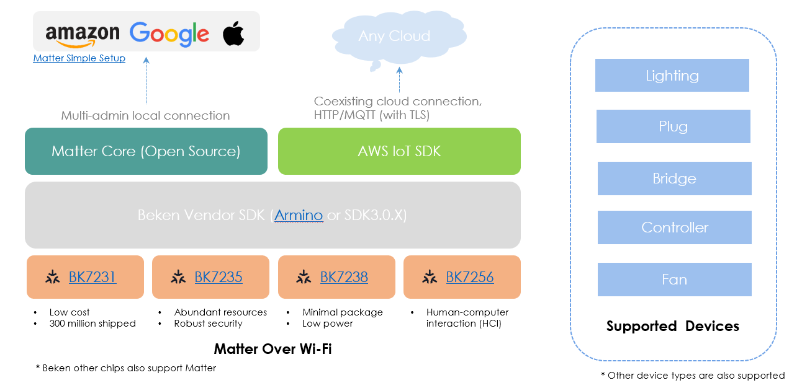
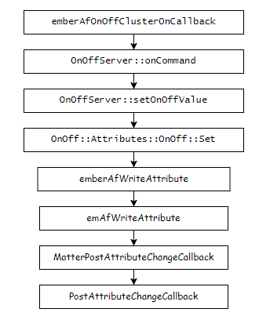

<a id="beken-matter"></a>

# Beken 的Matter 应用开发

下面是Beken Matter的解决方案整体视图

<a id="id4"></a>



Beken Matter Solution

<a id="bk-matter-repo"></a>

## bk\_matter repo的基本介绍

可以在配置文件 `projects/matter/config/common.config` 中，配置 `CONFIG_MATTER_EXAMPLE` ，编译指定的matter设备类型。比如Lighting，Plug等

相关example的源码可以在 `components/matter/connectedhomeip/examples/$(CONFIG_MATTER_EXAMPLE)/beken` ,找到并进行定制开发。

在bk\_matter中，Matter core以组件的形式包含在 `components/matter` ；
其中 `components/matter/connectedhomeip` 中是标准的Matter SDK。

在Matter SDK中只需要关心如下地方：

- `examples/{CONFIG_MATTER_EXAMPLE}/beken` beken实现的一些应用的demo
- `src/platform/Beken` 中是Beken对matter的适配，包括ble，wifi，kv存储等接口的实现
- `examples/platform/beken` 中是beken实现matter 应用的一些通用api

在armino中编译matter时，首先要使能matter组件（ `CONFIG_SUPPORT_MATTER=y` ），在编译时，armino会调用 `components/matter/CMakeLists.txt` ，从而调用 `components/matter/libCHIP.mk` 脚本，编译目录 `components/matter/connectedhomeip/examples/{MATTER_EXAMPLE}/beken` 下的gn工程，生成 `libMatter.a` 文件。这个文件中包含 `ChipTest` 函数，用于初始化并启动matter相关进程。

<a id="matter-lighting-example"></a>

## Matter Lighting example

下面是支持的Lighting的子的设备类型，通常建议开发Extended Color Light(0x010D)，其包含最全面的cluster。

- On/Off Light(0x0100)
- Dimmable Light(0x0101)
- Color Temperature Light(0x010C)
- Extended Color Light(0x010D)

**设备信息与恢复出厂设备**

- 设备上电：未配网的设备上电后，会启动Matter服务，自动进行BLE广播（默认15分钟后会停止）。已经配网的设备，设备上电不会进行BLE广播，而会自动连接保存的路由器，并且在该网络内广播自己的Matter服务。
- 打印设备信息：用户可以在串口CLI上输入 `matter_show` 查看设备onbording的基础信息。可以在浏览器上输入下面例子的 [网址](https://project-chip.github.io/connectedhomeip/qrcode.html) 查看扫描QR Code.

```
matter_show
chip[DL] Device Configuration:
chip[DL] Serial Number: BK000001
chip[DL] Vendor ID: 65521 (0xfff1)
chip[DL] Product ID: 32773 (0x8005)
chip[DL] Setup Passcode: 20202021
chip[DL] Setup Discriminator: 3840 (0x0f00)
chip[SVR] SetupQRCode: [MT:6FCJ142C00KA0648G00]
chip[SVR] Copy/paste the below URL in a browser to see the QR Code:
chip[SVR] https://project-chip.github.io/connectedhomeip/qrcode.html?data=MT%3A6FCJ142C00KA0648G00
chip[SVR] Manual pairing code: [34970112332]
```

- 恢复出厂设置：如果设备已经配过网，用户可以在CLI上输入 `matter_factory_reset` 擦除配网信息，设备自动重启并恢复配对状态

```
matter_factory_reset
```

**配网测试**

这里需要借鉴：

1. 可以使用chip-tool对设备进行配对，操作等进行简单的测试。具体使用方法可以参考 [这里](matter-tools/chip-tool.md) 。
2. 可以使用Apple/Google/Amazon等其它生态进行配网。可以参考 [Matter 配网测试](matter-tools/work-with-apple.md) 。

**二次开发**

如果客户想开发一款Matter灯泡，可以在已有的应用上进行修改。只需要在下面的文件中适配上和自己产品相关的硬件部分。

当然也可以选择根据 [从零开发Matter 新的设备类型产品](matter-develop.md) 开始一个全新的设备的开发。

<a id="id5"></a>



matter OnCommand 调用流程

在matter初始化时，通过函数 `PlatformMgr().AddEventHandler(CHIPDeviceManager::CommonDeviceEventHandler, reinterpret_cast<intptr_t>(cb));` 设置了回调函数。
在控制器发送OnCommand后，在 OnOffCluster 的实现中，Matter 将会按照上图流程调用相关函数，最终到下方代码的 `PostAttributeChangeCallback` 这个函数，调用第33行操作设备执行相关动作。

<a id="id6"></a>

DeviceCallbacks.cpp

```
 1void AppDeviceCallbacks::PostAttributeChangeCallback(EndpointId endpointId, ClusterId clusterId, AttributeId attributeId,
 2                                                     uint8_t type, uint16_t size, uint8_t * value)
 3{
 4    ChipLogProgress(DeviceLayer, "[%s] cluster ID: " ChipLogFormatMEI, TAG, ChipLogValueMEI(clusterId));
 5    switch (clusterId)
 6    {
 7    case Clusters::OnOff::Id:
 8        OnOnOffPostAttributeChangeCallback(endpointId, attributeId, value);
 9        break;
10
11    case Clusters::LevelControl::Id:
12        OnLevelControlAttributeChangeCallback(endpointId, attributeId, value);
13        break;
14
15    case Clusters::ColorControl::Id:
16        OnColorControlAttributeChangeCallback(endpointId, attributeId, value);
17        break;
18
19    default:
20        ChipLogProgress(Zcl, "Unknown cluster ID: " ChipLogFormatMEI, ChipLogValueMEI(clusterId));
21        break;
22    }
23}
24
25void AppDeviceCallbacks::OnOnOffPostAttributeChangeCallback(EndpointId endpointId, AttributeId attributeId, uint8_t * value)
26{
27    VerifyOrExit(attributeId == Clusters::OnOff::Attributes::OnOff::Id,
28                 ChipLogError(DeviceLayer, "[%s] Unhandled Attribute ID: '0x%04lx", TAG, attributeId));
29    VerifyOrExit(endpointId == 1 || endpointId == 2,
30                 ChipLogError(DeviceLayer, "[%s] Unexpected EndPoint ID: `0x%02x'", TAG, endpointId));
31
32    // At this point we can assume that value points to a bool value.
33    BkLightingMgr().SetOnOff(*value);
34
35exit:
36    return;
37}
```

<a id="matter-controller-example"></a>

## Matter Controller example

Matter Controller 通常作为Matter中枢，用于实现配对Matter device。Beken 实现的Controller可以支持在bk7235，bk7256，bk7258上编译运行。下面是一些常用的cli，用于配对控制等操纵。

- 配对设备

```
matter pair ble-wifi <pairing-code>
```

- 控制开关设备

```
matter onoff <node-id> <1/0>
```

- 控制level

```
matter setlevel <node-id> <level-value>
```

- 打印fabric信息

```
matter fabric
```

- 列出已配对设备

```
matter listdevices
```
