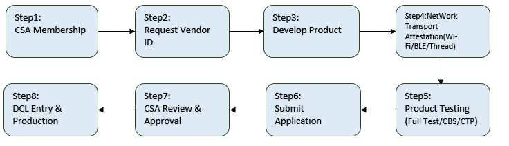

# Matter 产品认证及量产流程[](#matter "永久链接至标题")

[[English]](../../../en/v2.0.1/matter-production/index.html "../../../en/v2.0.1/matter-production/index.html")

这是整体的Matter开发认证的流程

Certification Steps[](#id11 "永久链接至图片")

## 1.成为CSA会员[](#csa "永久链接至标题")

CAS有一下四种会员资格，详情可从 [csa官网](https://csa-iot.org/become-member/#Membership "https://csa-iot.org/become-member/#Membership") 了解：

- Associate Members：使用基于标准的Matter产品，但不直接生产或制造它们。要加入Associate 会员并认证白标产品，公司必须通过CSA的 [认证转移计划](https://csa-iot.org/certification/transfer-program/ "https://csa-iot.org/certification/transfer-program/") 与联盟Participant 会员或者 Promoter 会员合作。

- Adopter Members：使用现有的、经批准的规范来构建产品。Adopter 会员可以访问已完成的、经批准的标准文档，通过联盟认证计划对产品进行认证，并将联盟技术徽标和商标用于认证产品。

- Participant Members：为以后将采用的标准做出贡献并制定标准。Participant 会员可以访问联盟工作组，亲身参与制定规范，并尽早获得规范草案和测试，并有机会更快地开发和上市。

- Promoter Members：为联盟标准做出贡献、制定和采用，并享受所有其他会员级别的权益。Promoter会员帮助领导联盟，最终批准所有标准，在联盟董事会中占有一席之地，并可能领导和参与董事会委员会。

## 2.获取VID[](#vid "永久链接至标题")

Vendor ID又叫Manufacturer ID code，通过发送请求邮件到 [certification@csa-iot.org](mailto:certification%40csa-iot.org "mailto:certification%40csa-iot.org") ，联盟将分配给你的公司指定得VID并通过邮件回复。

VID 数据库每个月会在 [https://groups.csa-iot.org/wg/members-all/document/10905](https://groups.csa-iot.org/wg/members-all/document/10905 "https://groups.csa-iot.org/wg/members-all/document/10905") 更新。

## 3.开发产品[](#id3 "永久链接至标题")

客户基于bk_matter上开发自己的产品，期间Beken会帮助客户熟悉SDK，当前的example可以满足客户绝大部分需求，并指导客户使用chip-tool和其它生态进行测试。基本可以在一个星期内完成。

产品的开发可以参考 [从零开发Matter 新的设备类型产品](../matter-develop/index.html "../matter-develop/index.html") 。

对于认证，Matter会根据产品的配置，需要通过一系列的自测。

以下是测试中需要用到的文件：

1. pics xml file
   用于对产品的功能进行定义，实验室会根据此文件勾选的功能对产品进行测试。
   可通过实验室过去对应版本的文件，或者从CAS官网下载： [https://groups.csa-iot.org/wg/matter-csg/document/26122](https://groups.csa-iot.org/wg/matter-csg/document/26122 "https://groups.csa-iot.org/wg/matter-csg/document/26122") 。
2. pics tool
   用于编辑pics xml的一个在线工具，直接访问 [https://picstool.csa-iot.org/](https://picstool.csa-iot.org/ "https://picstool.csa-iot.org/") 就能够使用。
3. [Test harness](https://github.com/project-chip/certification-tool "https://github.com/project-chip/certification-tool")
   一个Matter联盟提供的自动化测试工具，可自动化测试的项目会依赖此工具。 [https://github.com/project-chip/certification-tool](https://github.com/project-chip/certification-tool "https://github.com/project-chip/certification-tool")
4. chip-tool
   Matter测试过程中主要依赖的工具，具体使用方法可以参考 [测试工具 chip-tool](../matter-tools/chip-tool/index.html "../matter-tools/chip-tool/index.html")
5. chip-cert
   用于生成Matter 测试的证书，CD等，具体使用方法可以参考 [证书工具 chip-cert](../matter-tools/chip-cert/index.html "../matter-tools/chip-cert/index.html")
6. [其它文档](https://groups.csa-iot.org/wg/matter-csg/document/folder/2756 "https://groups.csa-iot.org/wg/matter-csg/document/folder/2756")
   不同版本Matter的各种测试文档会在上传到这里。

## 4.确认底层协议的认证[](#id6 "永久链接至标题")

ODM/OEM可以直接继承芯片厂家的Wi-Fi/BLE/Thread/Ethernet的相关联盟认证。CSA要求如下：
Ethernet (IEEE PMA Compliance Attestation required)
Wi-Fi (Wi-Fi 4/802.11n or later)
Thread (1.3.0 or later)
Bluetooth to support Matter commissioning (LE v4.0 or later)

## 5.认证测试[](#id7 "永久链接至标题")

客户需要根据自身的情况，选择如下是5种Matter的认证方式。Beken的芯片已经通过了Matterr认证，Beken会辅助客户解决认证中的问题。

1. 新认证（Full Certification)：客户需要联系实验室，沟通好测试产品的计划，。产品通过联盟授权实验室测试后取得认证。
2. 相似性认证（Certification by Similarity ，CbS )：从以获得认证的产品衍生出来的产品，根据其与先前产品的相似性而被授予认证。
3. 同系列认证（Product Family Certification ，PFC)：同系列产品中，若每个子产品都是一个单一的父产品的直接变体。比如同一产品，在世界不同的地方销售。
4. 转让认证（Certification Transfer Program ，CTP)：直接贴牌其它厂家的已经认证过产品（除了新的产品外壳外，没有任何硬件和软件变化）。

客户可以提前做好产品认证规划，如果有不确定的地方可以直接咨询Beken或者certification@csa-iot.org
对于新认证，测试通过后，第三方实验室会出具测试报告，其它的认证类型，需要填写相关的文档，CSA来进行审核。

## 6.提交认证申请[](#id8 "永久链接至标题")

客户需要在CSA的Certification Web Tool上提交认证申请，并且需要缴纳相应的认证费用。 期间如果CSA认证团队对申请单有疑问，会邮件联系申请人。

注意，因为Matter设备需要依赖于PKI(Public Key Infrastructure)来确保设备是厂家的真实Matter设备。整个PKI包含3级证书：PAA = > PAI = > DAC。每个Matter设备都有一个唯一的DAC(Device Attestation Certificate)。
客户有2种方案可以获得DAC

1. 与PKI提供商合作,使用PKI提供商的PAA CA;
2. 自建设备认证PKI, 运营自己的PAA。

如果是选择第1种方案，需要在填写申请时，写上origin_vendor_id和origin_product_id。这个会在下面的CD(Certification Declaration)中体现。

## 7.CSA审核和批准[](#id9 "永久链接至标题")

CSA的认证小组审核提交的报告后，如果没有问题，会邮件通知申请者，颁发电子的证书和CD(Certification Declaration)。后续生产时，CD证书会提前烧录到设备中。

## 8.录入DCL[](#dcl "永久链接至标题")

客户需要在 [https://webui.dcl.csa-iot.org](https://webui.dcl.csa-iot.org "https://webui.dcl.csa-iot.org") 登录上产品信息。然后在Certification Web Tool通知CSA，CSA会在compliance添加产品信息。
具体详细的操作步骤，CSA有官方的指导手册。

备注

在量产阶段，客户需要在产线预烧录DAC和CD证书，还有不会变化的VID,PID,产品名等信息。Beken可以提供 [自动化打包工具](../matter-tools/factory-data/index.html "../matter-tools/factory-data/index.html") ，把Matter信息打包成单独的bin，和固件烧写到flash中。
