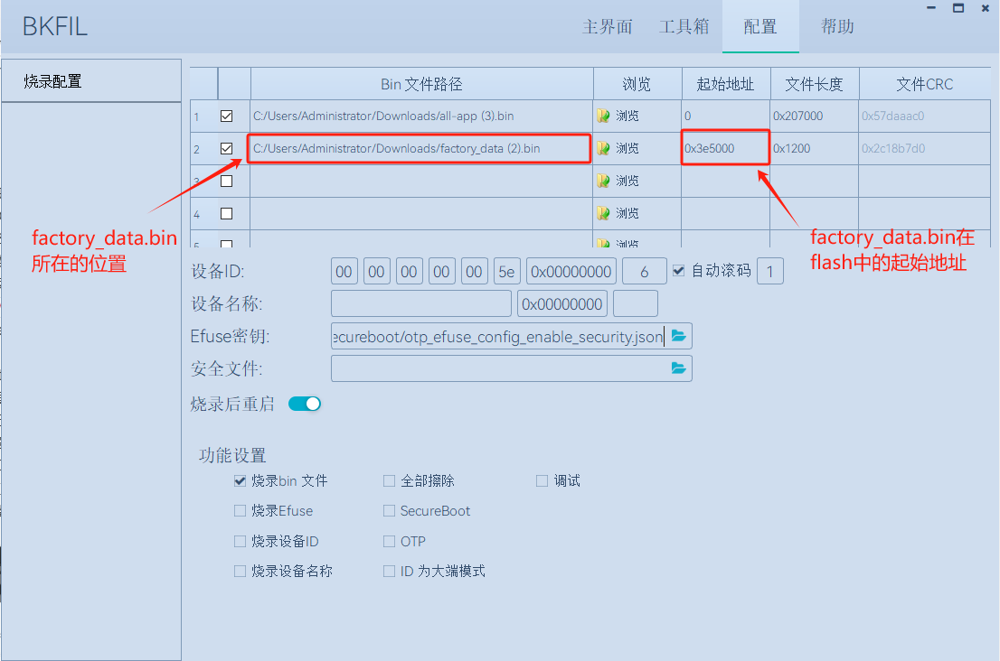

# factory-data 配置工具

## 如果使用私有的PAI、DAC证书以及其他的配置信息，需要进行以下配置

1.将工程配置成使用私有配置信息的设备

> 在 connectedhomeip/src/platform/Beken/CHIPDevicePlatformConfig.h 中将 CONFIG\_ENABLE\_BEKEN\_DEVICE\_INFO 配置为 1。 如下所示：
>
> `#define  CONFIG_ENABLE_BEKEN_DEVICE_INFO  1`
>
> 注意：如果 CONFIG\_ENABLE\_BEKEN\_DEVICE\_INFO 为0，表示设备使用Matter协议默认的配置信息。

2.生成factory\_data.bin的步骤

> 在工程的 toosls/matter\_factory\_data\_generate 文件夹下配置私有设备的信息。通过配置.gen.sh脚本，以便生成想要的bin文件。
>
> `python main.py generate --cd ./cd.bin --pai ./Chip-PAI-Cert.der --dac ./Chip-DAC-Cert_01.der --dac_key ./Chip-DAC-Key_01.der --vendor_name BEKEN --vendor_id 0x1342 --product_name lighting --product_id 0x03ed -o factory_data.bin`
>
> 在 toosls/matter\_factory\_data\_generate 文件夹中提供了三对儿DAC和DAC\_KEY，dac和dac\_key需要成对使用。如有需要，可以使用PAI和PAI\_KEY再生成更多的DAC和DAC\_KEY。可以灵活设置 vendor\_name、product\_name、serial-num、hardware-ver等参数。参数配置完成后，运行./gen.sh 即可生成factory\_data.bin。
>
> 注意：此路径中提供的PAI、DAC和CD证书都是基于 vendor\_id 为0x1342，product\_id 为0x03ed生成的，这两个参数不要修改。除非根据私有的 vendor\_id 和 product\_id 重新签名了PAI、DAC和CD证书。

3.烧写factory\_data.bin

> 在bk\_loder的工具中选中factory\_data.bin之所在的位置，设置factory\_data.bin在Flash中的起始地址。如下所示：
>
> 
>
> 如果设备是BK7236,factory\_data.bin在Flash中的起始地址,为vendor\_flash.c中全局变量bk\_flash\_partiton中matter\_factory分区的起始地址。如果设备是BK7231n或者BK7238，factory\_data.bin在Flash中的起始地址,为BkDriverFlash.c中全局变量bk7231\_partiton\_2M（Flash为2M大小）或者bk7231\_partiton\_4M（Flash为4M大小）matter factory info分区的起始地址。

## factory\_data.bin包含的信息

matter\_factory\_data\_generate工具用于将Matter设备所需要等证书等出厂配置信息打包到bin文件，烧录到设备。

matter\_factory\_data\_tool 可以将以下配置信息打包成bin文件，烧录到设备flash指定地址位置，方便生产时对设备的配置。

设备证书配置

|  |  |
| --- | --- |
| cert-dclrn | 由CSA联盟颁发的CD |
| dac-cert | dac证书 |
| pai-cert | pai证书 |
| dac-pub-key | dac公钥 |
| dac-key | dac私钥 |

设备配网信息配置

|  |  |
| --- | --- |
| discriminator | 配网鉴别码 |
| iteration-count | PAKE迭代次数 |
| salt | PAKE盐值 |
| verifier | PAKEPasscodeVerifier字段 |
| pin-code | 密码 |

设备基本信息配置

|  |  |
| --- | --- |
| vendor-name | 设备制造商名字 |
| vendor-id | 设备制造商VID |
| product-name | 产品名字 |
| product-id | 产品PID |
| serial-num | 序列号 |
| mfg-date | 产品生产日期 |
| hardware-ver | 硬件版本号 |
| hw-ver-str | 硬件版本号字符串 |
| rd-id-uid | 轮换设备标识符 |
| product-label | 产品标签 |
| product-url | 产品url |
