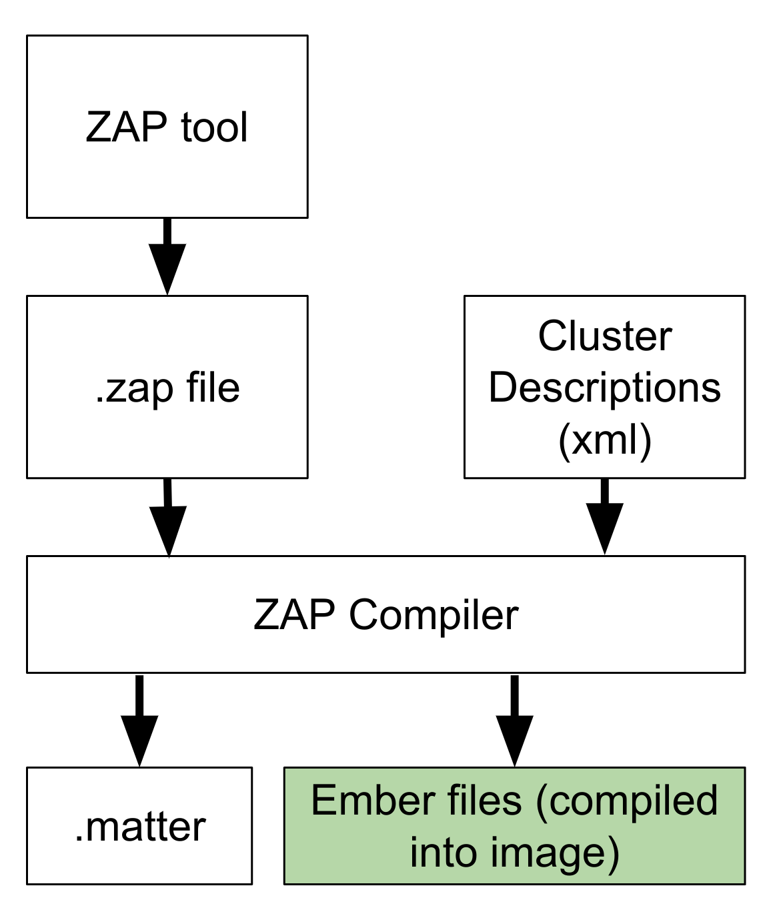
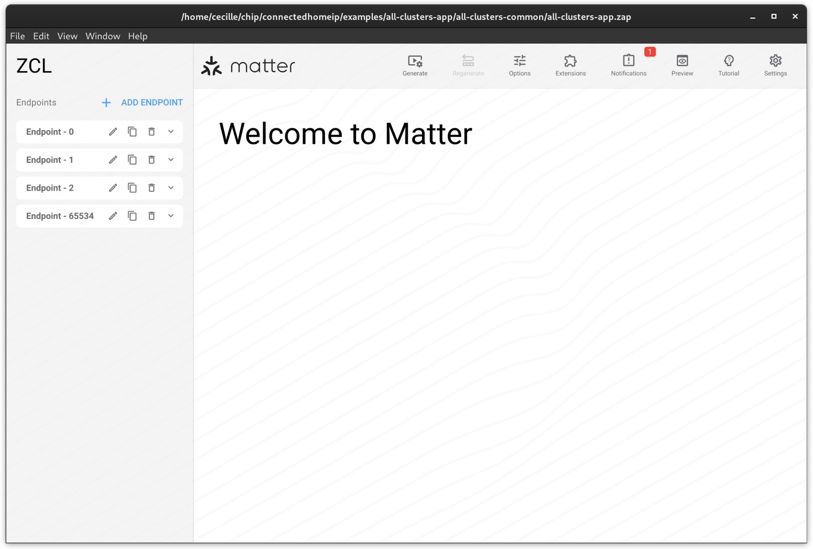
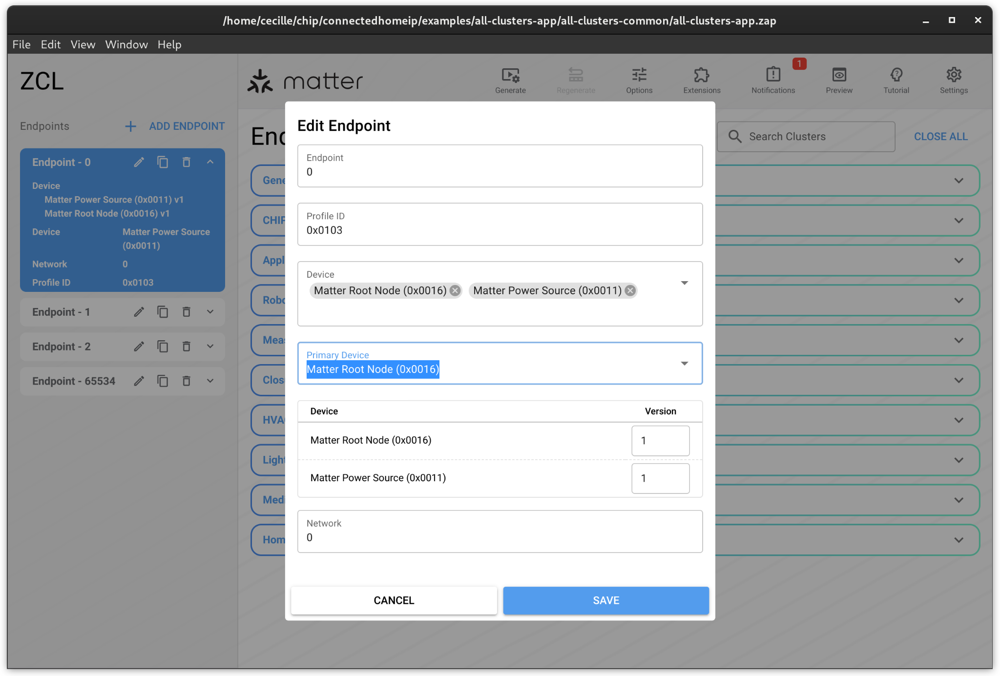
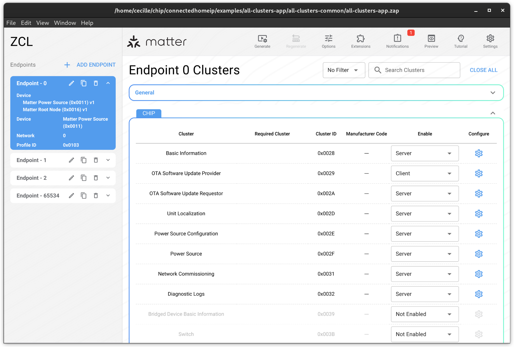
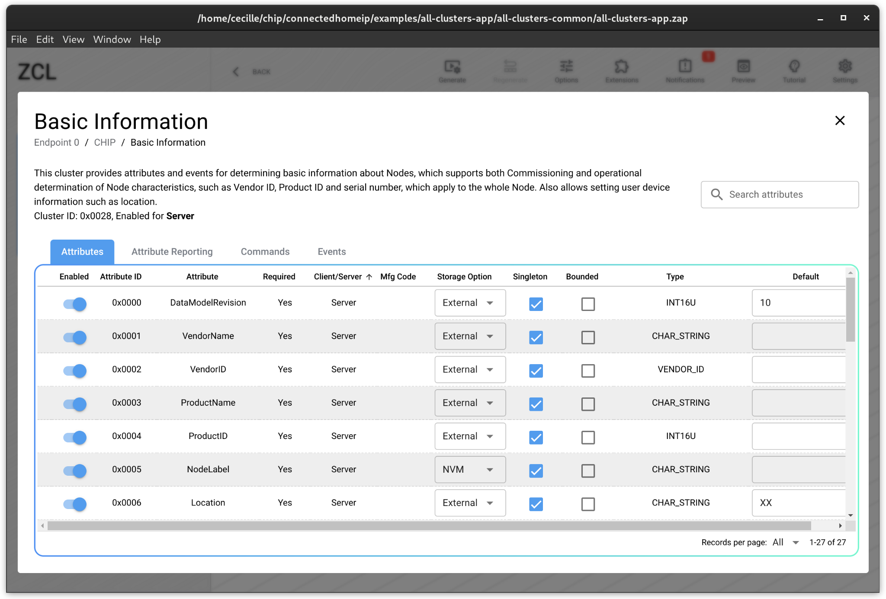
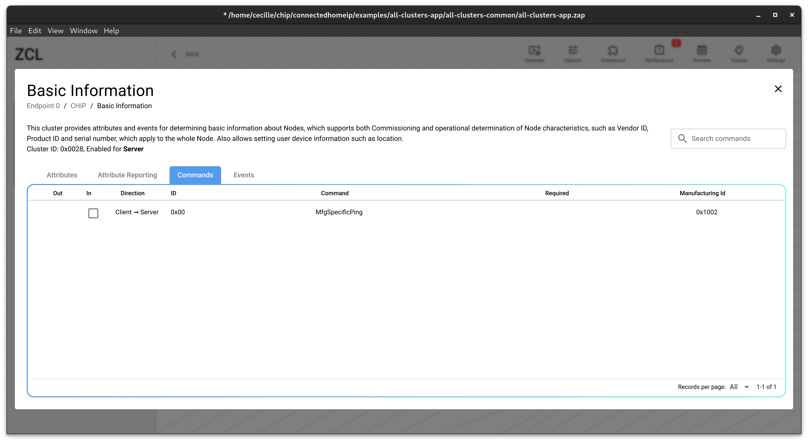

# 配置工具 ZAP

ZAP 工具是一种图形用户界面工具，用于生成描述设备endpoint组成的.zap 文件。这包括设备上的endpoint、每个endpoint上的群集和设备类型，以及群集功能、Attributes、Commands和Events。ZAP 编译器使用 `.zap` 文件和Cluster定义文件来生成 ember 层（一些C\+\+头文件和代码）。这将作为构建过程的一部分自动进行，并将 ember 层编译到固件中。

.matter文件是.zap的人可读版本，可用于审查。目前 [Code generation](https://project-chip.github.io/connectedhomeip-doc/code_generation.html) 在生成 ember 层的过程中也会依赖 .matter。

备注

本篇文章内容翻译自 [ZAP — Matter documentation](https://project-chip.github.io/connectedhomeip-doc/getting_started/zap.html#attribute-reporting) 。

## 使用方法

可以在 [这里](https://github.com/project-chip/zap) 直接下载zap源码，编译运行。

更好的方式是直接使用bk\_matter中已经编译好的zap工具，它和bk\_matter中的matter源码能保持以支持，必现出现因版本问题造成的不兼容。bk\_matter中的zap工具在 `components/matter/connectedhomeip/zap/zap` ，这是一个二进制文件，可以直接在 ubuntu 上运行。

可以直接选择 matter \+ chip-v1 新建一个空白的配置文件。但一般会通过 `File` -\> `Open File...` 打开一个存在的.zap配置文件。

打开后，左边是endpoint的配置。

点击编辑按钮，来编辑一个endpoint。

这将打开一个对话框，您可以在其中编辑终端的设备类型和版本。请勿编辑配置文件 ID 或网络。配置文件 ID 可将 zap 端点标识为 Matter 端点，而网络则是仅适用于 zigbee 产品的属性。

要编辑端点上的cluster，请选择endpoint。要启用endpoint上的cluster，请将 “Enable” 下拉菜单设为 “Server”，然后单击齿轮编辑Cluster。

## Cluster 配置

### Attributes

zap 文件将列出 cluster 中的所有可用属性。每列属性的介绍如下：

- Enable \- 打开以在设备上使能此属性。
- Attribute ID \- SPEC上对该属性定义的属性ID。
- Attribute \- SPEC上定义的属性名。
- Required \- 如果属性是强制性的，则设置为 “是”。请注意，某些属性在启用功能或其他属性后会变成强制属性。这不会反映在用户界面中。设备制造商应确保设备符合规范。可以使用一致性检查脚本 `components/matter/connectedhomeip/src/python_testing/TC_DeviceConformance.py` 来检查一致性。
- Client/Server \- 对于Matter，所有属性都是Server。
- Mfg code \- 仅适用于制造商的特定属性。
- Storage option \- 决定ember层是否为属性分配存储空间。该字段的正确值由 cluster 的实现决定。直接使用 ember 层的 clusers 将设置为 RAM（直接存储在RAM中）或 NVM (通过KV存储到flash中)，使用覆盖层并实现自己存储的集群为 external。Matter SDK 中的文件会根据集群实现和 Matter zap 配置文件中的描述，适当设置这些值。除非有特殊原因，否则最好保持这些值不变。
- Type \- SPEC上定义的该属性的类型。
- Default \- 这与规范中设置的 “默认值 “不同，它代表了如果在 ember 层（RAM 存储）中实现了某属性，则该属性的期望起始值。

### Attribute Reporting

在Matter中未被应用

### Commands

勾选您希望支持的Command。如果支持相应的请求Command，则需要响应Command。

### Events

在Matter中未被应用
