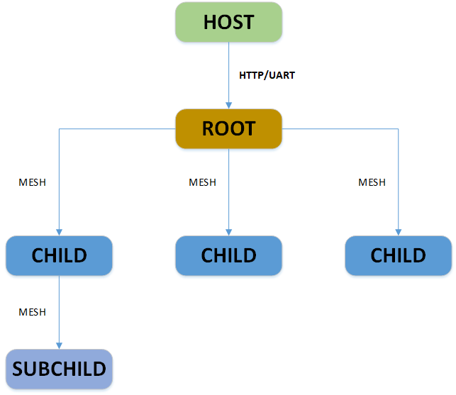
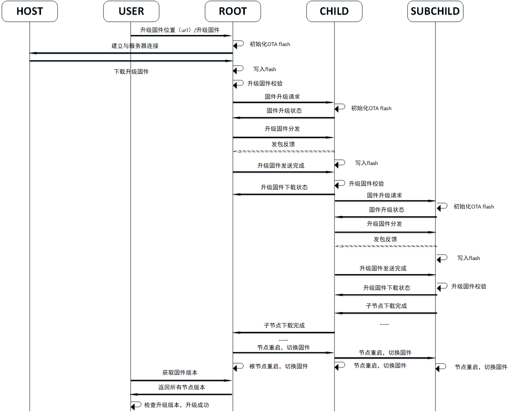

# 网络版本升级（OTA）

## **概述**

BK Wi-Fi Mesh OTA是BK Wi-Fi Mesh基于BK IDK OTA的升级方案，目的是实现BK Wi-Fi Mesh简洁高效的升级。

BK Wi-Fi Mesh OTA首先将升级的固件下载到根节点，再由根节点将升级的固件按固定大小的包，依次分发给和根节点直接连接的每一个子节点，当子节点接收完成并校验成功后，子节点将下载的升级固件继续分发给其直接连接的子节点，待所有子节点全部下载完成升级固件后，根节点给所有子节点发送重启命令以实现整个网络的整体升级。

## **升级类型**

**升级范围**：支持全网升级、部分节点升级与单节点升级，在调用 `bk_wifi_mesh_ota_start` 时通过配置结构体中的 `upgrade_type` 字段指定。

**升级通道**：分为 HTTP 与 UART 两种，通过 `ota_type` 字段选择。云端拉取固件与 App 下发固件均属于 HTTP 方式；云端升级示例可参考工程 `projects/examples/ota`。

上述字段及 OTA 相关参数均在 `bk_wifi_mesh_ota_start` 接口入参中统一配置。

## **功能**

> - **断点重传**：根节点将升级固件按照固定大小的数据包转发给子节点，每个子节点都会记录自己升级固件下载的具体情况，当发生下载流程中断，再次开始下载时，子节点会反馈当前子节点的升级状态，并请求上次升级固件中断位置的数据。
> - **固件转发**：每个节点都会将下载的升级固件的数据直接存放在OTA分区中，方便节点升级，减少数据拷贝次数；当需要转发数据时，从OTA分区中直接读取发送。
> - **固件检查**：生成的固件中包含版本编号和CRC校验码，用于检查版本升级信息，避免固件下载不完整的问题。

## **流程**

BK Wi-Fi Mesh OTA升级流程

### **第一步：固件下载**

**HTTP方式：**

1、 用户通过UART、BLE或者Wi-Fi等方式与根节点建立通信；

2、 用户将升级固件的网络位置发送给根节点；

3、 根节点根据网络位置使用BK IDK的HTTP的方式，从host下载升级固件；

4、 如果数据完整则将升级固件依次分发给子节点，否则返回升级固件下载失败。

**UART方式：**

1、 用户通过UART直接将升级固件发送到根节点的OTA分区；

2、 传输完成后，校验升级固件完整性。如果数据完整则将升级固件依次分发给子节点，否则返回升级固件下载失败。

### **第二步：固件分发**

1、 根节点依次给子节点通知OTA升级；

2、 子节点收到升级命令后，如果没有OTA数据缓存，则初始化OTA模块，返回升级状态；

3、 根节点开始分发数据，并根据子节点返回状态（如果存在断点重传，会返回断点数据位置），将所需的升级固件的分包发送给子节点；

4、 根节点将升级固件发送完成后，通知子节点数据发送完成，子节点校验升级固件的完整性，并将校验结果返回给根节点，同时开始同根节点相同的固件分发流程；

5、 当子节点连接的其他子节点全部完成升级固件下载或者超过重传次数时，子节点上报根节点该子节点的升级状态；

6、 当根节点收到步骤4的返回值后，重复步骤1，直到所有子节点均完成升级固件下载或者超过重传次数；

7、 当根节点收到步骤5的返回值后，检查是否所有子节点全部完成下载。

### **第三步：版本升级**

1、 当所有子节点均完成升级固件的下载时，根节点通知所有子节点重启；

2、 用户通过UART、BLE或者Wi-Fi等方式与根节点建立通信，检查固件版本，完成升级。

## **分区表**

> 参考：<http://docs.bekencorp.com/armino/bk7236/zh_CN/v2.0.1/developer-guide/config_tools/bk_config_partitions.html>

## **OTA API 说明**

### **通过网络升级**

调用 bk\_wifi\_mesh\_ota\_start 接口，通知根节点的OTA模块固件升级文件的网络位置，如果当前网络为广域网网络，则根节点会自动初始化OTA信息，然后连接服务器下载升级固件并进一步完成网络升级；如果当前网络为局域网网络，需要手机设备保持在根节点附近，并将手机热点信息发送给根节点，让根节点连接到手机热点上，然后完成同广域网相同的操作。

### **通过串口升级**

1、调用 bk\_wifi\_mesh\_ota\_start 接口，通知根节点的OTA模块准备升级，初始化OTA模块；

2、调用 bk\_wifi\_mesh\_ota\_data\_write 接口，将升级固件按照1k大小的包依次发送；

3、当数据全部传输完成后，调用 bk\_wifi\_mesh\_ota\_finish 接口，通知OTA模块检验传输的升级固件是否校验通过，并开始在MESH网络中开始升级。

### **用户自行下载固件到根节点OTA分区**

1、用户将升级固件下载到根节点的OTA分区；

2、调用 bk\_wifi\_mesh\_ota\_start 接口，通知根节点的OTA模块准备升级，初始化OTA模块；

3、调用 bk\_wifi\_mesh\_ota\_finish 接口，通知OTA模块检验传输的升级固件是否校验通过，并开始在MESH网络中开始升级。

备注

单个节点同时也可以支持IDK的OTA升级方式，独立进行OTA。
:   BK IDK OTA 参考：
    <https://docs.bekencorp.com/arminodoc/bk_idk/bk7236/zh_CN/v2.0.2/developer-guide/bootloader_ota/index.html>
