

# **BK Wi-Fi MESH配网及网络控制API使用说明**

## **1 设置模式及回调**

**1.1 模式**

所有mesh节点在初始化时调用此接口，配置模式；

> **API：**
>
> **bk\_err\_t bk\_wifi\_mesh\_set\_net\_mode(uint8\_t net\_mode);**
>
> - **uint8\_t net\_mode,1:指示广域网模式；2：局域网模式；3：局域网模式，但根节点sta连接了AP;**

**1.2 注册回调函数**

在调用配网API之前在所有mesh节点处调用API注册回调函数，用于后续获取空闲节点列表/获取拓扑结果/获取删除节点结果/获取用户信息等；

> **API：**
>
> **bk\_err\_t bk\_wifi\_mesh\_set\_api\_mode(void\* event\_cb);**
>
> - **int event\_cb(void \*arg, event\_module\_t event\_module, int event\_id, void \*event\_data);**
>   :   - event\_data: 返回的数据，具体内容请参考各api说明
>       - event\_module: 3(表示当前event为mesh事件)
>       - event\_id：
>         :   - 0- BK\_MESH\_EVENT\_GET\_IDLE\_NODE
>             - 1- BK\_MESH\_EVENT\_GET\_TOPO
>             - 2- BK\_MESH\_EVENT\_RM\_NODE
>             - 3- BK\_MESH\_EVENT\_GET\_VENDOR

## **2 获取空闲节点列表**

可在网关节点或任意节点调用API接口，并注册回调函数获取空闲节点列表，mesh节点收到请求后，将返回全部空闲节点列表。

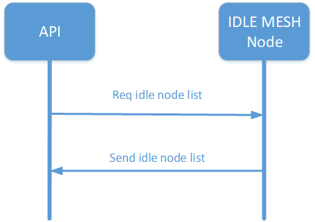

获取空闲节点示意图

**2.1 API说明**

> **API：**
>
> **bk\_err\_t bk\_wifi\_mesh\_get\_idle\_node(void);**

备注

1、在调用此API接口之前，需要先调用bk\_wifi\_mesh\_set\_api\_mode函数设置回调函数以获取空闲节点列表。

2、可通过在projet中修改CONFIG\_BK\_WIFI\_MESH\_FREE\_AP\_SSID宏的值改变空闲节点名称；

**2.2 返回数据格式**

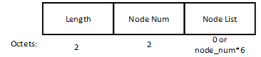

返回空闲节点列表数据格式含义如下：

> - Length：为Length后面的所有字段的长度
> - node\_num：表示返回空闲节点的数量；
> - node\_info\_list：仅node\_num不为0时存在，表示空闲节点的mac\_addr；

## **3 空闲节点配网**

可在网关节点或任意空闲节点调用API接口，通知mesh节点配网，mesh节点收到请求后，开始配网并通知其他节点。

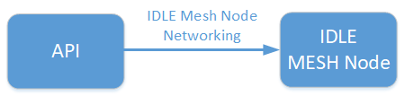

空闲节点配网示意图

**3.1 API说明**

> > **API：**
> >
> > **bk\_err\_t bk\_wifi\_mesh\_net\_cfg(const bk\_wifi\_mesh\_net\_cfg\_t \*config);**
> >
> > **必选参数：**
> >
> > - uint16\_t node\_num; 表示本次配网的mesh节点数量，大于0的整数；
> > - char \*node\_mac\_list; 本次配网的mesh节点对应的mac addr；
> > - uint8\_t max\_mesh\_num; mesh节点最大允许连接的mesh节点个数，1\~10为有效值，为0表示使用默认值10；
> > - uint8\_t design\_root\[WIFI\_MAC\_LEN\]; 指定根节点的mac地址；
> >
> > **广域网时，如下参数为必选**
> >
> > - char router\_ssid\[WIFI\_SSID\_STR\_LEN\]; 广域网配网时使用，根节点关联的AP的ssid；
> > - char router\_pw\[WIFI\_PASSWORD\_LEN\]; 广域网配网时使用，根节点关联的AP的pw；
>
> **可选参数：**
>
> > - uint32\_t net\_token;token配网口令，为0表示将使用随机token；
> > - uint8\_t mesh\_id;mesh网络标识符，为0表示使用默认值；
> > - char sap\_ssid\[WIFI\_SSID\_STR\_LEN\];表示配网时设置的sap的ssid，为0表示使用默认值；
> > - char sap\_pw\[WIFI\_PASSWORD\_LEN\];表示配网时设置的sap的pw，为0表示使用默认值；
> > - uint8\_t max\_level;mesh网络的最大层数，可设置为不小于1的整数，为0表示使用默认值10；

备注

1、【必选参数】表示调用API进行操作时必须要设置的值，否则操作不生效。

2、可配合3.3.1查询拓扑确认组网结果及网络结构。

3、调用此接口前，请确认节点为空闲节点，否则配置无法生效。可调用bk\_mesh\_get\_status\_info()接口确认,返回state为0，表示当前节点为空闲节点；

4、非空闲节点，可调用bk\_wifi\_mesh\_stop()/bk\_wifi\_mesh\_reset\_node()接口重置节点，将节点恢复到空闲节点状态。

## **4 MESH网络控制**

## **4.1 查询拓扑**

在根节点处调用API接口，查询mesh网络结构，根节点收到查询请求后，返回拓扑结构。

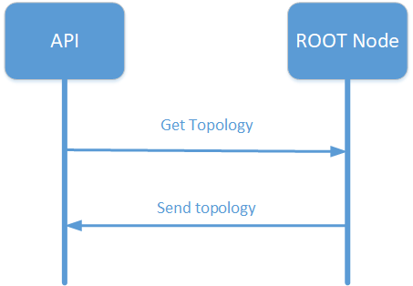

查询拓扑示意图

**4.1.1 API说明**

> **API：**
>
> **bk\_err\_t bk\_wifi\_mesh\_get\_topo(void);**

备注

在调用此API接口之前，需要先调用bk\_wifi\_mesh\_set\_api\_mode函数设置回调函数以获取拓扑结果，此API不直接返回拓扑。

**4.1.2返回数据格式**

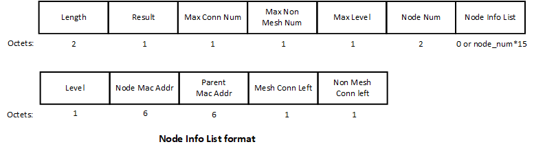

Mesh节点返回拓扑结构格式消息格式见上图，各参数含义如下：

> - Length；表示Length后面的所有字段的长度；
> - Result；表示返回拓扑说明，0：表示返回当前拓扑结果；1：表示当前无拓扑结果，返回拓扑为空；2：表示当前mesh网络不稳定，拓扑结果大于配网节点数，可10s后再次查询（最大重复3次）；
> - Max Conn Num：表示mesh网络中配置的最大mesh连接个数,由Mesh节点带回当前的配置的值；
> - Max Non Mesh Num：最大non mesh节点连接个数,由Mesh节点带回当前的配置的值；
> - Max Level：最大mesh网络层数，由Mesh节点带回当前的配置的值；
> - Node Num：指示，本次上报的当前Mesh网络的节点个数；
> - Node Info List：mesh网络的节点信息；
>
>   > - Level：表示该节点的层级；
>   > - Node Mac Addr：表示该节点的MAC地址；
>   > - Parent Mac Addr：表示该节点的父节点信息，全FFFFFFFFFFFF表示没有父节点信息；
>   > - Mesh Conn Left：表示该节点还剩余的mesh节点连接数量；
>   > - Non Mesh Conn Left：表示该节点还剩余的non-mesh节点连接数量；

## **4.2 增加节点**

在根节点处调用API接口，通知mesh节点增加节点，mesh节点收到请求后，通知其他节点加入MESH网络。

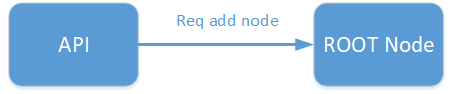

增加节点示意图

**4.2.1 API说明**

> **API：**
>
> **bk\_err\_t bk\_wifi\_mesh\_add\_node(const bk\_wifi\_mesh\_add\_node\_t \*add\_node);**
>
> **必选参数：**
>
> - uint16\_t node\_num; 表示本次加入网络的mesh节点数量；
> - char \*node\_mac\_list; 本次加入mesh网络的mesh节点对应的mac addr；
>
> **可选参数：**
>
> - char \*design\_parent; 增加节点分别对应的父节点；

备注

可配合3.3.1查询拓扑来检查节点是否加入网络；

## **4.3 删除节点**

在根节点处调用API接口，根节点收到删除请求后，通知MESH网络中的节点删除。

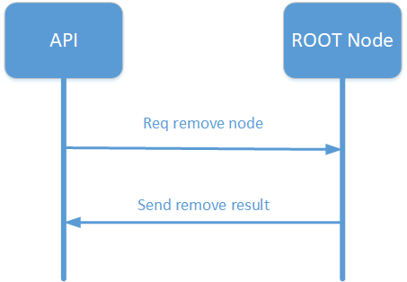

删除节点示意图

**4.3.1 API说明**

> **API：**
>
> **bk\_err\_t bk\_wifi\_mesh\_remove\_node(uint16\_t node\_num, uint8\_t \*node\_mac\_list);**
>
> **必选参数：**
>
> - uint16\_t node\_num; 表示本次删除的mesh节点数量
> - char \*node\_mac\_list; 本次删除的节点对应的mac addr

备注

在调用此API接口之前，需要先调用bk\_wifi\_mesh\_set\_api\_mode函数设置回调函数以获取删除结果，此API不直接返回结果。

**4.3.2返回数据格式**

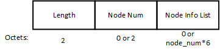

Mesh节点返回删除节点结果消息格式见上图，各参数含义：

> - Length：表示Length后面的所有字段的长度
> - node\_num：表示删除节点失败的个数，为0表示全部节点删除成功；
> - node\_info\_list：仅node\_num不为0时存在，携带失败node\_info\_list；

## **4.4 修改配置**

可在根节点处调用API接口，通知修改网络配置，mesh节点收到请求后，通知MESH网络中的节点修改MESH网络配置。

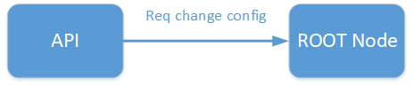

修改配置示意图

**4.4.1 API说明**

> **API：**
>
> **bk\_err\_t bk\_wifi\_mesh\_change\_cfg(const bk\_wifi\_mesh\_change\_cfg\_t \*change\_cfg);**
>
> **必选参数：**
>
> - uint16\_t node\_num; 表示修改mesh网络配置的节点数量
> - char \*node\_mac\_list; 表示修改mesh网络配置的节点对应的mac addr
>
> **可选参数：**
>
> - char \*design\_parent; 修改配置的节点指定的父节点
> - uint8\_t max\_mesh\_num; 表示修改的mesh节点最大允许连接的mesh节点个数，1\~10为有效值；
> - uint8\_t max\_level; 修改mesh网络的最大层数，可设置为不小于1的整数；

备注

可配合3.3.1查询网络拓扑确认修改配置是否生效

## **4.5 设置用户信息**

在根节点处调用API接口，设置用户信息，节点收到设置请求后，通知MESH网络中的其他节点。

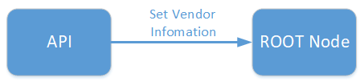

设置用户信息示意图

**4.5.1 API说明**

> **API：**
>
> **bk\_err\_t bk\_wifi\_mesh\_set\_vendor(const bk\_wifi\_mesh\_vendor\_t \*set\_vendor);**
>
> **必选参数：**
>
> - uint16\_t node\_num; 表示本次设置用户信息的mesh节点数量；
> - char \*node\_mac\_list; 本次设置用户信息的节点对应的mac addr；
> - uint16\_t vendor\_len; 表示设置用户信息的整体长度。
> - char \*vendor\_ptr; 为用户自定义字段

## **4.6 获取用户信息**

在根节点处调用API接口，获取用户信息，mesh节点收到请求后，汇总节点用户信息返回。

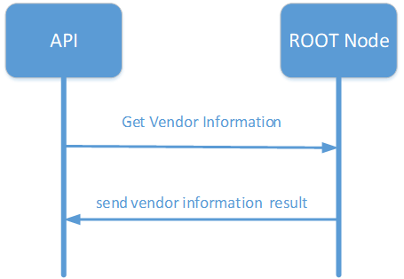

获取用户信息示意图

**4.6.1 API说明**

> **API：**
>
> **bk\_err\_t bk\_wifi\_mesh\_get\_vendor(const bk\_wifi\_mesh\_vendor\_t \*get\_vendor);**
>
> **必选参数：**
>
> - uint16\_t node\_num; 表示本次获取用户信息的mesh节点数量；
> - char \*node\_mac\_list; 本次获取用户信息的节点对应的mac addr；
> - uint16\_t vendor\_len; 表示获取用户信息的长度。
> - char \*vendor\_ptr; 为用户自定义字段，指定了本次获取的用户信息类型

备注

在调用此API接口之前，需要先调用bk\_wifi\_mesh\_set\_api\_mode函数设置回调函数以获取用户信息，此API不直接返回结果。

**4.6.2返回数据格式**

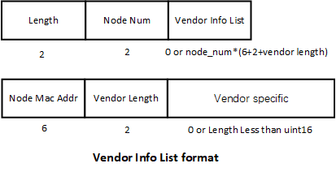

Mesh节点返回消息格式见上图，各参数含义如下：

> - Length：表示Length后面的所有字段的长度
> - Node num：表示返回用户信息的节点数
> - Vendor info result：表示各节点的用户信息
>
>   > - Node mac addr – 该节点的mac addr
>   > - vendor length – 用户信息的长度
>   > - vendor specific – 用户信息

## **4.7 OTA升级**

在根节点处调用API接口，通知OTA升级，根节点收到请求后，通知MESH网络中的所有节点将要开始OTA升级，然后根节点根据ota\_type采用不同的方式下载升级固件，并将固件通知给MESH网络中的所有mesh节点。

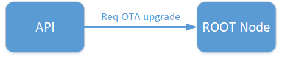

OTA升级示意图

**4.7.1 API说明**

> **API：**
>
> **bk\_err\_t bk\_wifi\_mesh\_ota\_start(const bk\_wifi\_mesh\_ota\_t \*ota\_cfg);**
>
> **必选参数：**
>
> - uint8\_t ota\_type; 表示本次ota升级的类型，1代表云端升级，2代表app升级，3代表串口升级;
> - uint8\_t upgrade\_type; 表示本次模式，0代表升级全部，1代表升级单个，2代表升级部分;
> - uint16\_t node\_num; 表示本次ota升级的mesh节点数量；
> - uint8\_t \* node\_mac\_list; 表示升级节点的mac地址;
> - char ap\_ssid\[WIFI\_SSID\_STR\_LEN\]; **【ota\_type \= 2时为必选参数】** ，表示手机热点的ssid;
> - char ap\_pw\[WIFI\_PASSWORD\_LEN\]; **【ota\_type \= 2时为必选参数】** ，表示手机热点的pw;
> - uint8\_t url\_len; **【ota\_type为1和2时为必选参数】**，代表url长度;
> - char \*url\_ptr; **【ota\_type为1和2时为必选参数】**;

备注

1、ota\_type为3时，用户通过UART直接将升级固件发送到根节点的OTA分区而非通过url下载固件。

2、可配合3.3.8查询OTA升级进度。

## **4.8 获取OTA状态**

在根节点处调用API接口，获取ota升级状态，根节点收到消息后，会返回当前ota状态。

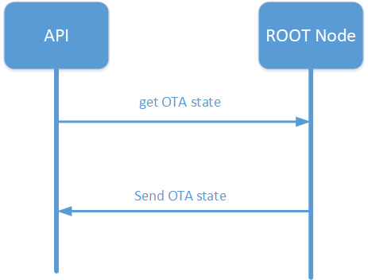

获取OTA状态示意图

**4.8.1 API说明**

> **API：**
>
> **uint8\_t bk\_wifi\_mesh\_get\_ota\_state(void);**

**4.8.2返回数据格式**

**uint8\_t ota\_status;**

参数含义如下：

> - OTA status：
>
>   > - 0表示空闲状态，未在OTA升级；
>   > - 1表示当前在OTA升级过程中；
>   > - 2表示rbl下载失败；
>   > - 3表示未扫描到手机热点，请确认输入热点名称是否正确；
>   > - 4表示手机热点密码错误，请确认输入热点密码是否正确；
>   > - 5表示与热点连接失败，请重试；

## **4.9 Reset节点**

在需要进行reset操作的节点处调用API接口，通知该节点reset，mesh节点收到reset消息后，会清除falsh并退出mesh网络恢复为空闲节点。

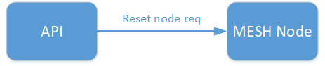

Reset节点示意图

**4.9.1 API说明**

> **API：**
>
> **bk\_err\_t bk\_wifi\_mesh\_reset\_node(const bk\_wifi\_mesh\_reset\_node\_t \*reset\_node);**
>
> **必选参数：**
>
> - uint16\_t node\_num; 表示本次reset节点的数量；
> - uint8\_t \* node\_mac\_list; 表示reset节点的mac地址;

## **4.10 获取节点状态信息**

在非网关节点处调用API接口获取节点信息，mesh节点收到消息后，返回节点当前状态信息。

**4.10.1 API说明**

> **API：**
>
> **bk\_err\_t bk\_wifi\_mesh\_status\_info(bk\_wifi\_mesh\_status\_t \*link\_status);**
>
> **返回参数含义：**
>
> - bk\_mesh\_link\_state\_t state; 表示节点连接状态，0：空闲节点；1：节点组网中；2：组网完成，加入mesh网络；3：网络恢复中
> - uint8\_t level; 表示节点在mesh网络中的层级;
> - uint8\_t link\_mesh\_num; 表示与该节点连接的mesh节点数;
> - uint8\_t link\_non\_mesh\_num; 表示与该节点连接的非mesh节点数;
> - uint8\_t parent\_mac\[6\]：表示节点连接的父节点的mac地址;
