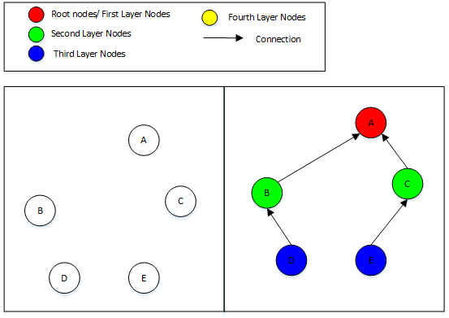
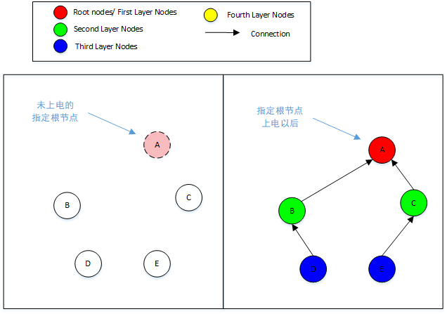
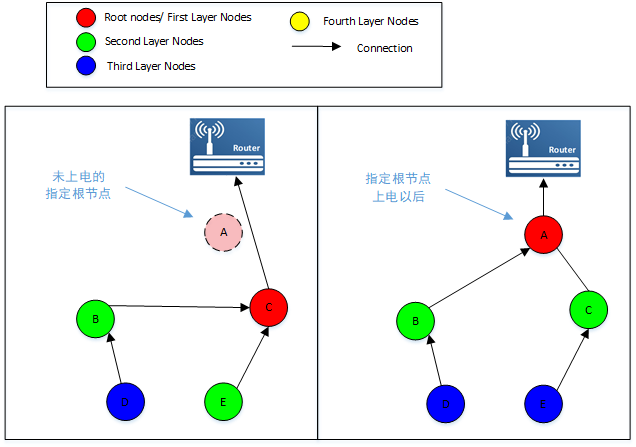
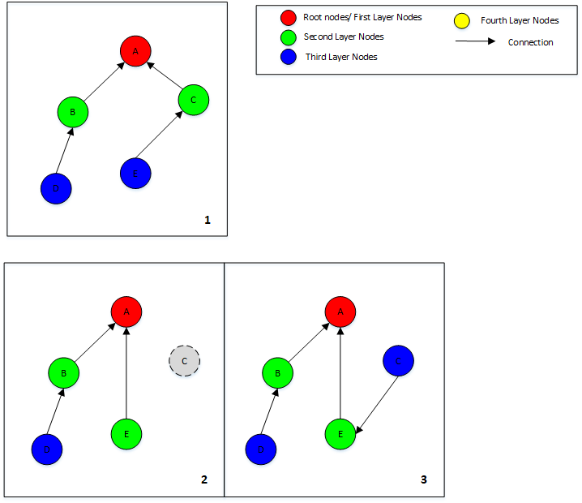
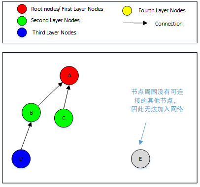
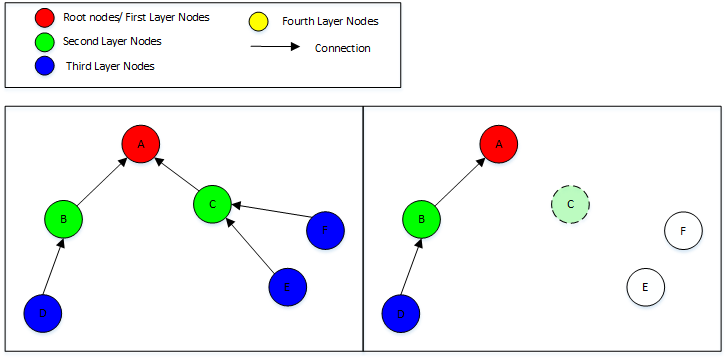
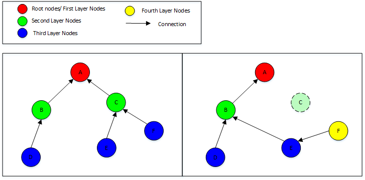

# 组网和网络恢复

## **自动组网**

本章节主要介绍树状结构和拓扑生成过程。网状拓扑结构和通信不存在组网连接过程，其网络恢复是网络拓扑的更新过程。

BK Wi-Fi Mesh为指定根节点方式，对于树状结构，由用户指定根节点以后，剩余节点将会通过Wi-Fi扫描和连接完成自动组网过程。各节点会根据周围节点的分布情况，逐层依次加入网络。

组网结果与节点的上电顺序有关。

APP配网和云端配网均相当于同步上电，具体参见 [配网和网络控制](mesh_net_distribution_and_control.md#mesh-net-distribution-and-control)。本章节主要介绍在已有配置的上电组网中同步上电和异步上电过程的差别。

下图为同步上电的组网结果：

同步上电组网

对于局域网网络，如果指定根节点后上电，其余节点会等待指定根节点上电以后依次加入网络。

局域网根节点异步上电

对于广域网网络，如果指定根节点上电时间太晚，先上电的节点中会产生一个根节点并组建网络；指定根节点上电以后，之前产生的根节点会让位给指定根节点，网络会根据指定根节点进行更新。

广域网根节点异步上电

同理，第二层节点异步上电与同步上电的组网结果也会不同，后上电的节点会加入已形成的网络，并不会影响现有网络，因此异步上电形成的网络可能不是最优结果。
下图1中为同步上电，图2和图3为第二层节点后上电的组网结果。

第二层节点异步上电

因此，建议用户对所有节点进行同步上电，或者按期望的网络结果依次上电。

另外组网结果也与节点位置分布有关。如果某个节点周围没有任何可连接的其他节点，该节点将无法加入网络。

节点E无法加入网络

因此建议用户合理布置节点的位置。

## **网络故障与自动修复**

在BK Wi-Fi Mesh网络中，当网络发生故障时（如节点掉电或者断连），网络将会在自动进行修复，保证网络的正常工作。

在BK Wi-Fi Mesh的局域网和广域网网络中，当根节点发生故障以后，网络中会产生新的根节点。当其他节点发生故障时，相连节点将会连接到其他节点上。

需要注意的是，节点的位置分布会影响网络恢复。如下图中当节点C故障以后，其相连节点E和节点F因为距离网络太远，周围没有可连接的已组网节点，而无法进行网络恢复。

节点E和F无法恢复

但如果稍微调整节点E和节点F的放置位置，当节点C发生故障时，它就可以成功进行网络恢复。

节点E和F位置调整以后可恢复

因此建议用户合理布置节点的位置。
