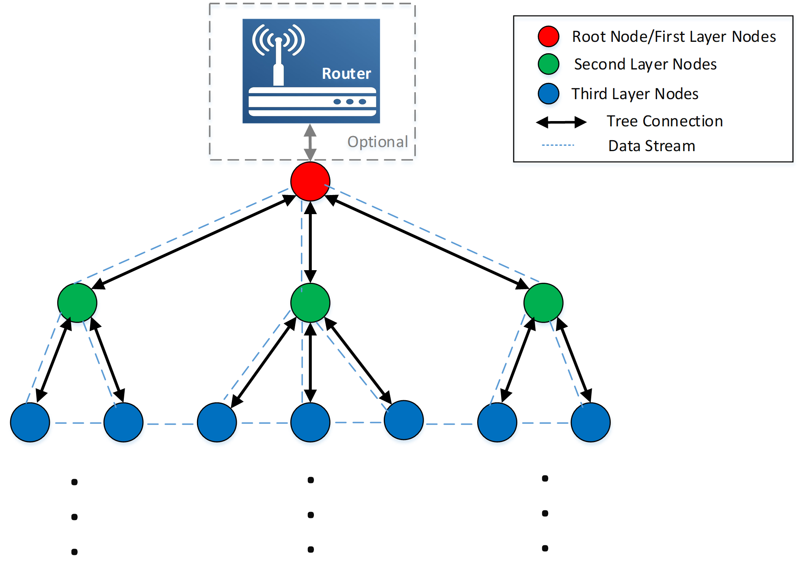

# 网络介绍

Wi-Fi Mesh技术主要有基于IEEE 802.11s的网状Mesh以及基于WFA EasyMesh的树状Mesh，两种Mesh各有优缺点。

BK Wi-Fi Mesh结合802.11s以及EasyMesh的优点，实现了网状\+树状双拓扑网络结构。同时，使用了私有的通信机制，使得网络传输时延更低，稳定性更好。

下图为BK Wi-Fi Mesh的示意图：

BK Wi-Fi Mesh网络示意图

以下为BK Wi-Fi Mesh的主要功能：

> - 支持局域网Mesh网络以及广域网Mesh网络。
> - 支持APP和云端对Mesh网络进行配网和网络控制。其中APP近场对一个Mesh节点连接，可完成整个Mesh网络的配置和控制，不受其他设备节点的距离和位置限制。
> - 支持多个Mesh组的区分和配置，解决多个Mesh网络组网需求
> - 稳定的网络异常检测和自愈恢复机制，使得网络更加稳定
> - 支持50/100/150/200以及更多节点的Mesh网络容量，解决Wi-Fi Mesh网络容量的痛点问题
> - 特色的OTA升级策略，使得Mesh网络的版本升级快速，简易和稳定
> - 支持Mesh网络内任意节点的相互通信
> - 支持non-Mesh的Wi-Fi设备连接到Mesh网络，拓展网络连接
> - 支持客户自定义的信息通过Mesh网络安全传递，比如控制和获取设备状态等
> - 提供了丰富的接口以及专属SDK，方便客户进行开发
> - 基于实际部署的快速自动配网组网功能，简化用户操作，同时能够通过APP可视化整个网络拓扑，设备连接关系一目了然

备注

网络容量和网络部署相关，越大的容量，带来的传输时延越大，吞吐越低。

## 模块导航

- [简介](../introduction.md)
- [快速入门](../get-started.md)
- [开发者指南](../developer.md)
- [配网和网络控制](mesh_net_distribution_and_control.md)
- [组网和网络恢复](mesh_net_build_and_restore.md)
- [数据传输](mesh_data_transmission.md)
- [网络版本升级（OTA）](bk_mesh_ota.md)
- [配网及网络控制API使用说明](mesh_net_api.md)
- [性能指标](performance_indicators.md)
- [API参考](../api-reference.md)
- [示例演示](../examples.md)
