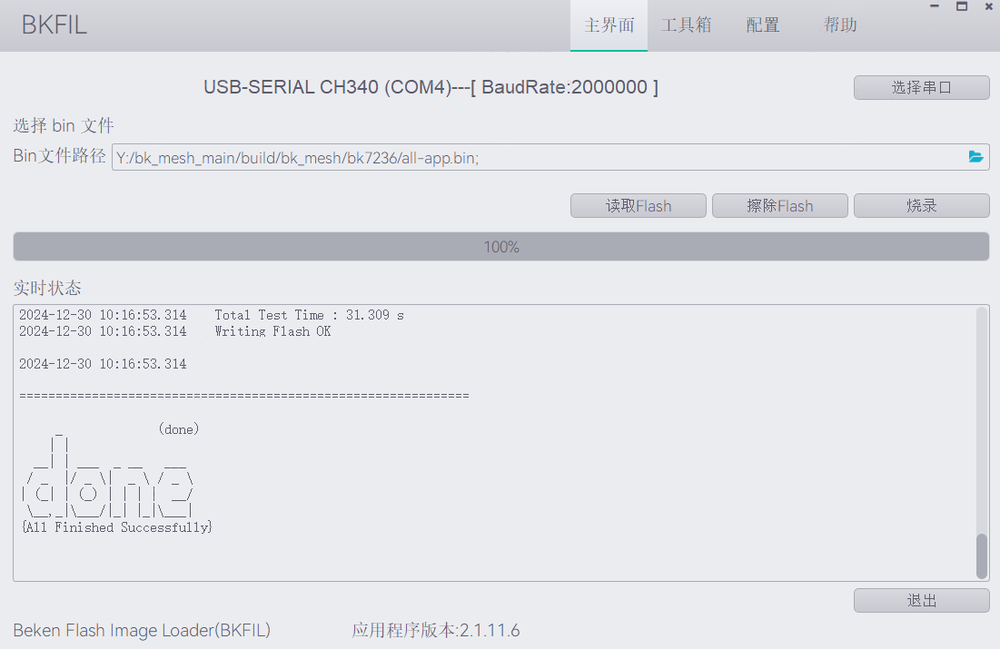
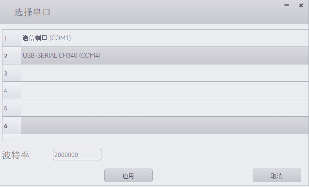

<a id="id1"></a>

# 快速入门

本文档以博通集成BK7236开发板为例，通过一个简单的示例项目向您展示

> - 如何构建BK-MESH SDK编译环境；
> - 如何配置BK-MESH SDK工程；
> - 如何编译、下载固件；

<a id="id2"></a>

## 准备工作

硬件：

> - 博通集成BK72XX开发板(以BK7236为例)
> - 串口烧录工具(BKFIL–Beken Flash Image Load)
> - 电脑（Windows 与 Ubuntu）

备注

BK-MESH SDK 仅支持在 Linux 平台编译，仅支持在 Windows 平台进行固件烧录。
因此，您需要两台电脑，一台 Linux 平台，一台 Windows 平台；
当然，您也可以只使用 Windows 平台，在 Windows 平台上安装 Linux 虚拟机。

软件：

> - ARM工具链，用于编译BK-MESH SDK所适配的不同芯片版本(ARM:BK7258/BK7236)；
> - 构建工具，包含 CMake；
> - BK-MESH SDK 源代码；
> - 串口烧录软件–BK FIL；

<a id="bk-mesh-sdk"></a>

## BK-MESH SDK代码下载

您可从 gitlab 上下载 BK-MESH SDK:

```
mkdir -p ~/armino_bk_mesh
cd ~/armino_bk_mesh
git clone git@gitlab.bekencorp.com:armino/bk_mesh/bk_mesh.git -b mesh_release/v2.0.1 --recurse-submodules
```

备注

从官网的gitlab下载的为最近的SDK代码，相关账号找项目上审核申请。

<a id="id3"></a>

## 构建编译环境

> BK-MESH SDK 当前支持Linux环境下编译，下面介绍BK-MESH SDK的编译环境搭建

备注

本章节将阐述整个BK-MESH SDK的编译环境搭建，即用户之前没有Beken IDK的编译经验。
如果您之前拥有Beken IDK的编译环境与经验，请跳过本章节。

备注

如果您想了解Beken IDK的编译环境搭建，请参考如下网址：

[https://docs.bekencorp.com/arminodoc/bk\_idk/bk7236/zh\_CN/v2.0.1/get-started/index.html](../../bk_idk/BK7236/get-started.md)

<a id="id4"></a>

## 工具链安装

BK-MESH SDK工具链下载路径如下：

工具链下载:

> <http://dl.bekencorp.com/tools/toolchain/>

请根据手上拥有的模组芯片型号，自行匹配下载的toolchain类型:

```
BK7258/BK7236::ARM
```

工具包下载后，通过如下操作命令解压至对应的/opt目录下:

```
ARM  :: $ sudo tar -zxvf gcc-arm-none-eabi-10.3-2021.10-x86_64-linux.tgz -C /
```

<a id="id5"></a>

## 程序编译依赖库安装

在终端输入下述命令安装python3,CMake,Ninja,Cr-ypto以及依赖库:

```
sudo dpkg --add-architecture i386
sudo apt-get update
sudo apt-get install build-essential cmake python3 python3-pip doxygen ninja-build libc6:i386 libstdc++6:i386 libncurses5-dev lib32z1 -y
sudo pip3 install pycrypto click
```

<a id="id6"></a>

## 文档编译依赖库安装

在终端上输入如下命令安装文档编译所需要的 python 依赖:

```
sudo pip3 install sphinx_rtd_theme future breathe blockdiag sphinxcontrib-seqdiag sphinxcontrib-actdiag sphinxcontrib-nwdiag sphinxcontrib.blockdiag
```

设置Python默认版本:

```
sudo ln -s /usr/bin/python3 /usr/bin/python
```

<a id="id7"></a>

## 编译工程

在终端下输入下述命令编译 BK-MESH SDK 默认工程，PROJECT为选填参数:

```
cd ~/armino_bk_mesh
make bk7236
```

如需编译指定工程，以pwm\_led工程为例，则在终端输入下述命令:

```
cd ~/armino_bk_mesh
make bk7236 PROJECT=bk_mesh/pwm_led
```

备注

无论哪个工程，请在编译之前确认Log端口与AT端口的配置：

> - Log 端口 (CONFIG\_UART\_PRINT\_PORT): 默认为0(UART0)
> - AT 端口 (CONFIG\_DEFAULT\_AT\_PORT): 默认为1(UART1)

如果有配置需求，请按照如下操作进行更改:

> - cd projects/bk\_mesh/xxx/config/bk72xx (xxx:选择编译的工程，默认为3\_led; bk72xx:为使用的Beken模组芯片，目前请使用bk7236)
> - vim config
> - 在打开的config文件中，配置CONFIG\_UART\_PRINT\_PORT\=xxx,CONFIG\_DEFAULT\_AT\_PORT\=yyy (xxx:配置的log端口；yyy:配置的AT端口)
> - 关闭config
> - 返回根目录
> - make clean \&\& make bk72xx -j8

编译结束并烧录后，请使用两个串口工具分别监听Log端口和AT端口输出！

<a id="id8"></a>

## 工程配置

BK-MESH SDK的工程配置基础上遵循Beken IDK的工程配置，详情请参见:

> [https://docs.bekencorp.com/arminodoc/bk\_idk/bk7236/zh\_CN/v2.0.1/get-started/index.html](../../bk_idk/BK7236/get-started.md)

<a id="id9"></a>

## 新建工程

BK-MESH SDK默认工程为projects/bk\_mesh/3\_led，新建工程可参考projects/bk\_mesh/app

<a id="id10"></a>

## 烧录代码

在 Windows 平台上， BK-MESH 目前支持 UART 烧录。

<a id="id11"></a>

### 通过串口烧录

备注

BK-MESH SDK支持UART烧录，推荐使用USB转UART串口模块进行下载。

串口烧录工具如下图所示:

<a id="id12"></a>


USB转UART串口模块

烧录工具使用BK FIL进行烧录，获取地址如下：

> <http://dl.bekencorp.com/tools/flash/>

在此目录下获取最新版本的BK FIL,如:

```
BEKEN_BKFIL_V2.0.8.13_20230821.zip
```

BK\_FIL.exe 界面及相关配置如下图所示：

<a id="id13"></a>



BK-FIL烧录工具

选择烧录COM口，配置波特率为2000000，如下图所示：

<a id="id14"></a>



BK-FIL串口选择

备注

请选择Log输出端口所连接的COM口为下载烧录对应的COM口
