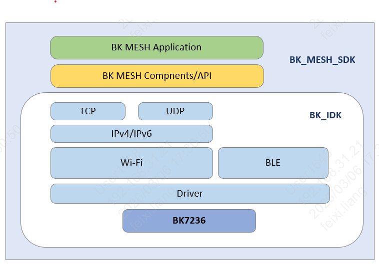
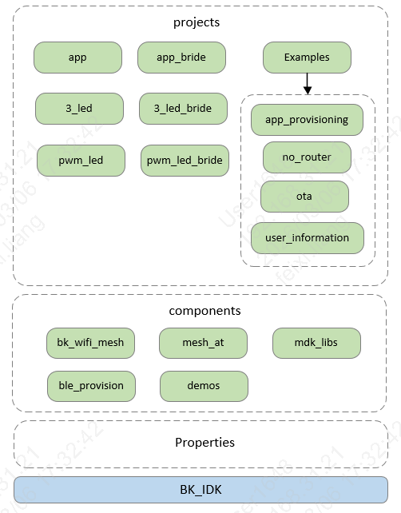

# 简介

## BK-MESH SDK 简介

BK-MESH SDK是基于Beken IDK的BK-WIFI-MESH开发框架。
BK-WIFI-MESH可增强Wi-Fi网络覆盖以及支持更多接入设备，同时具有自主组网和自主修复能力。

BK-MESH SDK的结构框图所示:

BK-MESH SDK的结构框图

BK-MESH SDK的代码目录结构所示:

BK-MESH SDK的代码目录结构框图

## 模块导航

- [快速入门](get-started.md)
- [开发者指南](developer.md)
- [API参考](api-reference.md)
- [示例演示](examples.md)
