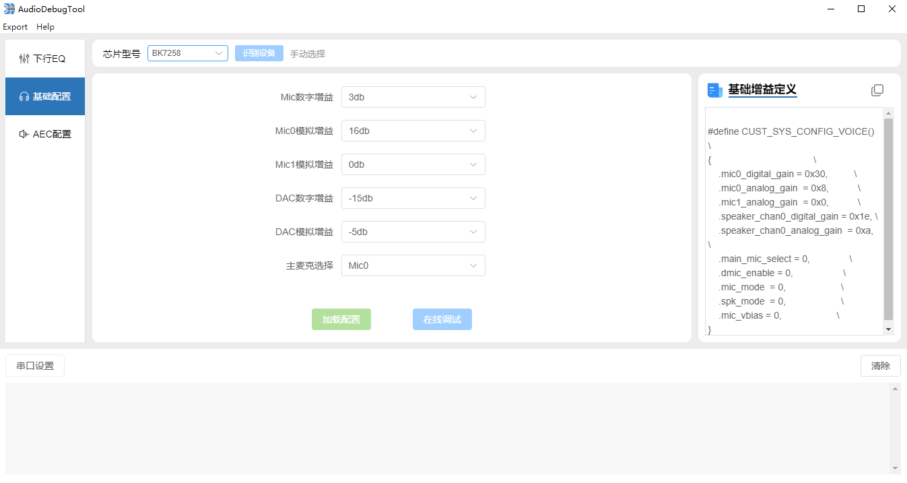
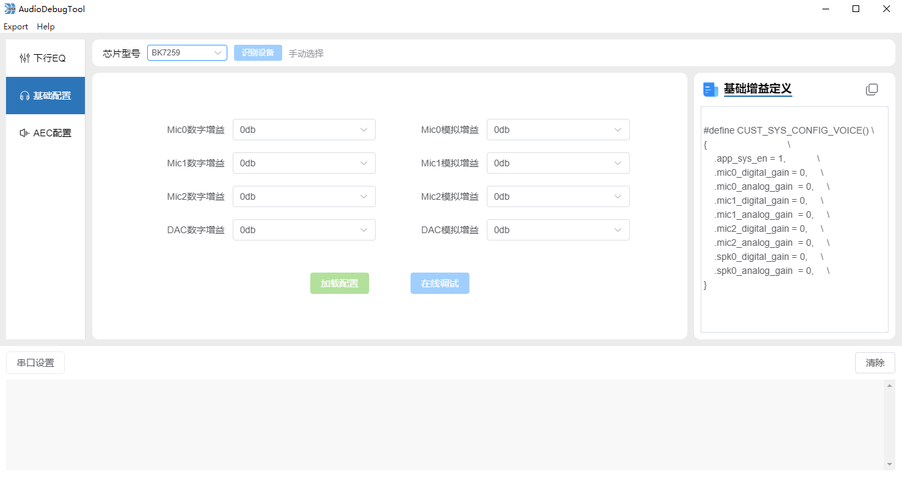
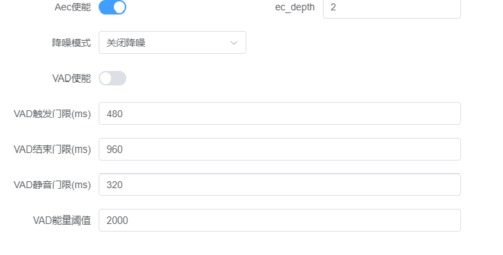

# 5\. 音频参数调试

## 5.1. EQ参数

**EQ参数说明**

- 采样率 : EQ 处理使用的采样率，支持 48000 / 44100 / 32000 / 24000 / 16000 / 8000 Hz，需与设备当前运行的采样率一致。
- 总增益 : EQ 整体增益，设置范围 \[-12dB, 6dB\]。
- 滤波器参数表 : 每个滤波器为一段均衡，可独立配置以下参数：

  > - 频率(Freq) : 该段滤波器的中心/截止频率，设置范围 \[20Hz, 22000Hz\]。
  > - 增益(Gain) : 该段的增益，设置范围 \[-15dB, 15dB\]。
  > - Q值(Q) : 品质因数，控制作用频带的宽窄，设置范围 \[0.1, 30\]，Q 值越大作用频带越窄。
  > - 类型(Type) : 滤波器类型，可选 PK(峰值) / LS(低架) / HS(高架) / LP(低通) / HP(高通) / BP(带通) / NT(陷波) / AP(全通)。
  > - 使能(Enable) : 是否启用该段滤波器。

备注

- 采样率需与设备一致，否则点击“在线调试”时会提示“采样率不一致”。可先点击“加载配置”同步设备当前采样率。

## 5.2. 基础配置参数

备注

- 基础配置参数因芯片型号不同而有差异：以下为 **BK7258** 的参数说明，**BK7259** 的差异见本节末尾“BK7259 基础配置参数差异”。

**基础配置参数说明（BK7258）**

- 主麦克选择 : BK7258硬件有两路音频ADC， 对于单麦克风硬件解决方案有如下两种选择：

  > - 主麦克风选择MIC0，含义是：MIC0通路用于人声采集，MIC1通路用于音频回采；
  > - 主麦克风选择MIC1，含义是：MIC1通路用于人声采集，MIC0通路用于音频回采。
- Mic 数字增益 : 芯片MIC通道ADC转换后的数字增益控制，设置范围为\[-45dB, 18dB\]，根据使用的麦克风灵敏度大小去调整增益，常用的硅MIC的数字增益建议设置为“0dB\~3dB”。
- Mic0 模拟增益 : 芯片内部MIC电路的放大电路模拟增益控制，设置范围为\[0dB, 32dB\]，根据使用的麦克风灵敏度大小去调整增益，MIC0一般用于人声采集， 常用的硅MIC的模拟增益建议设置为“16dB”。
- Mic1 模拟增益 : 芯片内部MIC电路的放大电路模拟增益控制，设置范围为\[0dB, 32dB\]，根据使用的麦克风灵敏度大小去调整增益，MIC1一般用于采集回声，建议设置为”0dB”。
- DAC 数字增益 : 芯片内部DAC的数字增益控制，设置范围为\[-45dB, 18dB\]，建议设置为”0dB”。
- DAC 模拟增益 : 芯片内部DAC的模拟增益控制，设置范围为\[-15dB, 0dB\]，建议设置为”-5dB”。

备注

- 若有问题，请联系硬件工程师确认板子的硬件电路和BEKEN参考硬件电路相比是否发生变化。

**BK7259 基础配置参数差异**

BK7259 支持三路麦克风（MIC0 / MIC1 / MIC2），基础配置由 8 项增益组成，且 **界面所选数值即为对应的 dB 值（直接为有符号整数，无需映射）**：

- Mic0 / Mic1 / Mic2 数字增益 : 各 MIC 通道 ADC 转换后的数字增益，设置范围 \[-100dB, 18dB\]。
- Mic0 / Mic1 / Mic2 模拟增益 : 各 MIC 电路放大电路的模拟增益，设置范围 \[0dB, 30dB\]，步进 2dB。
- DAC 数字增益 : DAC 数字增益，设置范围 \[-100dB, 12dB\]。
- DAC 模拟增益 : DAC 模拟增益，设置范围 \[0dB, 7dB\]，步进 1dB。

备注

- BK7258 与 BK7259 的“加载/下发”命令字一致，但 BK7259 的增益为逐通道 int8 直传，下发字节数与 BK7258 不同，工具会根据所选型号自动处理，使用时只需确保已正确选型。
- 导出代码时，BK7259 会自动包含 `app_eq_en` / `app_sys_en` / `app_aec_en` 等使能项，并选用对应的算法头文件，无需手动修改。

## 5.3. AEC配置参数

**AEC配置参数说明**

- AEC 使能 : 上行语音处理算法总控制开关，AEC使能时，MIC采集的数据进行语音处理；AEC不使能，MIC采集的数据不进行语音处理。
- 降噪模式选择 ： 当前支持的降噪模式有如下三种选择：

  - 关闭降噪 ：当不需要降噪处理场景时，选择关闭降噪，此时算法MIPS消耗少；
  - 传统降噪 ：当需要降噪，但系统MIPS不足或SRAM空间不足时，选择传统降噪；
  - AI 降噪 ： 当需要降噪，且系统MIPS和SRAM空间足够时，选择AI降噪，此时降噪效果最佳。
- VAD 使能 : 上行语音VAD控制开关，VAD使能，语音数据进行VAD检测并输出VAD\_FLAG标志；VAD不使能，语音不进行VAD检测。

  > - VAD 触发门限(ms)： 持续检测到语音信号超过触发门限阈值后，判定为语音开始。
  > - VAD 结束门限(ms)： 持续检测静音超过结束门限阈值后，判定为语音结束。
  > - VAD 静音门限(ms) ： 检测到信号能量低于 **能量阈值** 持续时间超过静音门限阈值，判定为静音段。
  > - VAD 能量阈值 ： 比较音频帧的能量与预设阈值，判断当前帧是语音还是静音。

备注

- VAD功能仅在AI降噪打开情况下生效。

