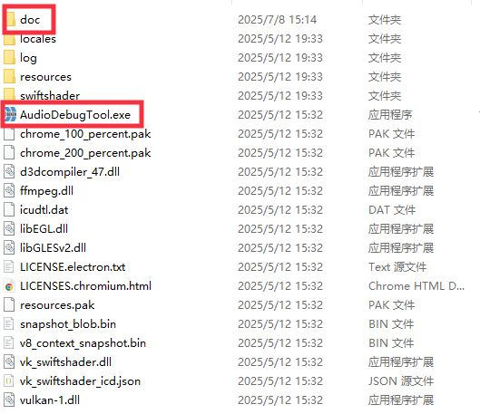

# 2\. 下载安装

## 2.1. 软件下载

<https://dl.bekencorp.com/tools/AudioDebugTool/>

## 2.2. 解压执行

下载后解压，解压后的文件如下图所示

- **doc**: 该系统的使用文档目录
- **AudioDebugTool.exe**: 可执行文件，双击即可运行该软件

## 模块导航

- [1. 简介](summary.md)
- [3. 界面介绍](introduction.md)
- [4. 芯片选型](chipselect.md)
- [5. 音频参数调试](audparams.md)
- [6. 导出](export.md)
- [7. ReleaseNotes](releasenotes.md)
