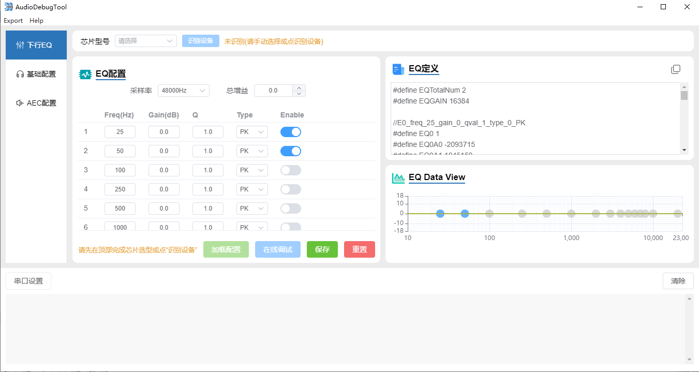
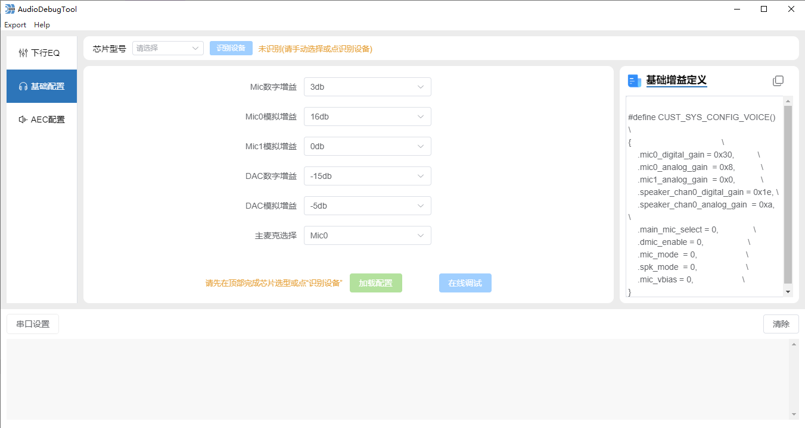
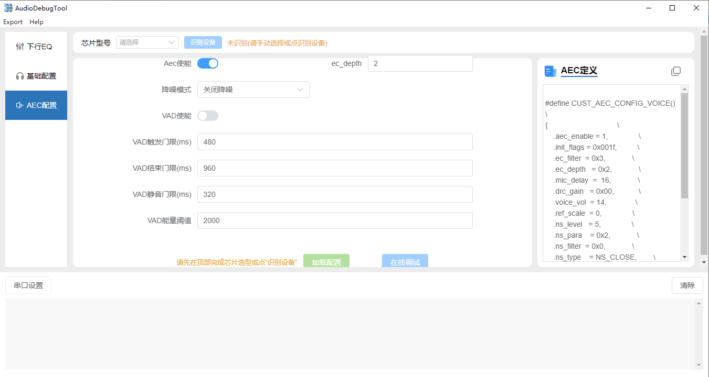

# 3\. 界面介绍

## 3.1. 整体界面

启动软件后，软件整体分为工具栏、芯片选型栏、功能模块、串口栏四个部分，功能模块目前包含EQ配置、基础配置和AEC配置 ，界面如下图所示

备注

- 顶部 **芯片选型栏** 用于确定当前设备型号（BK7258 / BK7259），需先完成选型才能加载/下发/导出参数，详见 [芯片选型](chipselect.md)。

## 3.2. EQ配置

EQ 配置界面用于调试下行音频的均衡器参数：

- 可设置 **采样率** 与 **总增益**。
- 滤波器参数表中，每个滤波器可配置 频率(Freq)、增益(Gain)、Q 值、类型(Type) 以及是否使能(Enable)。
- 界面右侧实时显示频响曲线与对应的 EQ 定义代码，便于直观查看调试效果。
- 点击 **加载配置** 按钮，可将开发板的 EQ 参数读取到界面中。
- 点击 **在线调试** 按钮，将当前 EQ 参数发送到开发板。
- 点击 **保存** / **重置** 按钮，可保存或重置本地 EQ 配置。

## 3.3. 基础配置

- 点击 **加载配置** 按钮，可将开发板配置参数读取到表单中。
- 点击 **在线调试** 按钮，表单配置参数发送到开发板。

## 3.4. AEC配置

- 点击 **加载配置** 按钮，可将开发板配置参数读取到表单中。
- 点击 **在线调试** 按钮，表单配置参数发送到开发板。

## 3.5. 串口栏

串口栏中包含当前连接的串口及串口的日志输出

**串口设置**

点击串口设置，在弹出的对话框中选择好对应串口信息，点击确定后，将连接对应的串口，如下图所示：

**串口日志**

串口连接后，日志栏将显示串口的日志输出，如下图所示：

