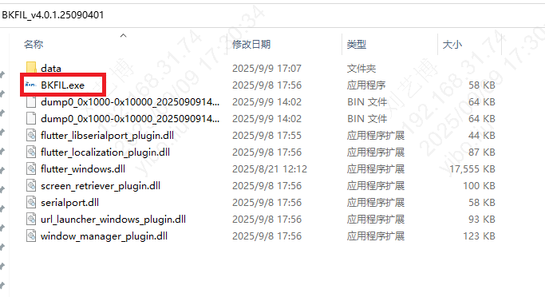
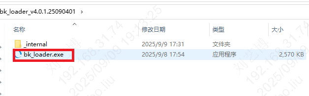

# 下载地址

GUI:
:   <https://dl.bekencorp.com/tools/bkfil/v4/gui>

CLI:
:   <https://dl.bekencorp.com/tools/bkfil/v4/cli>

# windows

## GUI

1. 下载
2. 解压
3. 双击BKFIL.exe执行

## CLI

1. 下载
2. 解压
3. bk\_loader.exe为可执行文件

# macos

说明：自 v4.1.2 起，Mac 下载产物调整为：GUI 提供一个 BKFIL 安装包；CLI 提供两个架构包（arm64 / x86\_64），需按机型选择。

## GUI

1. 下载 .dmg 文件
2. 双击打开 .dmg 文件
3. 将 BKFIL.app 拖拽到 Applications 文件夹
4. 从 Applications 运行 BKFIL

## CLI

1. 下载对应架构的 CLI 安装包（Apple Silicon 选 arm64，Intel 选 x86\_64）
2. 双击安装 .pkg
3. 在终端运行 bk\_loader

# linux

## GUI

1. 下载
2. 解压
3. 双击BKFIL执行

## CLI

1. 下载
2. 解压
3. bk\_loader为可执行文件

## 模块导航

- [简介](../../intro/intro.md)
- [下载安装](../download.md)
- [快速开始](../../quick_start/quick_start.md)
- [使用示例](../../example/example.md)
- [功能介绍](../../features/features.md)
- [外置Flash配置](../../flash_config/flash_config.md)
- [工厂模式](../../factory/factory.md)
- [常见问题](../../faq/faq.md)
- [发布日志](../../release_notes/release_notes.md)
