提供了两种实现方式：GUI和CLI。

术语解释：[术语解释](../../features/features_guide/features_guide.md#introduction)

<a id="all-app-bin"></a>

# 烧录all-app.bin

1. 使用CLI
   :   .\\bk\_loader.exe download -p COM11 -b 1500000 `--reset_baudrate` 115200 -i D:/all-app.bin `--reboot`

- .\\bk\_loader.exe: CLI工具路径
- download: 烧录
- -p: 串口名称
- -b: 工作波特率
- `--reset_baudrate`: 重置波特率
- -i: bin文件路径
- `--reboot`: 烧录完成后重启设备

CLI 中指定 bin 文件有两种方式：`-i` / `--infile` 与 `--infile_json`，区别如下：

| 维度 | `-i` / `--infile` | `--infile_json` |
| --- | --- | --- |
| 入参形式 | 字符串：`path` 或 `path@addr-length` | JSON 数组，每项为 `{"path":..., "start":..., "len":...}` |
| 多个 bin 的分隔符 | 用英文逗号 `,` 分隔（`a.bin@0x0-0x1000,b.bin@0x11000-0x2000`） | 由 JSON 数组表达，无需逗号分隔 |
| 路径含英文逗号 | **不支持**（逗号会被当作多文件分隔符） | 支持 |
| `start` / `len` 可省略 | `@addr-length` 整体可省略；存在时两者必须同时给出 | 各自可省略：`start` 缺省回退到 `-s`/`0x0`，`len` 缺省为整文件 |
| 适用场景 | 单文件、路径无特殊字符的常见情况 | 多 bin、路径含逗号、或希望更明确结构化表达 |

警告

使用 `-i` / `--infile` 指定固件路径时，路径中不能包含空格、英文括号 `()`、英文逗号 `,`、`&`、`;`、`|` 等特殊字符。
若路径中确实包含逗号，请改用 `--infile_json` 通过 JSON 方式传入（见下方示例）。
若确实需要使用 `-i` 方式传入，建议给固件路径加上双引号。

2. 使用GUI

- 选择all-app.bin文件

[](../../../../_assets/b35daf2c1594eec5b989-download_all_app.png)

<a id="json-bin"></a>

# 通过 JSON 指定待烧录 bin 文件

JSON 数组中每个元素描述一个 bin（数组允许只有一个元素，也可包含多个）：

- `path`: bin 文件路径，必填。支持英文逗号等特殊字符。
- `start`: flash 起始地址，可选。省略时回退到 `-s` / `--startaddr`，再回退到 `0x0`。
- `len`: 要烧录的长度，可选。省略时使用文件全部长度。支持十六进制字符串（如 `"0x1000"`）或整数。

1. 最简形态（仅 `path`，整文件烧到 `-s` 指定地址，未指定时为 `0x0`）：

   ```
   [{"path": "D:/fw/app,v1.bin"}]
   ```
2. 精确控制起始地址与长度：

   ```
   [{"path": "D:/fw/app.bin", "start": "0x1000", "len": "0x2000"}]
   ```
3. 一次烧录多个 bin：

   ```
   [
     {"path": "D:/fw/bootloader.bin"},
     {"path": "D:/fw/app.bin", "start": "0x11000"}
   ]
   ```

CLI 调用形式（将上述 JSON 作为 `--infile_json` 的值传入）：

.\\bk\_loader.exe download -p COM11 -b 1500000 `--reset_baudrate` 115200 `--infile_json` \<JSON\> `--reboot`

备注

`--infile_json` 与 `-i` / `--infile` 二选一使用即可。

<a id="all-app-bin8k-flash0x1000"></a>

# 将all-app.bin的前8K数据，烧录到flash的0x1000地址

1. 使用CLI
   :   .\\bk\_loader.exe download -p COM11 -b 1500000 `--reset_baudrate` 115200 -i D:/all-app.bin@0x1000-0x2000 `--reboot`

- -i: bin文件路径
- D:/all-app.bin@0x1000-0x2000 格式为：path@addr-length
  :   - path: bin文件路径
      - addr: flash的起始地址
      - length: 要操作的长度

2. 使用GUI

- 选择all-app.bin文件
- 编辑区域

[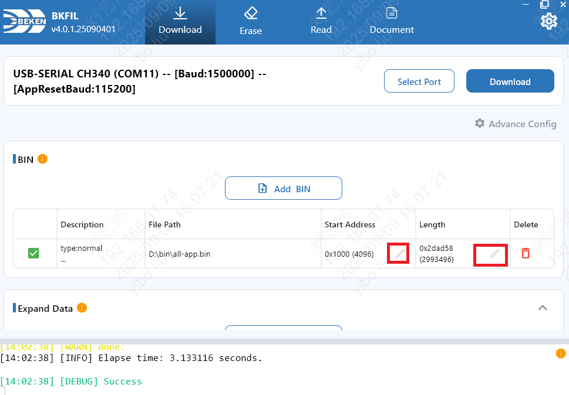](../../../../_assets/eb7420ba81859604f4a4-download_all_app_pre_8k_1.png)

[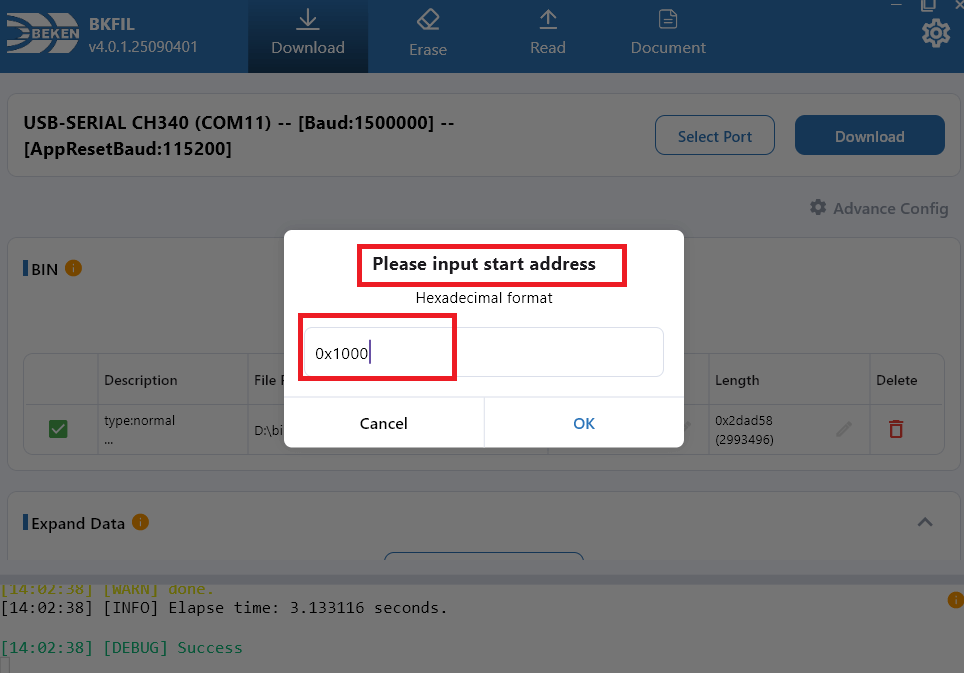](../../../../_assets/b5e7da0648b3632a1d13-download_all_app_pre_8k_2.png)

[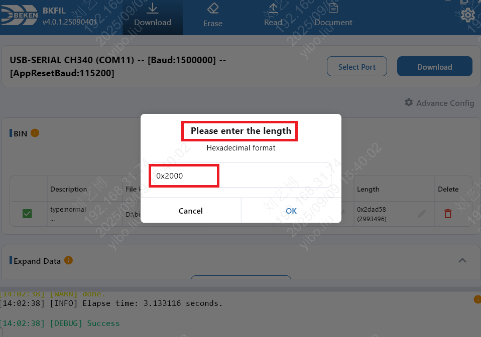](../../../../_assets/379f9e413b1cf41da001-download_all_app_pre_8k_3.png)

<a id="bootloader-ota-bin"></a>

# 烧录bootloader-ota.bin

bootlader-ota.bin用来升级bootloader

1. 使用命令行：
   :   .\\bk\_loader.exe download -p COM11 -b 1500000 `--reset_baudrate` 115200 -i D:/bootloader-ota.bin `--reboot`
2. 使用GUI

- 选择bootloader-ota.bin文件

[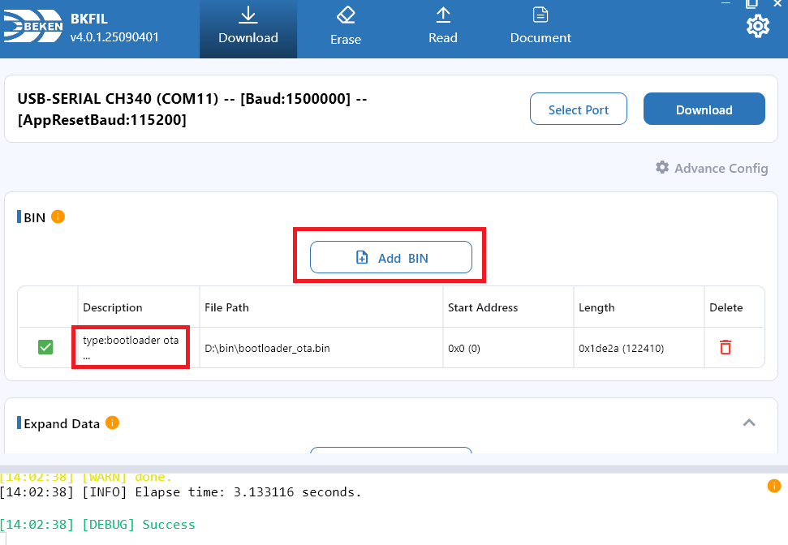](../../../../_assets/7a9f693c3e0a210dc533-download_bootloader_ota.png)

<a id="all-app-outter-flash-bin"></a>

# 烧录all-app-outter-flash.bin

all-app-outter-flash.bin，可用来烧录外部flash

1. 使用命令行：
   :   .\\bk\_loader.exe download -p COM11 -b 1500000 `--reset_baudrate` 115200 -i D:/all-app-outter-flash.bin `--reboot`
2. 使用GUI

- 选择all-app-outter-flash.bin文件

[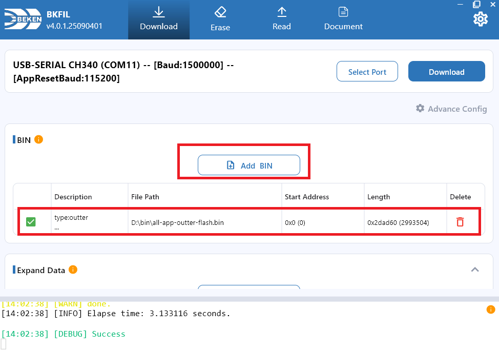](../../../../_assets/833432216472e3bc68ed-download_outter_flash.png)

<a id="id1"></a>

# 烧录设备名称

设备名称example，格式为string，烧录到flash的0x1000地址，字节序为大端序。

1. 使用CLI
   :   .\\bk\_loader.exe download -p COM11 -b 1500000 `--reset_baudrate` 115200 `--expand_data` device\_name@3@0x1000@example `--reboot`

- `--expand_data`：拓展数据
- 拓展数据格式 name@type@addr@data
  :   - name：拓展数据名称
      - type：拓展数据类型
      - addr：flash地址
      - data：拓展数据值

拓展数据: [拓展数据](../../features/features_guide/features_guide.md#expand-data-introduction)

2. 使用GUI

- 添加拓展数据
- 填写名称、类型、地址、数据

警告

名称中间不能有空格。

[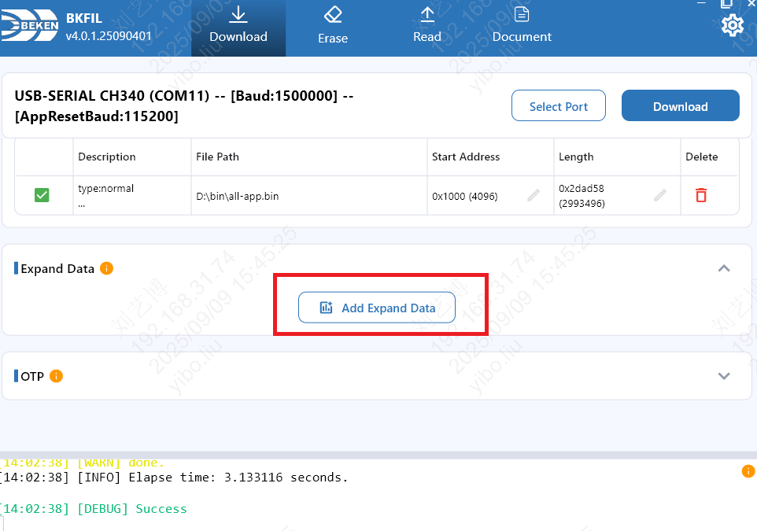](../../../../_assets/53e71201a706d5b4f7d5-download_device_name_1.png)

[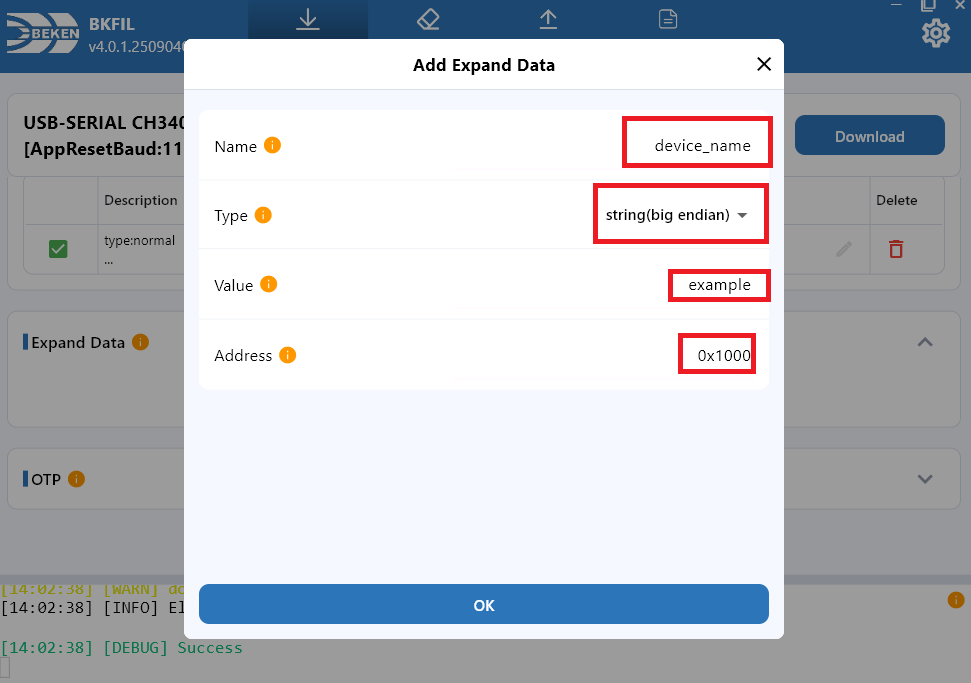](../../../../_assets/20b5d16f028971125239-download_device_name_2.png)

<a id="id2"></a>

# 烧录拓展数据

1. 使用CLI
   .\\bk\_loader.exe download -p COM11 -b 1500000 `--reset_baudrate` 115200 `--expand_data` name@type@addr@value `--reboot`

- name：拓展数据名称
- type：字节序
- addr：拓展数据地址
- value：拓展数据值

2. 使用GUI

- 添加拓展数据
- 填写名称、字节序、地址、数据

[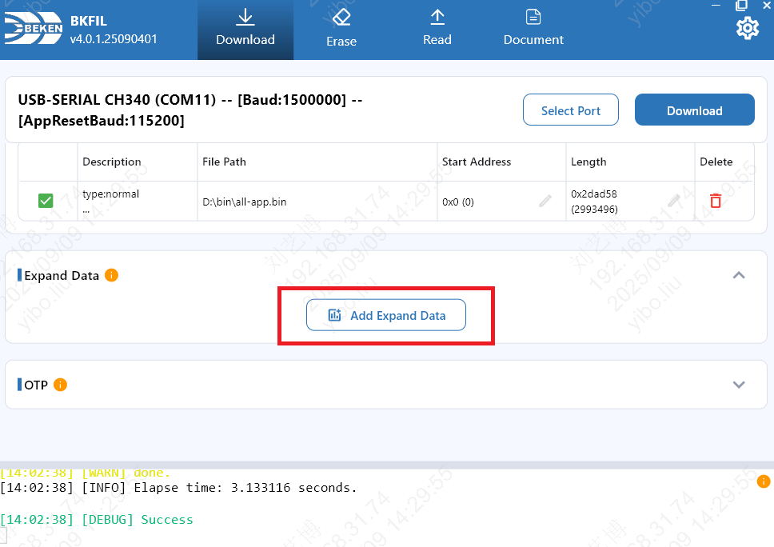](../../../../_assets/45e4705980975625ea88-download_expand_data_1.png)

[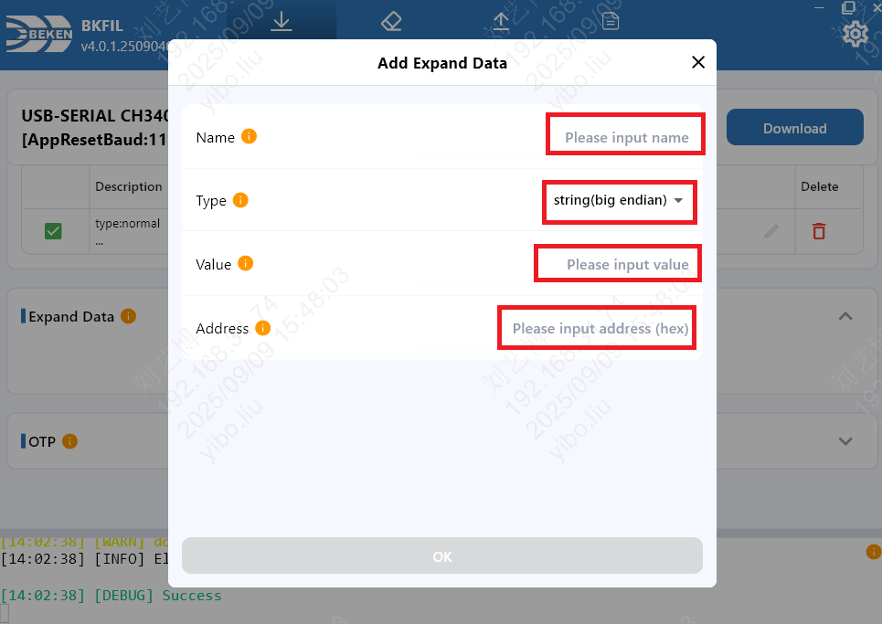](../../../../_assets/52256cda2a0716711301-download_expand_data_2.png)

<a id="otp-efuse"></a>

# 烧录OTP/eFuse

OTP/eFuse 文件为 JSON 格式

1. 使用CLI
   :   .\\bk\_loader.exe download -p COM11 -b 1500000 `--reset_baudrate` 115200 `--safe_json` D:/safe.json `--reboot`

- `--safe_json`: OTP/eFuse 文件路径

2. 使用GUI

- 选择 OTP/eFuse 文件

备注

OTP/eFuse 文件格式，请参考 [https://docs.bekencorp.com/arminodoc/bk\_idk/bk7236/zh\_CN/v2.0.1/developer-guide/config\_tools/bk\_config\_otp\_efuse.html](../../../../bk_idk/BK7236/developer-guide/config_tools/bk_config_otp_efuse.md)。

警告

**警告：** OTP/eFuse 数据一旦烧录将无法修改，请务必确认数据内容完全正确后再进行烧录操作！

[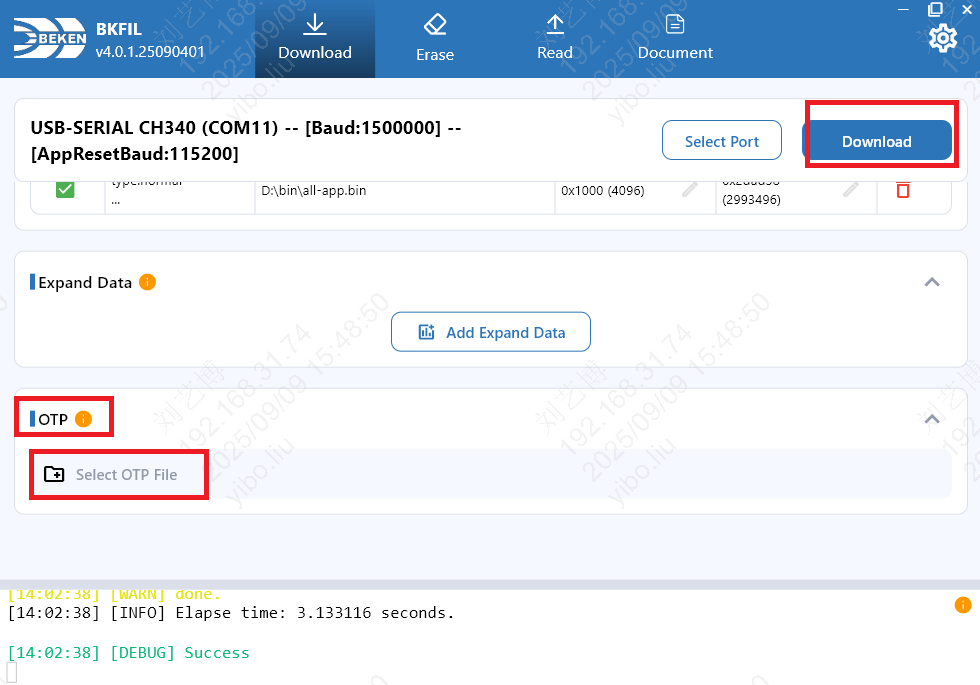](../../../../_assets/2f603e9545955edd8d4c-download_efuse.png)

<a id="flash"></a>

# 将flash数据全部擦除

1. 使用CLI
   :   .\\bk\_loader.exe erase -p COM11 -b 1500000 `--reset_baudrate` 115200 `--chip_all` `--reboot`

- erase：擦除
- `--chip_all`：flash全部
- `--reboot`：擦除完成后重启设备

2. 使用GUI

- 选择全量擦除

警告

警告： flash中包含重要的校准数据,请确保擦除区域的正确性。

[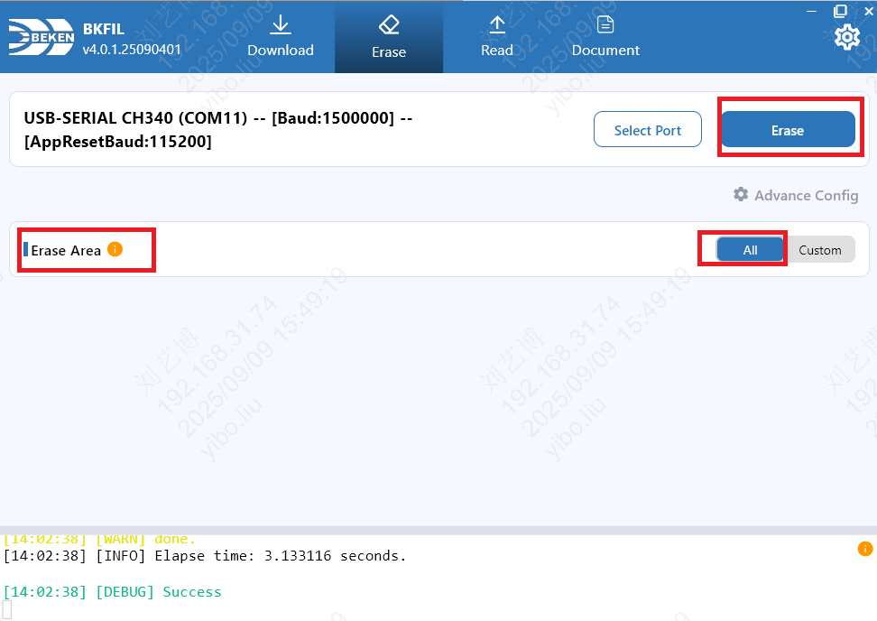](../../../../_assets/9354d9ccb90305b0952d-erase_all.png)

<a id="id3"></a>

# 擦除flash指定区域数据

1. 使用CLI
   :   .\\bk\_loader.exe erase -p COM11 -b 1500000 `--reset_baudrate` 115200 -f 0x1000-0x2000,0x3000-0x4000 `--reboot`

- erase：擦除
- -f:指定要擦除的flash区域
- 格式：-f:addr1-length1,addr2-length2
  :   - addr1: 要擦除的flash区域的起始地址
      - length1: 要擦除的flash区域的长度
      - addr2: 要擦除的flash区域的起始地址
      - length2: 要擦除的flash区域的长度

2. 使用GUI

- 填写区域
- 开始擦除

[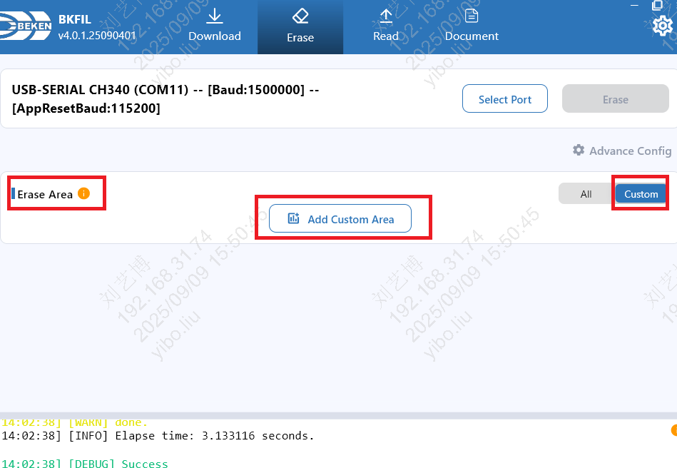](../../../../_assets/78bd89eae5668c5f94cc-erase_custom_1.png)

[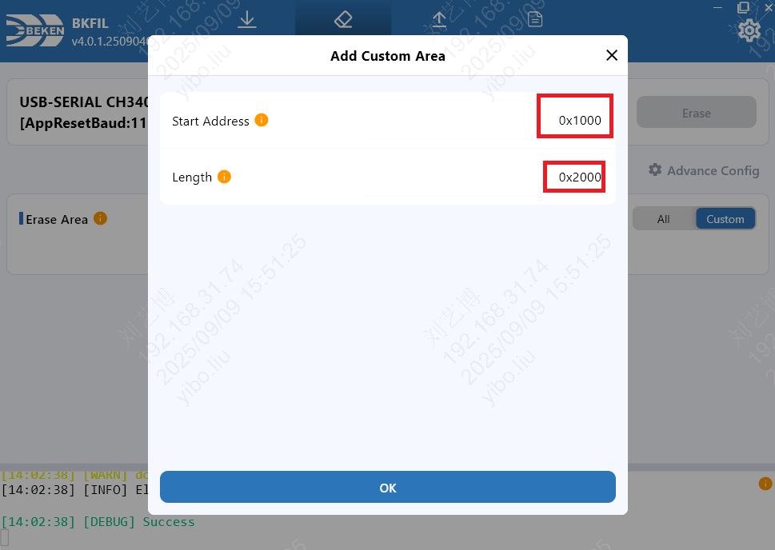](../../../../_assets/fc4235830d305ebb1628-erase_custom_2.png)

<a id="id4"></a>

# 读取 OTP/eFuse

GUI 入口为 `otp/efuse`，由工具按地址自动识别 OTP 或 eFuse；CLI 也可使用单独的 `--read_efuse` / `--read_otp` 指定通道。

1. 使用CLI

   - 自动识别（推荐，对应 GUI 自定义模式）：

     .\\bk\_loader.exe read -p COM11 -b 1500000 `--reset_baudrate` 115200 `--read_otp_efuse_auto` 0x44850014-4 `--reboot`
   - 仅读 eFuse：

     .\\bk\_loader.exe read -p COM11 -b 1500000 `--reset_baudrate` 115200 `--read_efuse` 0-0 `--reboot`
   - 仅读 OTP：

     .\\bk\_loader.exe read -p COM11 -b 1500000 `--reset_baudrate` 115200 `--read_otp` 0x4b010000-4 `--reboot`

   字段说明：

   - read：读取
   - `--read_otp_efuse_auto`：按地址自动识别 OTP/eFuse 通道；具体地址范围请参考芯片手册
   - `--read_efuse`：仅读 eFuse；入参为 `addr-length`，`0-0` 表示读取 eFuse 的全部
   - `--read_otp`：仅读 OTP，地址为 OTP 寄存器地址
   - 入参格式：`addr-length`，多段以英文逗号分隔（如 `0x44850014-4,0xa-4`）
2. 使用GUI

- 读取类型选择 `otp/efuse`
- 读取模式有两种：

  - **自定义**：手动添加一条或多条地址区间（地址 \+ 长度）
  - **按 JSON**：选择本地 JSON 配置文件，按文件内容批量读取

[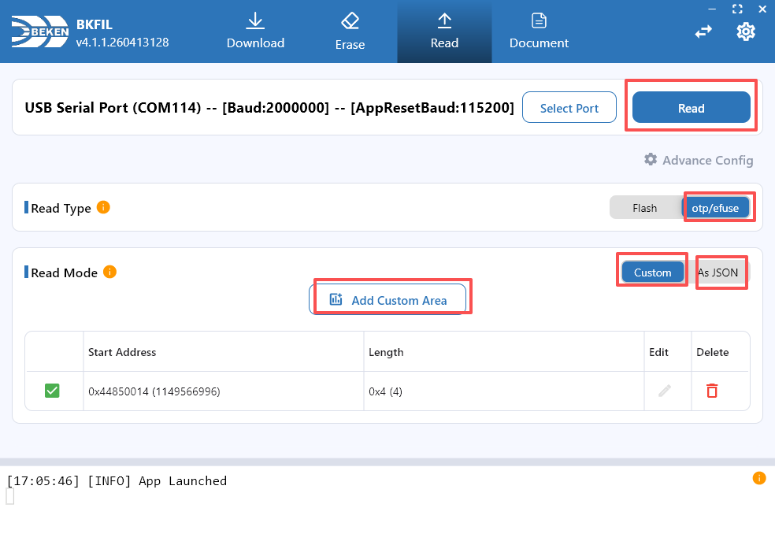](../../../../_assets/179fe2888137f2f61106-read_efuse.png)

<a id="id5"></a>

# 读取flash全部数据

1. 使用CLI

   > .\\bk\_loader.exe read -p COM11 -b 1500000 `--reset_baudrate` 115200 `--chip_all` `--reboot`

- `--reboot`：读取完成后重启设备

2. 使用GUI

- 选择全部flash

[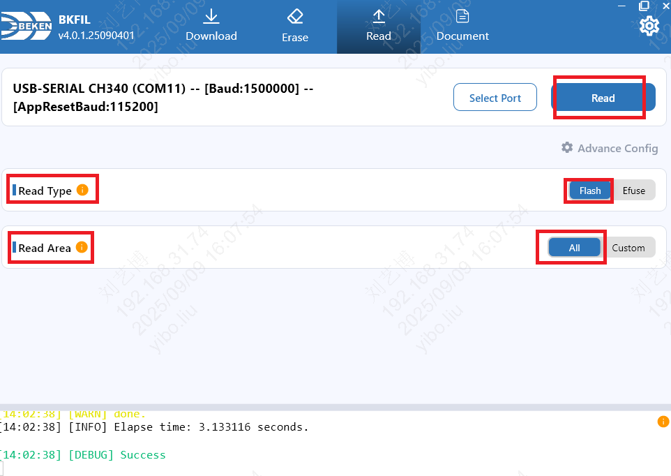](../../../../_assets/492fe5e86124120d609c-read_all.png)

<a id="id6"></a>

# 读取flash指定区域

1. 使用CLI
   :   .\\bk\_loader.exe read -p COM11 -b 1500000 `--reset_baudrate` 115200 0 -f 0x0-0x1000,0x2000-0x3000 `--reboot`
2. 使用GUI

- 填写区域

[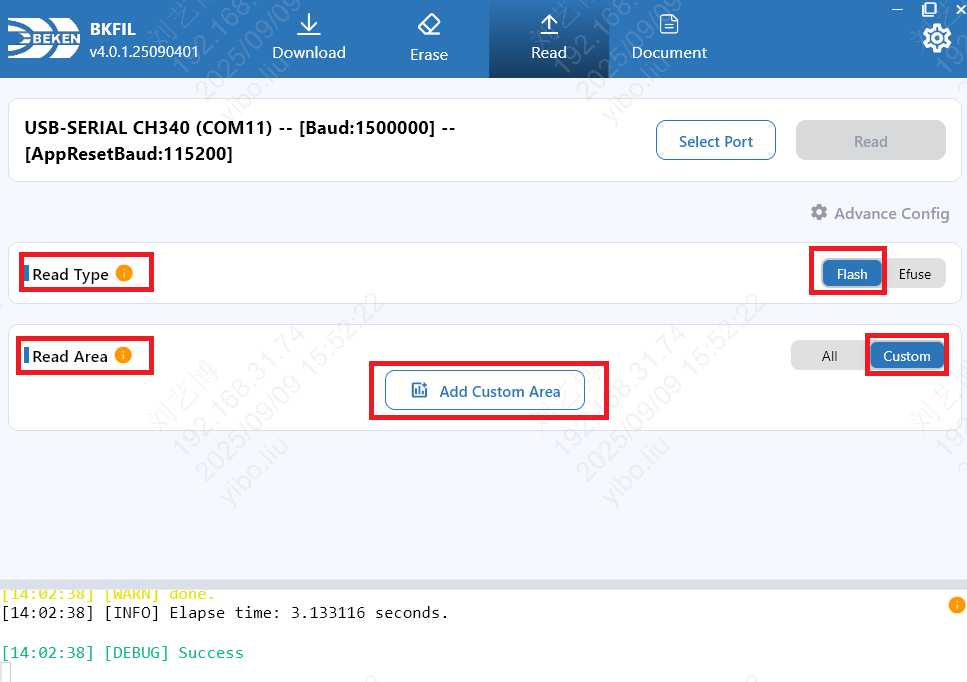](../../../../_assets/f75d9de79c907bfbc8d5-read_custom_1.png)

[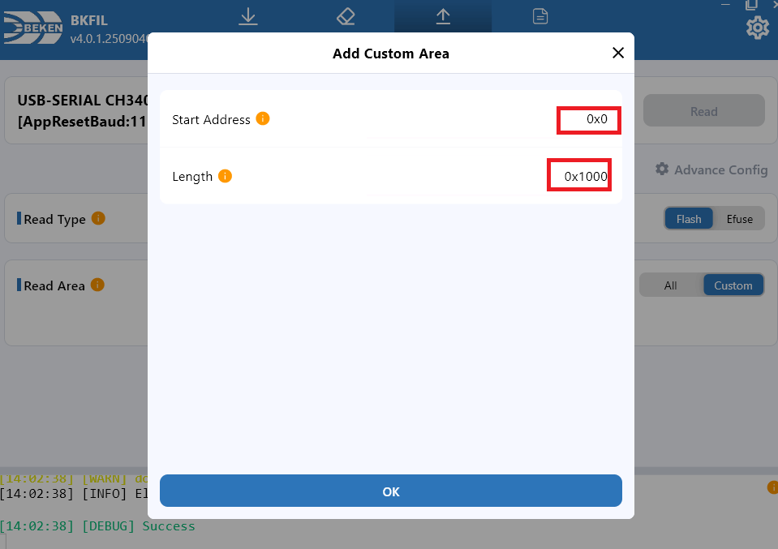](../../../../_assets/ba5021af3aee39eb7dd0-read_custom_2.png)
