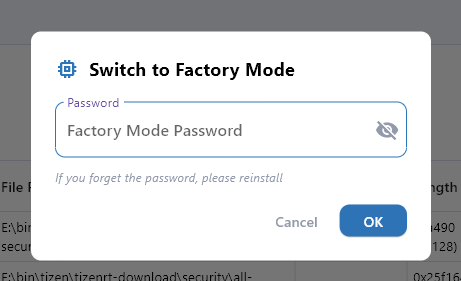
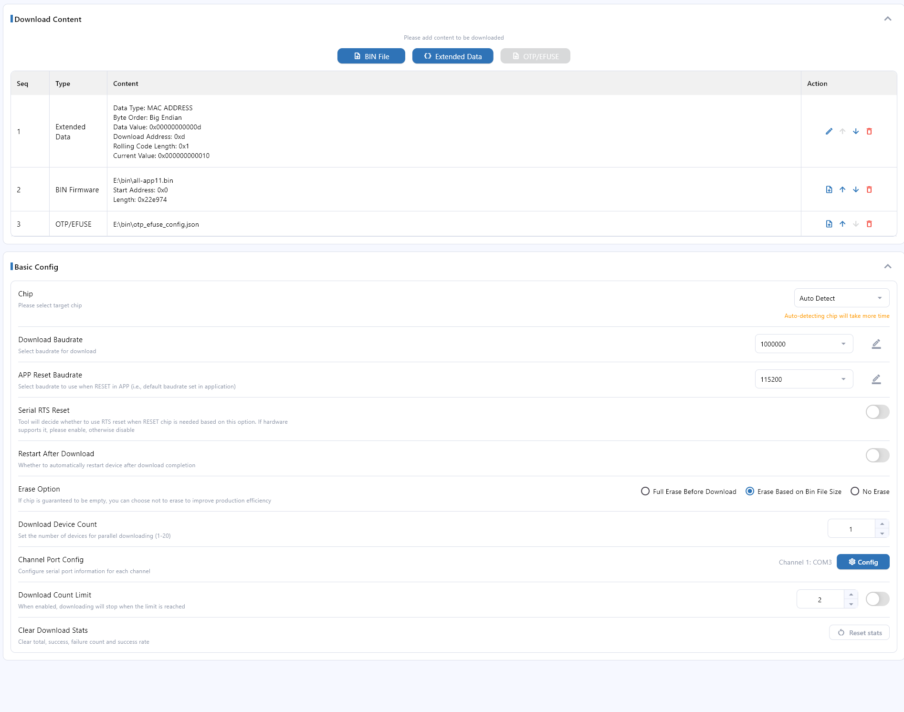
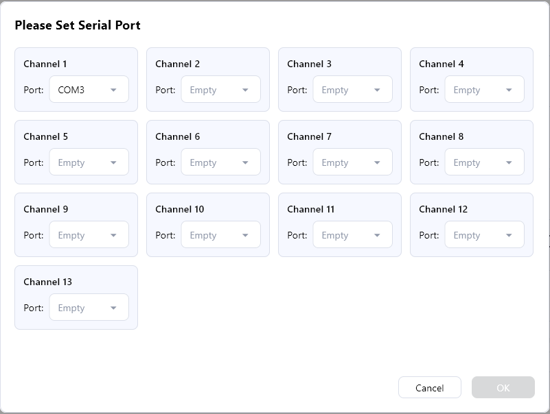
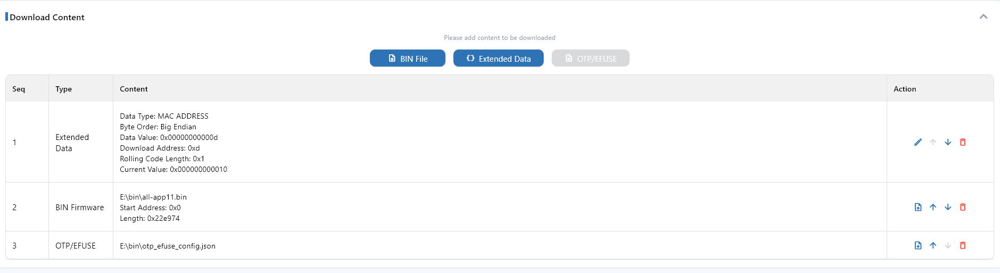
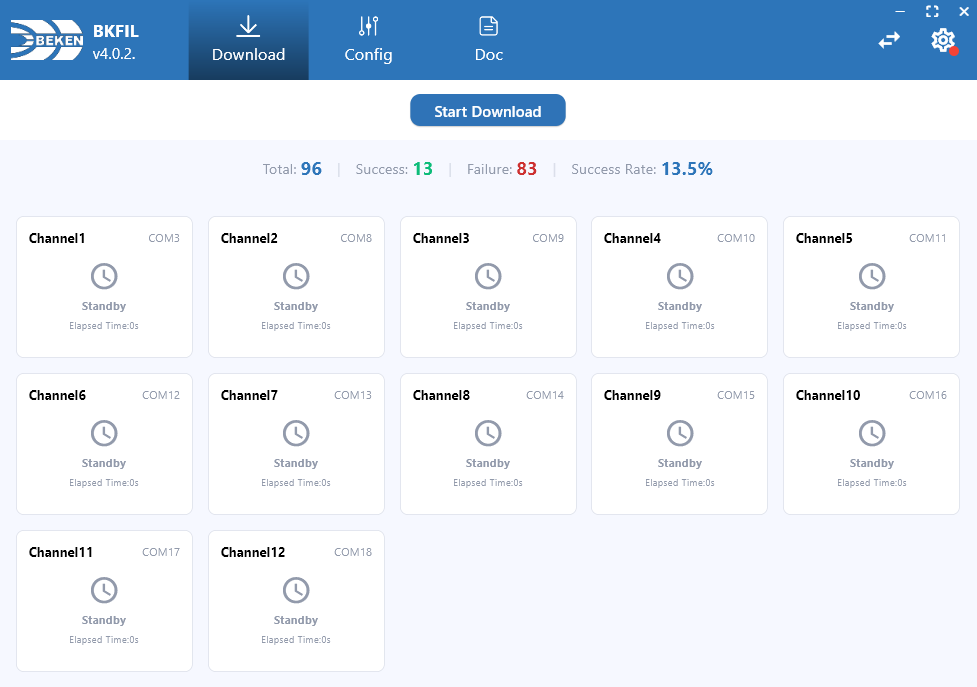
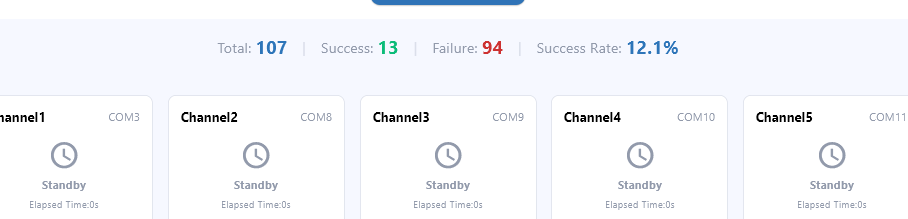

<a id="overview-section"></a>

<a id="id1"></a>

# 概述

工厂模式是面向产线批量烧录的模式，支持多通道并行烧录、统一配置管理和实时监控。

<a id="id2"></a>

## 适用场景

- 产线批量烧录
- 多设备并行烧录
- 配置固定、需重复使用
- 需要统计成功/失败数量及成功率

<a id="id3"></a>

## 主要能力

- **多通道并行烧录**：通道数可配置，各通道独立执行
- **实时监控**：每通道显示状态、耗时
- **统计**：自动统计总数、成功数、失败数、成功率

<a id="guide-section"></a>

<a id="id4"></a>

# 功能说明

工厂模式面向产线批量烧录，支持多通道并行烧录与配置管理。以下说明工厂模式的功能与配置项。

<a id="id5"></a>

# 多通道并行烧录

工厂模式支持同一固件向多路串口设备并行烧录，各通道独立执行、互不干扰。

- **默认通道数**：8 通道
- **通道数可配置**：根据实际需求在配置中设置设备数量
- **串口配置**：为每个通道配置对应串口（如 COM1、COM2 等）
- **独立执行**：各通道在独立线程中执行，互不影响
- **实时状态**：每通道实时显示烧录状态（待机、烧录中、成功、失败）

<a id="id6"></a>

# 配置管理

工厂模式配置分为以下部分：

<a id="id7"></a>

## 基础配置

- **芯片型号**：选择目标芯片型号，支持自动识别
- **下载波特率**：烧录过程中的通信波特率（默认 2000000）
- **APP 复位波特率**：APP 运行时的波特率（默认 115200）
- **RTS 复位**：是否使用 RTS 信号复位
- **烧录后重启**：烧录完成后是否自动重启设备
- **擦除选项**：
  \- 全擦除：烧录前擦除整个 flash
  \- 根据 bin 大小擦除：仅擦除待烧录区域
  \- 不擦除：烧录前不擦除 flash
- **设备数量**：配置待烧录设备数量（默认 8）
- **通道串口配置**：为每个通道配置对应串口
- **烧录数量限制**：烧录数量上限

<a id="id8"></a>

## 烧录内容配置

- **BIN 文件**：添加待烧录的 bin 文件
- **扩展数据**：添加扩展数据（如 MAC 地址、设备名称等）
  \- 支持滚动码，每通道自动递增
- **OTP/eFuse**：添加 OTP 或 eFuse 配置文件

<a id="id9"></a>

# 实时监控

工厂模式提供实时监控，每通道显示：

- **通道状态**：待机、烧录中、成功、失败
- **烧录阶段**：当前阶段（如连接设备、擦除 flash、烧录 bin 等）
- **串口信息**：该通道对应的串口名称
- **耗时**：该通道已烧录耗时

<a id="id10"></a>

# 统计

工厂模式自动统计烧录结果：

- **总数**：已烧录设备总数
- **成功**：成功数量
- **失败**：失败数量
- **成功率**：成功数量占总数的百分比

<a id="id11"></a>

# 密码保护

进入工厂模式配置页需验证密码，避免误操作：

- **设置密码**：首次使用工厂模式时需设置密码
- **验证密码**：进入配置页时需输入密码验证

<a id="id12"></a>

# 注意事项

- 工厂模式配置页需密码验证，请妥善保管密码
- 串口配置需与实际硬件连接一致
- 多通道并行烧录时，请确保各通道串口连接正常
- 建议在测试环境验证配置后再用于产线

<a id="quick-start-section"></a>

<a id="id13"></a>

# 快速开始

本文帮助您快速了解工厂模式并完成首次配置与烧录。

<a id="id14"></a>

# 切换到工厂模式

1. 打开 BKFIL 应用
2. 在界面右上角找到模式切换入口（或启动时在模式选择界面选择「工厂模式」）
3. 切换到「工厂模式」

<a id="id36"></a>
[](../../../../_assets/271b9bdf49d43425bed9-factory_mode_select.png)


模式选择 / 切换到工厂模式

备注

首次切换到工厂模式时，系统会提示设置工厂模式密码。请妥善保管密码，进入配置页需验证密码。

<a id="id15"></a>

# 基本配置步骤

首次使用工厂模式需完成基本配置：

1. **进入配置页**
   \- 切换到工厂模式后，点击「配置」标签
   \- 输入工厂模式密码（首次使用需先设置密码）

<a id="id37"></a>
[](../../../../_assets/6ed5957f795f9d5c51e7-factory_config_page.png)


工厂配置页（基础配置与烧录内容）

2. **基础配置**
   \- **芯片型号**：选择目标芯片型号，或选择「自动识别」
   \- **下载波特率**：设置烧录波特率（默认 2000000）
   \- **APP 复位波特率**：设置 APP 运行时的波特率（默认 115200）
   \- **设备数量**：设置待烧录设备数量（默认 8）
3. **通道串口配置**
   \- 点击「通道串口配置」按钮
   \- 为每个通道配置对应串口（如 COM1、COM2 等）
   \- 确保串口配置与实际硬件连接一致

<a id="id38"></a>
[](../../../../_assets/e032a67aa63b718ebc20-factory_port_config.png)


通道串口配置弹窗

4. **烧录内容配置**
   \- 点击「添加」按钮添加待烧录内容
   \- 可添加：BIN 文件（选择待烧录的 bin）、扩展数据（如 MAC 地址、设备名称等）、OTP/eFuse（添加 OTP 或 eFuse 配置文件）

<a id="id39"></a>
[](../../../../_assets/60f36b79cd51ee7c9fa5-factory_download_content.png)


烧录内容配置（添加 BIN / 扩展数据 / OTP eFuse）

5. **保存配置**
   \- 配置完成后点击「保存」按钮

<a id="id16"></a>

# 首次烧录流程

配置完成后即可开始首次烧录：

1. **切换到烧录页**
   \- 点击「烧录」标签
   \- 查看各通道状态（默认显示为「待机」）

<a id="id40"></a>
[](../../../../_assets/3854187c4777ded0ce08-factory_flash_page.png)


工厂烧录页（通道卡片、开始烧录、统计）

2. **确认配置**
   \- 确认串口配置正确
   \- 确认已配置烧录内容
   \- 确认设备已正确连接至对应串口
3. **开始烧录**
   \- 点击「开始烧录」按钮
   \- 系统将向所有已配置通道同时下发烧录命令
   \- 各通道实时显示烧录状态与进度
4. **监控烧录过程**
   \- 观察各通道状态变化
   \- 查看进度与耗时
   \- 注意是否有通道报错
5. **查看结果**
   \- 烧录结束后查看统计信息
   \- 查看成功数、失败数、成功率

<a id="id41"></a>
[](../../../../_assets/3729b094b67e4ffd77c3-factory_flash_result.png)


烧录结果与统计

<a id="id17"></a>

# 常见问题

**Q：通道数量可以改吗？**
A：可以，在基础配置的「设备数量」中修改。

**Q：串口配置错了怎么办？**
A：可重新进入配置页，修改通道串口配置后保存。

<a id="example-section"></a>

<a id="id18"></a>

# 使用示例

本文提供工厂模式的各种使用示例，便于产线批量烧录。

<a id="id19"></a>

# 基础配置示例

<a id="id20"></a>

## 配置 8 通道并行烧录

1. **进入配置页**
   \- 切换到工厂模式
   \- 点击「配置」标签
   \- 输入密码进入配置页
2. **基础配置**
   \- 芯片型号：BK7258（或选择自动识别）
   \- 下载波特率：2000000
   \- APP 复位波特率：115200
   \- 设备数量：8
   \- 擦除选项：根据 bin 大小擦除
   \- 烧录后重启：开启
3. **通道串口配置**
   \- 点击「通道串口配置」按钮
   \- 为 8 个通道配置串口：通道 1: COM1，通道 2: COM2，……，通道 8: COM8
4. **保存配置**
   \- 点击「保存」按钮保存配置

<a id="id21"></a>

# 烧录内容配置示例

备注

以下名称、地址、数据值均为演示示例。扩展数据（含 MAC 地址）的实际存储地址和格式取决于芯片型号与固件方案，请查阅对应 SDK 或产线规范，勿直接照搬。

<a id="bin"></a>

## 添加 BIN 文件

1. 在配置页「烧录内容」区域点击「添加」按钮
2. 选择「BIN 文件」
3. 选择待烧录的 bin 文件路径
4. 确认添加

<a id="id22"></a>

## 添加扩展数据（设备名称）

1. 在配置页「烧录内容」区域点击「添加」按钮
2. 选择「扩展数据」
3. 填写扩展数据信息：
   \- **名称**：device\_name
   \- **类型**：string（大端）
   \- **数据值**：example
   \- **下载地址**：0x2000
4. 确认添加

<a id="otp-efuse"></a>

## 添加 OTP/eFuse 文件

1. 在配置页「烧录内容」区域点击「添加」按钮
2. 选择「OTP/eFuse」
3. 选择 OTP 或 eFuse 配置文件（JSON 格式）
4. 确认添加

<a id="id23"></a>

# 滚动码功能示例

滚动码可使每通道的扩展数据自动递增，适用于每台设备需要唯一标识的场景。

<a id="id24"></a>

## 配置滚动码扩展数据

1. 添加扩展数据时启用「滚动码」选项
2. 设置滚动码步长（如 1）
3. 设置基准值（如 1000）
4. 保存配置

滚动码原理示例：
\- 通道 1 使用基准值：1000
\- 通道 2 使用基准值 \+ 步长：1001
\- 通道 3 使用基准值 \+ 2×步长：1002
\- 以此类推……

<a id="id25"></a>

# 烧录示例

<a id="id26"></a>

## 单次烧录

1. 配置完成后切换到「烧录」标签
2. 确认各通道状态为「待机」
3. 确认设备已正确连接至对应串口
4. 点击「开始烧录」按钮
5. 观察各通道烧录进度
6. 等待烧录完成
7. 查看统计（成功数、失败数、成功率）

<a id="id27"></a>

## 批量烧录

批量烧录流程与单次烧录相同，区别在于：

- 已配置多通道（如 8 通道）
- 系统将同时向所有通道下发烧录命令
- 各通道独立执行、互不影响
- 可实时查看各通道状态

<a id="cli"></a>

## 通过 CLI 多通道烧录

除 GUI 外，可使用 CLI 命令 `batch_download` 实现多通道并行烧录，与工厂模式能力对应。

**1\. 多通道烧录同一固件**

多路串口同时烧录同一 bin 文件（示例：COM1、COM2、COM3，波特率 1500000，烧录后重启）：

```
.\\bk_loader.exe batch_download -p COM1,COM2,COM3 -b 1500000 ``--reset_baudrate`` 115200 -i D:/firmware.bin ``--reboot``
```

- `.\\bk_loader.exe`：CLI 工具路径（Windows；Linux/macOS 下为 `bk_loader batch_download`）
- `batch_download`：多通道烧录子命令
- `-p`：逗号分隔的串口列表
- `-b`：烧录波特率
- `--reset_baudrate`：APP 复位波特率
- `-i`：bin 文件路径
- `--reboot`：烧录完成后重启设备

**2\. 多通道烧录并写入扩展数据（含滚动码）**

每通道写入不同扩展数据时，可使用 `--expand_data_batch`，格式为 `name@type@addr@value`；若需按通道递增（滚动码），在末尾加 `@step`。其中 `name`、`addr`、`value` 须按 SDK 或产线规范填写，以下仅为格式演示：

```
.\\bk_loader.exe batch_download -p COM1,COM2,COM3 -b 1500000 ``--reset_baudrate`` 115200 -i D:/firmware.bin ``--expand_data_batch`` serial_no@0@0x2000@1000@1 ``--reboot``
```

- `--expand_data_batch`：扩展数据，多项用逗号分隔；单条为 `name@type@addr@value` 或 ``` name@type@addr@value@step``（``step ``` 为每通道递增值）

**3\. 多通道烧录并写入 OTP/eFuse**

OTP、eFuse 等通过 JSON 配置文件指定，使用 `--safe_json`：

```
.\\bk_loader.exe batch_download -p COM1,COM2,COM3 -b 1500000 ``--reset_baudrate`` 115200 -i D:/firmware.bin ``--safe_json`` D:/safe.json ``--reboot``
```

- `--safe_json`：OTP/eFuse 等安全配置的 JSON 文件路径

**常用参数汇总**

- `-e` / `--erase`：擦除方式，`none` 不擦除、`all` 全片擦除、`bin` 按 bin 区域擦除（默认）
- `--chipname`：芯片型号（如 BK7258）；不传则从设备识别

<a id="id28"></a>

# 高级功能示例

<a id="id29"></a>

## 配置烧录数量限制

1. 在基础配置中启用「烧录数量限制」
2. 设置限制数量（如 100）
3. 保存配置

启用后，达到设定数量时系统将停止烧录。

<a id="id30"></a>

## 配置自定义波特率

1. 在基础配置中可添加自定义下载波特率
2. 可添加自定义 APP 复位波特率
3. 保存配置

自定义波特率会与默认波特率列表合并显示。

<a id="id31"></a>

# 配置保存与使用

<a id="id32"></a>

## 保存配置

在配置页完成配置后点击「保存」按钮，配置会写入本机默认路径。下次进入工厂模式时将从该路径自动加载。

若需在其他电脑或本机其他位置使用相同配置，请将已保存的配置文件复制到目标位置（本机为应用配置目录下的工厂配置文件）。

<a id="id33"></a>

# 常见使用场景

<a id="id34"></a>

## 场景 1：8 通道并行烧录同一固件

- 配置 8 通道
- 添加一个 bin 文件
- 所有通道烧录相同固件
- 适用于标准产品量产

<a id="mac"></a>

## 场景 2：多通道烧录不同 MAC 地址

- 配置多通道
- 添加 bin 文件
- 添加 MAC 地址扩展数据并启用滚动码
- 每通道自动分配不同 MAC 地址
- MAC 存储地址由具体产品方案决定，请查阅对应 SDK 或产线规范

<a id="otp"></a>

## 场景 3：批量烧录含 OTP

- 配置多通道
- 添加 bin 文件
- 添加 OTP 配置文件
- 所有通道同时烧录 bin 与 OTP

<a id="id35"></a>

# 注意事项

- 串口配置需与实际硬件连接一致
- 多通道并行烧录时请确保各通道串口连接正常
- 滚动码仅适用于扩展数据，不适用于 bin 文件
- 建议在测试环境验证配置后再用于产线
