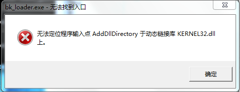

<a id="id1"></a>

# 如何区分安全芯片和非安全芯片

- 请参考博通集成的官方文档。
- 请联系博通集成对应的技术支持人员进行咨询。

<a id="bkfil"></a>

# BKFIL是否可以直接查看芯片是否开启安全

BKFIL 不具备这个功能。

<a id="id2"></a>

# 打开工具后，在串口下拉菜单中找不到对应串口

1. 检查串口是否正确连接
2. 检查串口驱动是否正确安装

<a id="get-bus-fail"></a>

# 烧录过程中，出现‘Get bus fail’ 错误

1. 检查串口是否选择正确
2. 芯片是否成功重启

<a id="windows-7-kernel32"></a>

# 在 Windows 7 环境中出现 KERNEL32 错误

当在 Windows 7 环境中遇到以下报错时，请安装补丁 KB2533623 进行修复。

[](../../../../_assets/22bb6ef391907e484665-kernel32_err.png)

<a id="linux-cli"></a>

# Linux 系统下运行 CLI 提示权限不足

请使用 `chmod` 指令为可执行文件添加执行权限：

```
chmod +x <CLI 可执行文件的绝对路径>
```

<a id="linux-gui"></a>

# Linux 系统下运行 GUI 提示权限不足

请使用 `chmod` 指令为 GUI 可执行文件添加执行权限：

```
chmod +x <GUI 可执行文件的绝对路径>
```

<a id="linux"></a>

# Linux 系统下查找不到串口，或串口权限不足

1. 请检查串口驱动是否正确安装。
2. 使用 `chmod` 指令修改串口设备的权限。

<a id="macos-bk-loader-command-not-found"></a>

# macOS 终端执行 bk\_loader 提示 command not found

通常是当前终端窗口的 `PATH` 还未刷新所致，请按以下步骤排查：

1. 关掉当前终端窗口重新打开，再次执行 `bk_loader --help`。
2. 若仍提示 `command not found`，确认 `/usr/local/bin/bk_loader` 软链接是否存在，并确认 `PATH` 中包含 `/usr/local/bin`。

<a id="macos-bk-loader-write-permission-denied-operation-not-permitted"></a>

# macOS 上执行 bk\_loader 出现 write permission denied / Operation not permitted

需要给所用终端开启「完全的磁盘访问权限」：

1. 打开 **System Settings → Privacy \& Security → Full Disk Access**。
2. 点击 `+`，将正在使用的终端 app（Terminal / iTerm2 / VSCode 等）加入并打开开关。
3. 关掉终端窗口重新打开，再次执行 `bk_loader`。

<a id="macos-bk-loader-cli"></a>

# 如何在 macOS 上卸载 bk\_loader CLI

在终端中执行以下命令：

```
sudo rm -rf /usr/local/lib/bk_loader /usr/local/bin/bk_loader
sudo pkgutil --forget com.beken.bk_loader
```

<a id="intel-mac-2-mbps"></a>

# Intel 架构 Mac 烧录波特率高于 2 Mbps 时失败

- Intel 架构的 Mac 不支持高于 2 Mbps 的烧录波特率。
- Apple Silicon（ARM 架构）的 Mac 不受此问题影响。

在 Intel Mac 上使用超过 2 Mbps 的烧录波特率时，会出现 `baudrate switch fail`
报错（例如配置为 4 Mbps 时还会同时打印 `set baudrate 4000000 fail`），
请将烧录波特率调整为 2 Mbps 或更低后再试。
