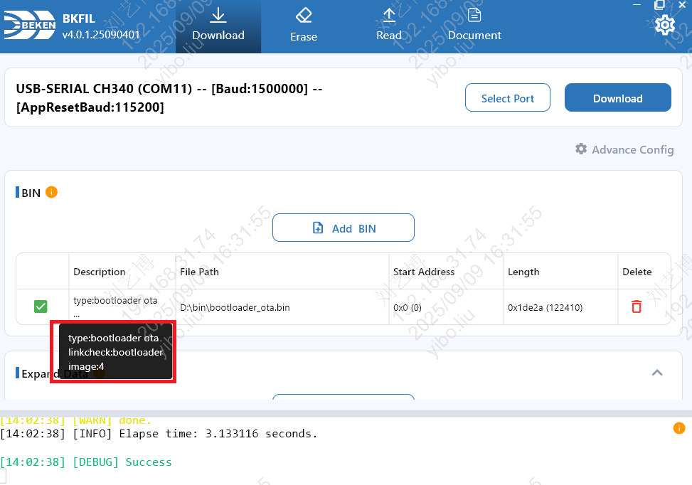
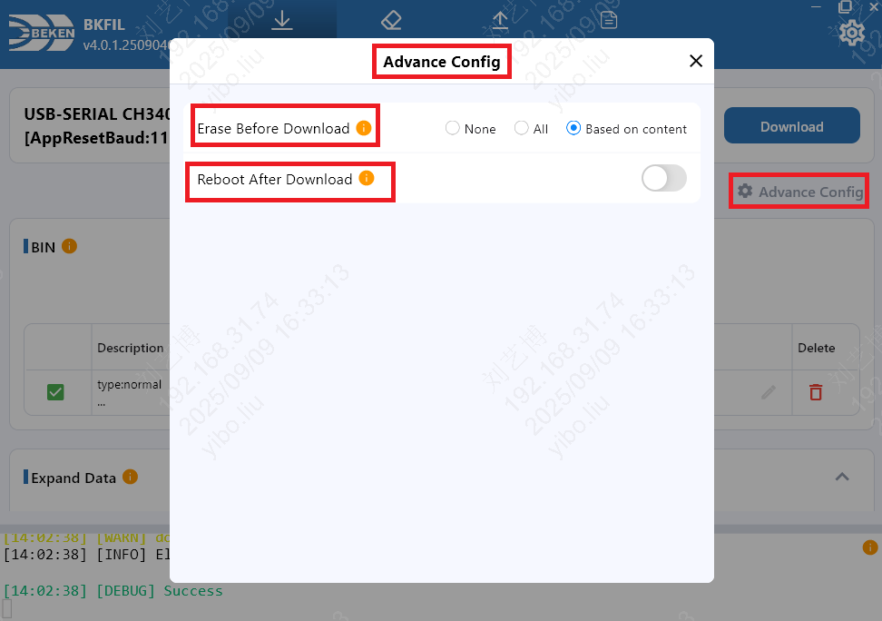
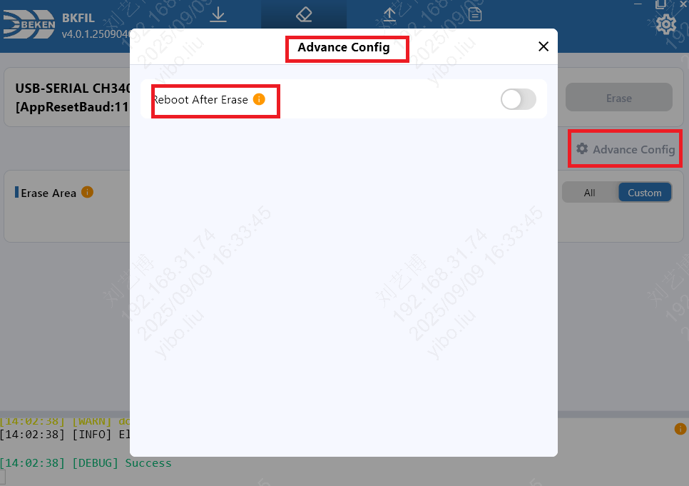
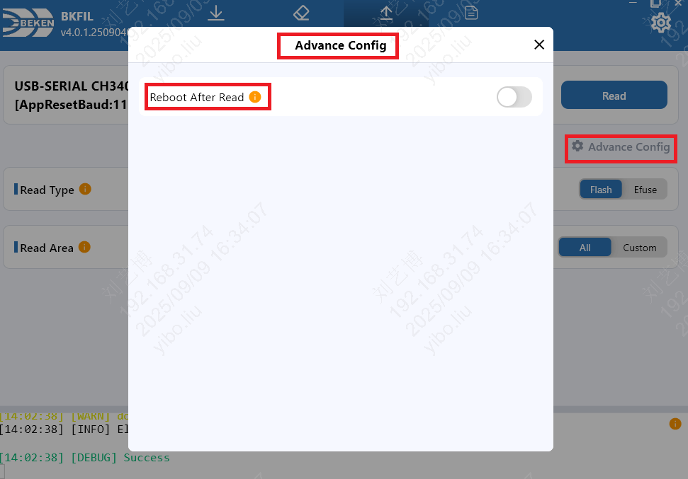
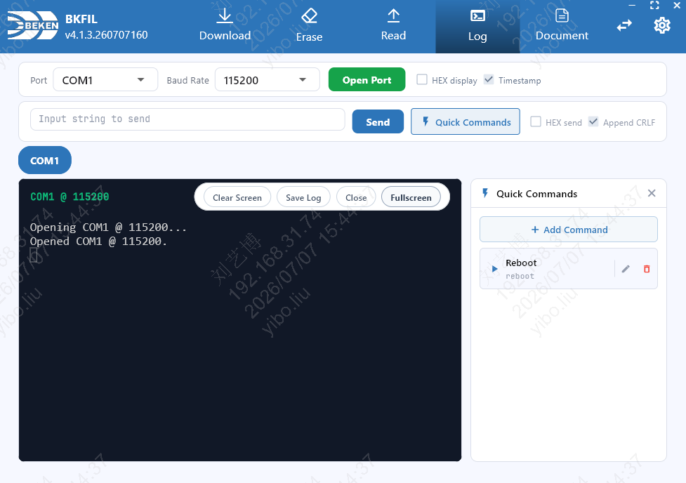

# 术语解释

## 芯片介绍

芯片分为开启安全功能的芯片（统称为安全芯片）和未开启安全功能的芯片（统称为非安全芯片）。

- 安全芯片：使用bootloader进行烧录、读取、擦除。
- 非安全芯片：使用bootrom进行烧录、读取、擦除。

## bin

- bin文件是烧录到flash中的固件。
- 不同类型的业务对应不同的bin文件，不同的bin文件有不同的作用。

bin分类如下：

- normal
  :   普通bin文件，包含了完整的应用程序代码和数据。
- ota
- bootrom all bin
- bootloader app
- secure fix
- outter
- normal fixed
- bootlader ota
  :   升级bootloader。
- bl1 secure fixed
- bl1 secure extension

## 波特率

1. Baud：工具在烧录、读取、擦除的过程中，使用的通信波特率。
2. AppRestBaud：APP运行时的波特率。工具给芯片发送reset指令时，会将串口切换到此波特率，然后再发送reset指令,默认为115200。

## USB转串口芯片波特率支持

不同的USB转串口芯片对波特率的支持有所不同，请根据您使用的芯片选择合适的波特率：

| 芯片型号 | 最大支持波特率 |
| --- | --- |
| CP210X | 2000000 (2 Mbps) |
| CH340 | 2000000 (2 Mbps) |
| FT232R / FT232RL | 3000000 (3 Mbps) |
| FT2232 / FT4232 (多通道) | 6000000 (6 Mbps) |

备注

如果选择的波特率超过芯片支持的最大值，可能会导致通信失败。建议根据实际使用的USB转串口芯片选择合适的波特率。

# 芯片选择

研发模式下，下载 / 读取 / 擦除页面顶部提供「芯片选择」，可在以下两项之间切换，选择后会自动记忆：

- **BK3515N**：明确指定芯片为 BK3515N，按该芯片执行下载 / 读取 / 擦除。
- **BK72xx 系列**：由设备自动识别芯片型号，适用于 BK72xx 系列芯片。

备注

工厂模式的芯片选择在工厂配置中单独设置，不受此处影响。

# 烧录功能

## 添加bin

- **描述**：简介bin文件的基本信息，包括包含的镜像数量、工作环境和bin的业务种类。
- **长度**：文件要烧录的长度。只有normal类型的bin可以编辑长度。
- **地址**：文件要烧录到flash的指定地址。只有normal类型的bin可以编辑地址。

## 拓展数据

扩展数据功能允许将一些特定数据（如MAC地址、设备名称、BLE地址等）写入到flash的指定地址。

- **名称**：扩展数据的名称，名称中间不允许有空格。
- **类型**：指定数据的字节序，支持以下四种类型：
  0\. hex(little endian)：十六进制小端格式
  1\. hex(big endian)：十六进制大端格式
  2\. string(little endian)：字符串小端格式
  3\. string(big endian)：字符串大端格式
- **数据**：要写入到flash的具体数据，根据类型的不同，数据的格式也不同。
- **地址**：指定数据要写入到flash的指定地址。

备注

若数据地址超出 flash 容量，工具会打印错误日志说明越界事实；该条数据不会被跳过，烧录流程与任务结果不受影响。

## OTP

选择otp文件进行烧录。

- otp文件格式，请参考 [https://docs.bekencorp.com/arminodoc/bk\_idk/bk7236/zh\_CN/v2.0.1/developer-guide/config\_tools/bk\_config\_otp\_efuse.html](../../../../bk_idk/BK7236/developer-guide/config_tools/bk_config_otp_efuse.md)。

警告

在进行OTP烧录前，请务必确认OTP文件的内容完全正确，避免因错误数据导致芯片功能异常。

## 烧录高级配置

- **烧录前是否需要擦除flash**

  - **不擦除**：烧录前不擦除flash
  - **全擦除**：烧录前全擦除flash，清除所有数据
  - **根据内容擦除**：擦除要烧录的区域
- **烧录后是否重启**

  - **不重启**：烧录后不重启板子
  - **重启**：烧录后自动重启板子

# 擦除功能

擦除全部和擦除指定区域。

## 擦除全部

擦除全部功能会擦除整个flash区域，清除所有存储在flash中的数据。

警告

**警告：** 擦除整个flash区域后，flash中的数据会全部丢失，包括一些重要的校准数据和用户配置数据。

## 擦除指定区域

添加指定区域，工具进行擦除。

## 擦除高级配置

- **擦除后是否重启**

  - **不重启**：擦除后不重启板子
  - **重启**：擦除后自动重启板子

# 读取功能

读取全部、读取指定区域、读取efuse。

## 读取全部flash

读取全部flash功能会将flash中所有内容读取出来，并存储到对应的文件中。

## 读取自定义区域flash

填写指定区域，工具进行读取。

## 读取efuse

读取efuse配置。

## 读取高级配置

- **读取后是否重启**

  - **不重启**：读取后不重启板子
  - **重启**：读取后自动重启板子

# 串口日志

串口日志用于打开串口、实时查看设备日志，并向设备发送指令，适用于调试与自检。入口为顶部导航栏的「日志」标签。

## 打开串口

- **串口**：选择要打开的串口。
- **波特率**：选择通信波特率，默认 115200。
- **打开串口**：按所选串口与波特率建立会话。每个串口对应一个独立的会话 Tab，可在多个串口之间切换；会话状态有「打开中」「已打开」「已暂停」「恢复中」「已断开」「已关闭」「异常」，保存日志时另有「保存中」指示。
- **HEX 显示**：以十六进制形式显示接收到的日志。
- **时间戳**：在每行日志前显示时间戳。

## 发送指令

- **字符串发送**：在输入框中输入要发送的内容，点击「发送」下发。
- **HEX 发送**：勾选「HEX 发送」后按十六进制格式输入（例如 `01 03 00 00`）。每 2 位组成 1 个字节，可使用空格、逗号、分号或冒号分隔；格式非法时不会下发。
- **追加 CRLF**：发送时在末尾追加回车换行；勾选「HEX 发送」时会自动关闭该选项，HEX 发送不追加 CRLF。
- 发送仅作用于当前选中的串口 Tab。

## 快捷指令

点击「快捷指令」打开侧栏，用于管理与下发常用指令。

- **新增指令**：填写名称与内容后保存。
- **编辑 / 删除**：修改或删除已有指令。
- **发送**：一键下发对应指令。工具默认内置一条名为 Reboot 的快捷指令（内容为 `reboot`），可在此基础上自行增删。

## 日志显示与保存

- **清屏**：清空当前会话的日志显示。
- **保存日志**：将后续日志记录保存到文件。
- **关闭**：关闭当前串口会话。
- **全屏显示**：全屏查看日志窗口。

# AI 能力接口服务

AI 能力接口服务是 BKFIL 内置的本机 HTTP 服务，将部分能力以接口形式对外开放，供外部工具或 AI 调用，实现自动化操作。

备注

该服务监听 `0.0.0.0`，会绑定所有网卡；端口在 `17631`–`17640` 段内取第一个可用端口（默认起始端口 `17631`，被占用时自动顺延），建议仅在可信网络或本机环境中使用。外部工具可对该端口段逐个 `GET /v1/capabilities`，以返回 `service` 为 `bkfil_ai_capability` 的端口作为实际服务端口。
当 BKFIL 处于工厂模式等状态时服务不可用，此时相关接口会返回 `503 AI_CAPABILITY_UNAVAILABLE`，并在 `reason` 中说明原因。

备注

可在 BKFIL 设置页查看该服务的运行状态与实际监听端口，无需手动探测端口即可确认服务是否可用。

## 主要能力

- **raw\_task**：在指定串口执行原始命令（如烧录、读取版本等），任务完成后可下载执行产物。
- **serial\_log**：以共享方式打开串口，采集并向设备发送串口日志数据。

服务通过 REST 接口启动任务、上传 / 下载文件、查询状态，并通过 WebSocket 订阅任务事件。完整的接口说明（端点、请求 / 响应、参数、错误码等）请以下文引用的技能仓库为准。

## 配合 Armino Skills 使用

BKFIL 可与 [Armino SDK AI 开发技能包](https://github.com/bekencorp/armino_skills) 配合使用。
在支持的 Agent 平台（如 Cursor、Claude Code）加载这些技能后，即可用自然语言完成固件烧录、
串口日志查看等操作，底层通过本服务执行。

备注

完整的接口说明（端点、请求 / 响应、参数、错误码等），以及技能的安装、配置、连接模式与具体用法，请以上述仓库为准（内容持续更新）。
