

# 硬件准备

在开始之前，请确保您已准备好以下硬件：

- 1条 UART 串口线
- 1块 USB转串口底板
- 1片 待下载芯片
- 1台 电脑

备注

- Beken芯片默认是uart0烧录
- 部分开发板如AI开发板，已经板载了USB转串口芯片，无需额外准备串口底板

[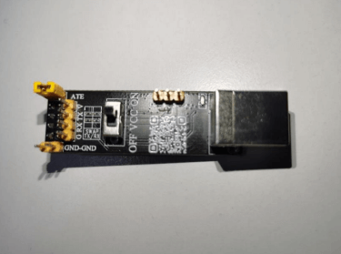](../../../../_assets/55ee3a1afa48b8fa3552-port_baseboard_1.png)

串口底板

[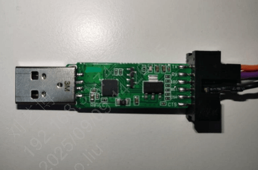](../../../../_assets/ee98251caee0f94891ac-port_baseboard_2.png)

其他串口底板

[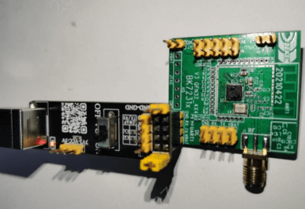](../../../../_assets/19b89b8fa3006504c881-port_baseboard_and_target_chip.png)

串口底板和待下载芯片

[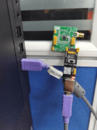](../../../../_assets/a58aecddc6af38228e04-port_baseboard_and_target_chip_and_pc.png)

串口底板和待下载芯片和电脑

# 软件准备

参考 [下载安装](../../download/download.md)

# 烧录

1. 选择串口和波特率

[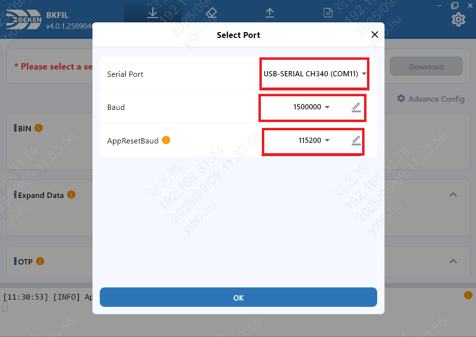](../../../../_assets/66e260752210d6f73dc0-select_port_and_baud.png)

2. 选择bin文件

3. 开始烧录

[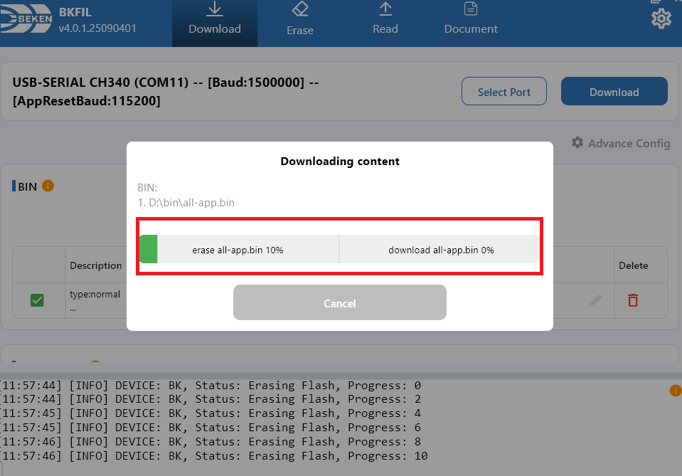](../../../../_assets/a11b1d846aca1ccb08de-download_ing.png)

4. 烧录完成

[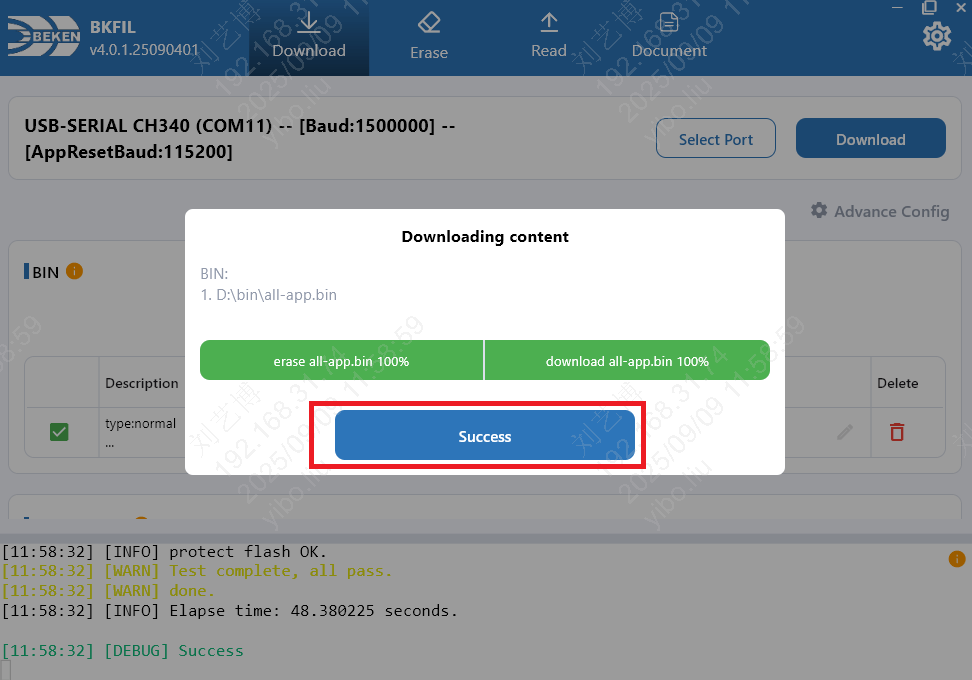](../../../../_assets/1243f5a0f1d26081eb32-download_success.png)

# 擦除

警告

擦除操作会清除指定区域内的所有数据，请谨慎操作。

1. 选择串口和波特率
2. 选择要擦除的区域

[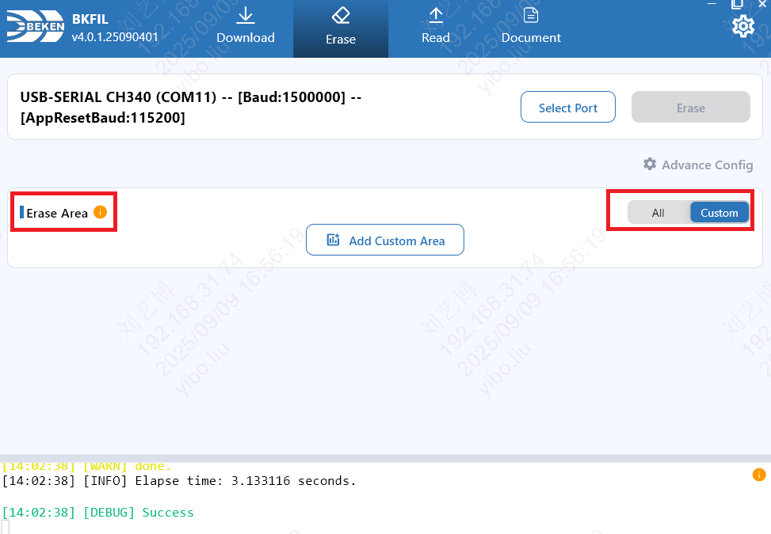](../../../../_assets/e4a971c2d06a5e3bb441-erase_type.png)

[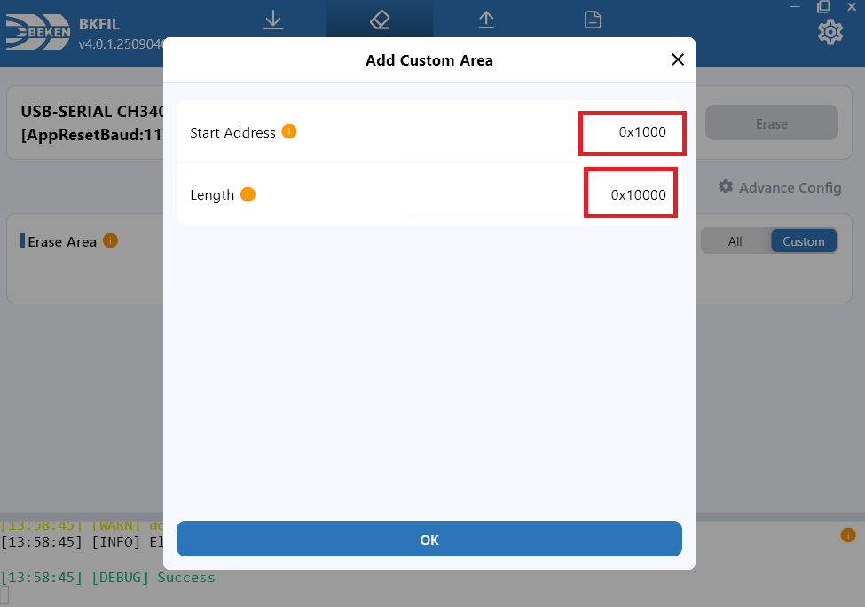](../../../../_assets/135406708da56c265cdc-erase_custom_area.png)

3. 开始擦除

[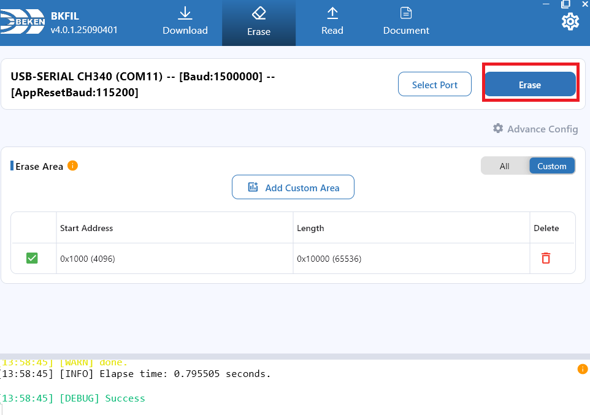](../../../../_assets/729b5360171103141987-erase.png)

[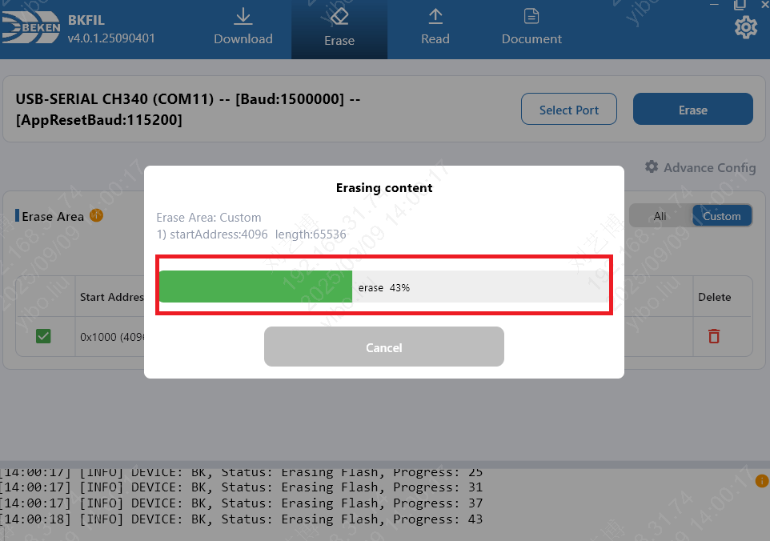](../../../../_assets/7fa26f36d051f0a46278-erase_ing.png)

4. 擦除完成

[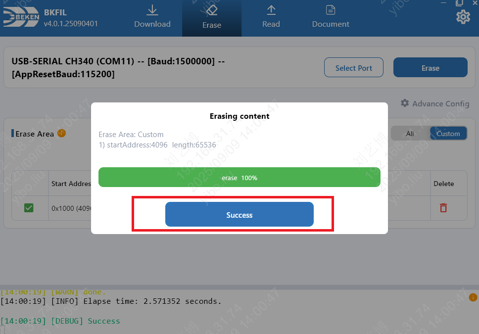](../../../../_assets/a7d20fc27a3a5f22c165-erase_success.png)

# 读取

1. 选择串口和波特率
2. 选择读取区域

[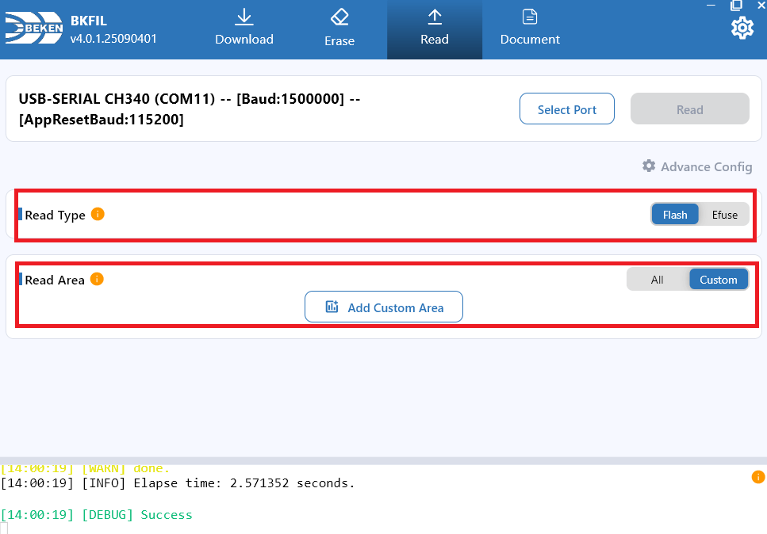](../../../../_assets/819f3be6f68e23140eea-read_type.png)

[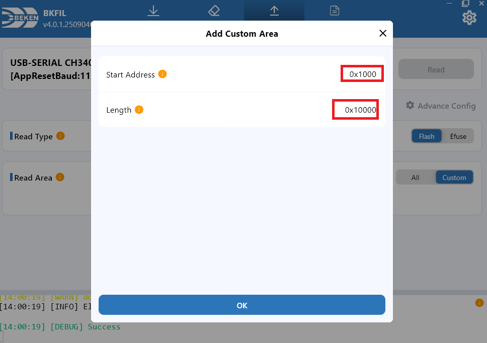](../../../../_assets/3478f93841657400b231-read_area.png)

3. 开始读取

[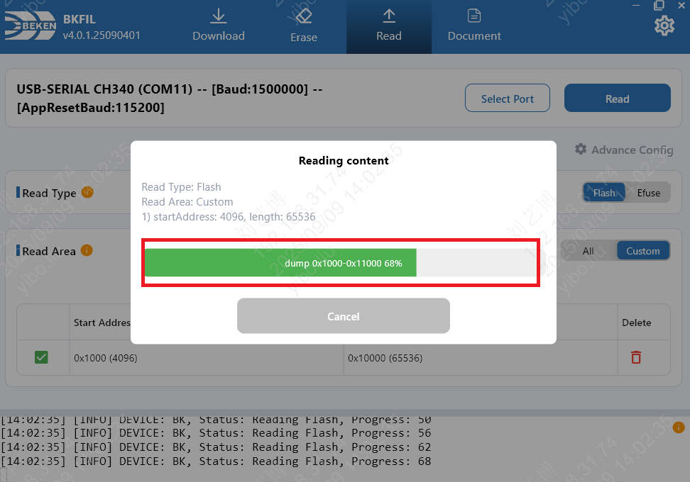](../../../../_assets/9fdb9c9ebb606859775e-read_ing.png)

4. 读取完成

[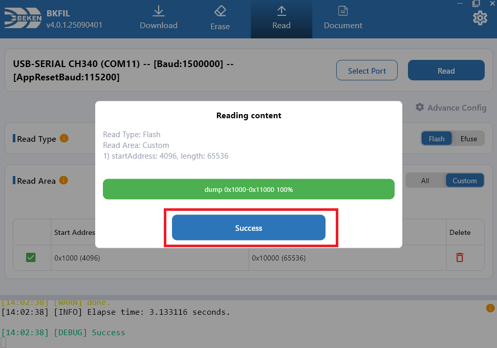](../../../../_assets/1702ad321ef7027f4413-read_success.png)
