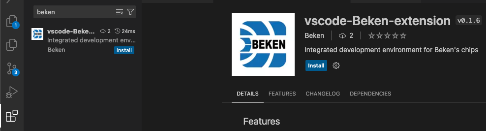
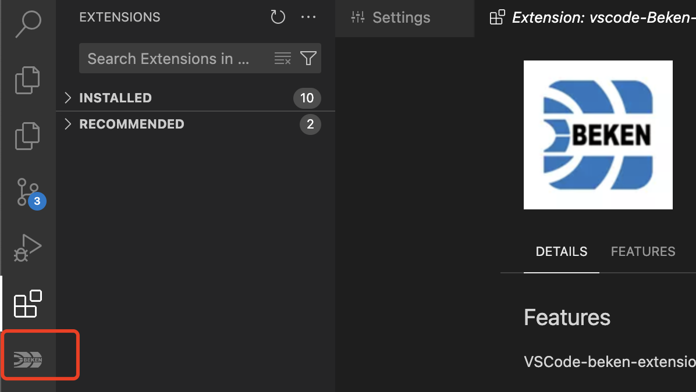

# 在线安装

- 打开 Visual Studio Code。
- 选择左侧的 “Extensions” 图标，或者按下 Ctrl\+Shift\+X 快捷键。
- 在搜索栏中输beken并按下回车，点击`Install`进行安装。

ext\_install

插件安装完成以后，即可在VSCode侧边栏看到Beken插件图标。

beken\_log

## 模块导航

- [文档](../../vscode_beken_ext.md)
- [简介](../vscode_ext_guide.md)
- [安装](../vscode_ext_install.md)
- [离线安装](offline_install.md)
- [使用说明](../vscode_ext_usage.md)
- [常见问题](../vscode_ext_qa.md)
- [版本历史](../vscode_ext_history.md)
