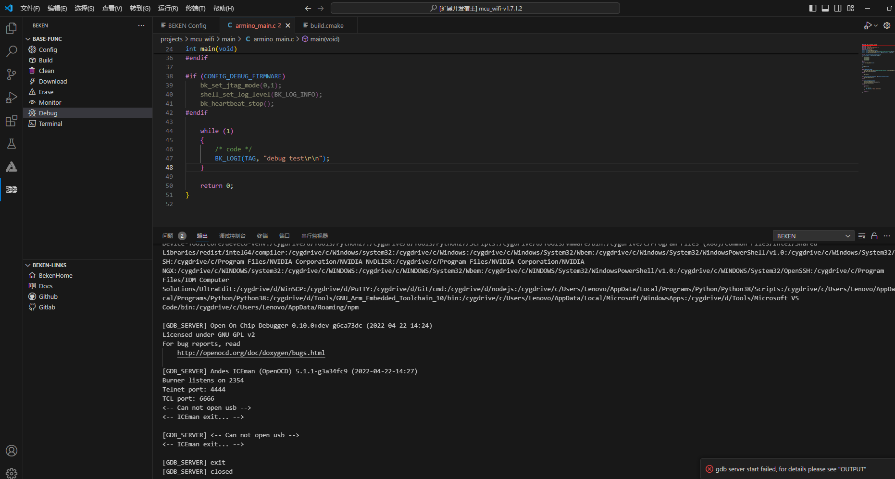
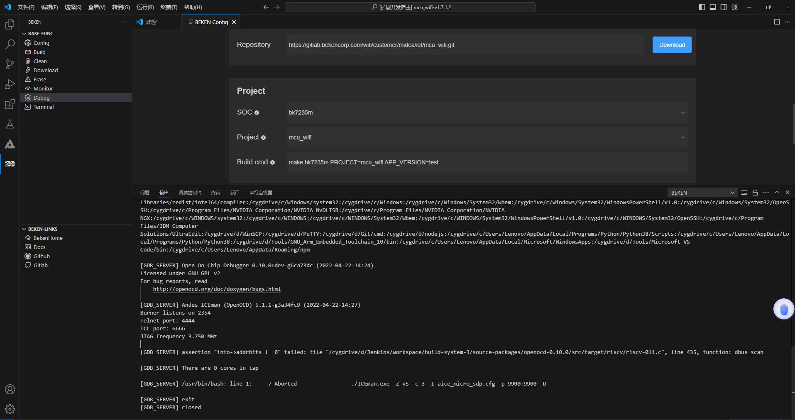

# 常见问题

## 1\. `Debug`报错: `Can not open usb`

debug\_error\_1

可能原因:

1. 硬件连接断开
2. 驱动未安装 (见`Debug`**驱动安装**步骤)

## 2\. Debug报错: `[GB_SERVER] assertion "info-›addrbits != 0" failed: file "/cygdrive/d/Jenkins/workspace/build-system-3/source-packages/openoc-0.10.0/src/target/riscv/riscv-011.c", line 435, function: dbus scan`

debug\_error\_0

可能原因: 未设置DEBUG模式 （见`Debug`**软件设置DEBUG模式**步骤）

## 模块导航

- [文档](../vscode_beken_ext.md)
- [简介](vscode_ext_guide.md)
- [安装](vscode_ext_install.md)
- [使用说明](vscode_ext_usage.md)
- [版本历史](vscode_ext_history.md)
