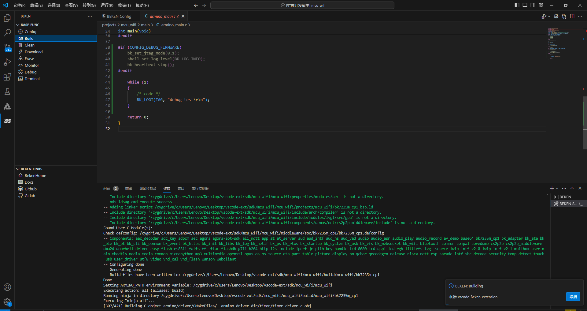

# 编译

点击功能栏`Build`即可对当前`SDK`工程进行编译,
编译完成后右下角会给出提示。

> 注: 编译过程中可点击右下角`取消`按钮取消当前编译操作。

build\_0

## 模块导航

- [文档](../../vscode_beken_ext.md)
- [简介](../vscode_ext_guide.md)
- [安装](../vscode_ext_install.md)
- [使用说明](../vscode_ext_usage.md)
- [配置](config.md)
- [烧录](download.md)
- [清除](clean.md)
- [擦除](erase.md)
- [串口监视器](monitor.md)
- [调试](debug.md)
- [终端](terminal.md)
- [常见问题](../vscode_ext_qa.md)
- [版本历史](../vscode_ext_history.md)
