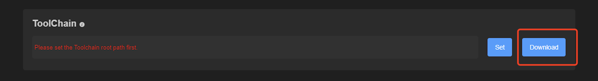
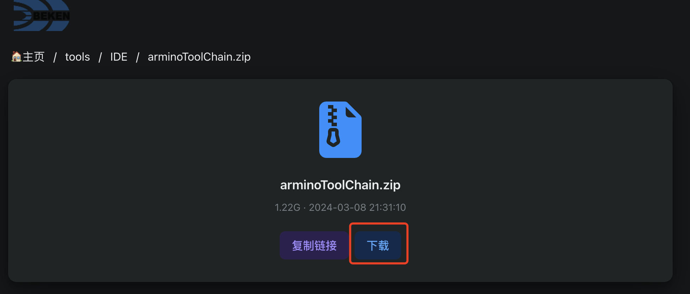
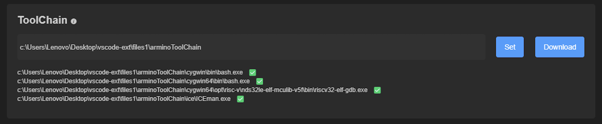
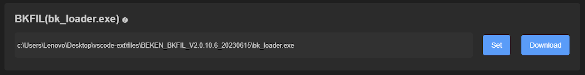
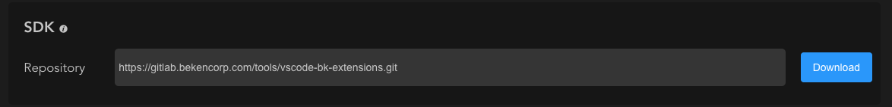
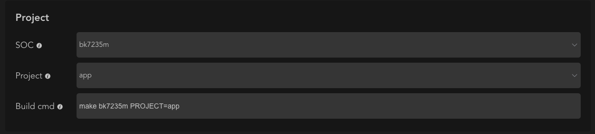
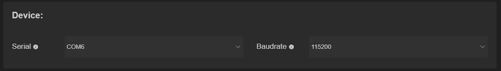

# 配置

插件安装完成后，点击侧边栏BEKEN图标，即可开始使用插件。

插件使用之前请先按照说明进行相应的配置。

点击BEKEN图标进入插件，选择`BASE-FUNC` -\> `Config`
进入插件配置页面，如下图：

初始

## 环境配置

环境配置主要是配置插件功能所需要的各种工具路径。

### Toolchain

1. 点击`ToolChain`配置中的`Download`，跳转到`ToolChain`下载链接，进行下载

toolchain\_download

toolchain\_download2

2. 下载完成以后，对`arminoToolChain.zip`进行解压，点击`ToolChain`配置中的`Set`选择解压后的`arminoToolChain`目录即可，插件会对ToolChain中相关的工具进行检测并显示出检测结果，检测结果没有错误即说明`ToolChain`配置成功!

toolchain\_download4

> 注: ToolChain配置属于全局配置，所有beken工程共享同一个配置。

### BKFIL

1. 点击`BKFIL`配置中的`Download`，跳转到`BKFIL`下载链接，选择需要的`BKFIL`版本，点击页面中的`下载`按钮，即可进行下载
2. 下载完成以后，对下载后的.zip文件进行解压，点击`BKFIL`配置中的`Set`选择解压后的`bk_loader.exe`文件即可。

   
   

   bkfil\_download

> 注: BKFIL配置属于全局配置，所有beken工程共享同一个配置。

## 工程配置

环境配置完成以后，即可进行工程配置。

### SDK

1. `SDK`配置中提供默认的`gitlab`仓库地址，也可点击输入框进行编辑，自定义`git`仓库地址。点击`Download`按钮进行下载。

   
   

   sdk\_download\_0
2. 下载时需要输入`gitlab`用户名、密码，然后选择需要下载的`tag`进行下载即可，插件会打开vscode终端，进行下载。

### Project

`SDK`下载完成以后，即可在VSCode中打开项目，Project会读取当前项目中的数据。

project\_config

#### soc

soc读取路径: `根目录/middleware/soc`

#### Project

project路径读取: 根目录/projects

#### Build cmd

`Build cmd`配置提供默认的`Build`命令，也可以点击输入框进行编辑，自定义`Build`命令。

### Device

device

#### Serial

烧录:raw-latex:擦除时所用的板卡Uart口

#### Baudrate

烧录:raw-latex:擦除时所用的波特率
