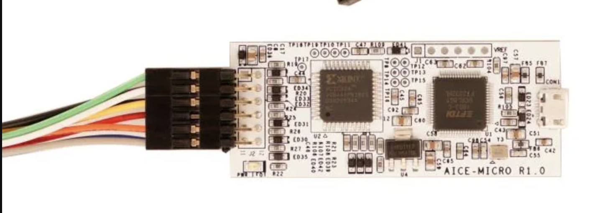
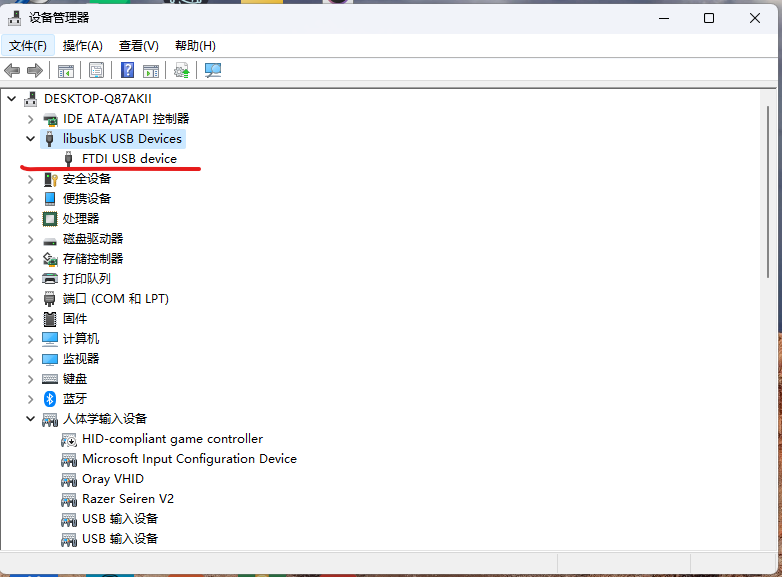
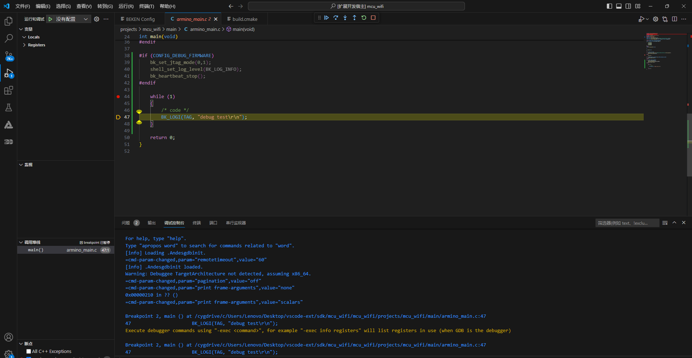

<a id="id1"></a>

# 调试

备注

单步调试工具购买链接:

[https://www.mouser.cn/ProductDetail/Andes-Technology/AICE-MICRO?qs\=%2Fha2pyFadujWNb1PWQCwfhOePVtsbeXUj03dp%252BBl%252Bs80iFs0K%252B0LQQ\=\=](https://www.mouser.cn/ProductDetail/Andes-Technology/AICE-MICRO)

1. 硬件调试器连接

<a id="id2"></a>



andes

调试器和bk7235m连接说明:

```
7# VTref  ---- 3.3V
4# TMS    ---- RX
6# TCK    ---- TX
3# GND    ---- GND
```

2. 安装驱动

   驱动位置: arminoToolChain/ice/libusb-AICE-driver/Install\_driver.exe

   双击安装驱动以后，设备管理器中即可看到驱动程序:

<a id="id3"></a>



driver

3. 软件设置DEBUG模式

   修改`armino_main.c`:

   ```
   #if (CONFIG_DEBUG_FIRMWARE)
    //设置调试模式
    //第一个参数: 0代表cpu0  , 1代表cpu1
    //第二个参数: 0代表group1 , 1代表group2
    bk_set_jtag_mode(0,1);  s
    //关闭心跳，调试cpu1时需要
    bk_heartbeat_stop();
   #endif
   ```

> 注: 开启调试模式时，Uart2不可用

4. 进行Build和烧录。
5. 点击功能栏`Debug`，选择需要Debug的.elf文件，即可进行调试。

<a id="id4"></a>



debug\_1

## 模块导航

- [文档](../../vscode_beken_ext.md)
- [简介](../vscode_ext_guide.md)
- [安装](../vscode_ext_install.md)
- [使用说明](../vscode_ext_usage.md)
- [配置](config.md)
- [编译](build.md)
- [烧录](download.md)
- [清除](clean.md)
- [擦除](erase.md)
- [串口监视器](monitor.md)
- [终端](terminal.md)
- [常见问题](../vscode_ext_qa.md)
- [版本历史](../vscode_ext_history.md)
