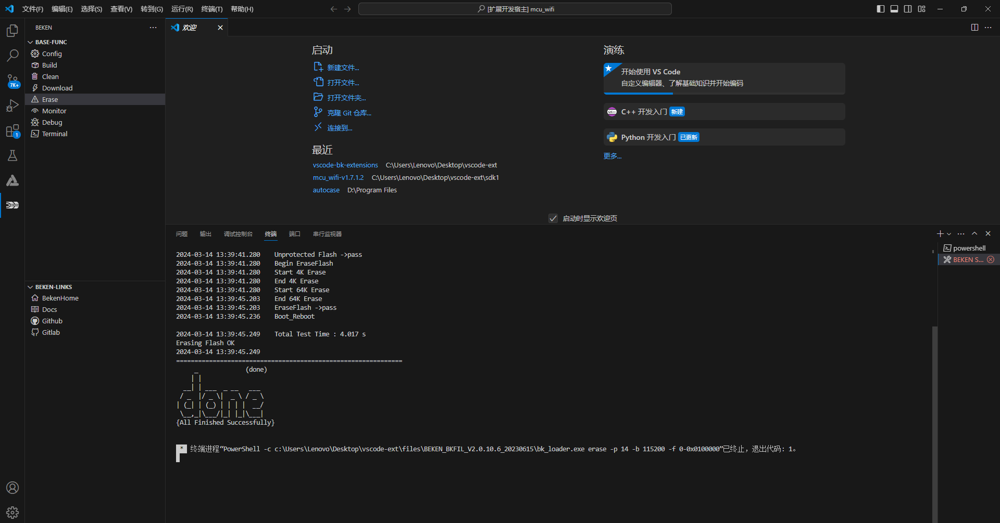

# 擦除

点击功能栏`Erase`，输入擦除地址，即可进行擦除操作。

erase\_done

## 模块导航

- [文档](../../vscode_beken_ext.md)
- [简介](../vscode_ext_guide.md)
- [安装](../vscode_ext_install.md)
- [使用说明](../vscode_ext_usage.md)
- [配置](config.md)
- [编译](build.md)
- [烧录](download.md)
- [清除](clean.md)
- [串口监视器](monitor.md)
- [调试](debug.md)
- [终端](terminal.md)
- [常见问题](../vscode_ext_qa.md)
- [版本历史](../vscode_ext_history.md)
