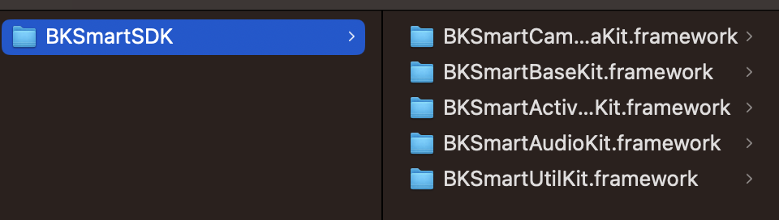
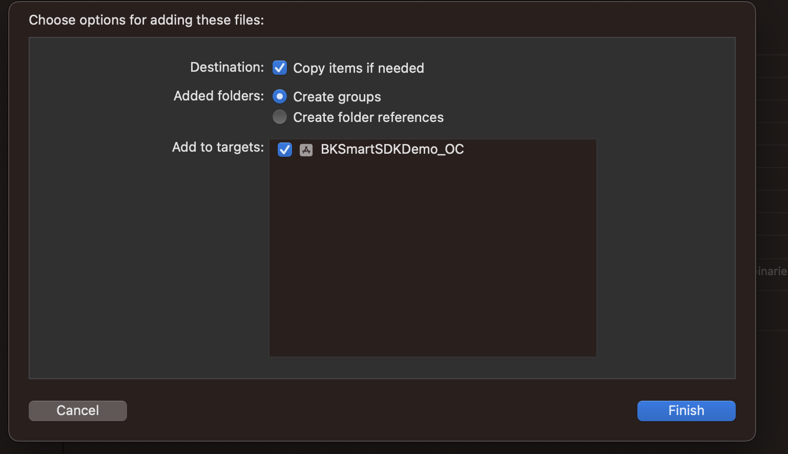
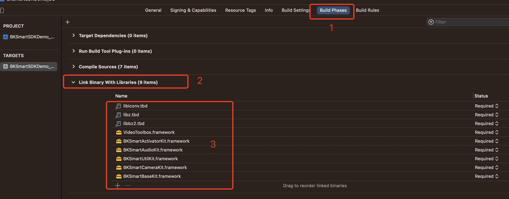
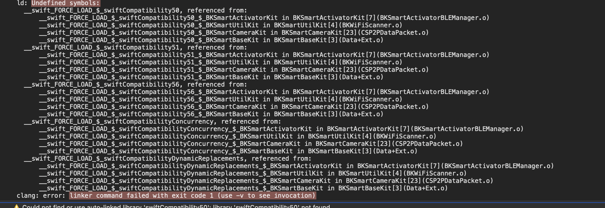
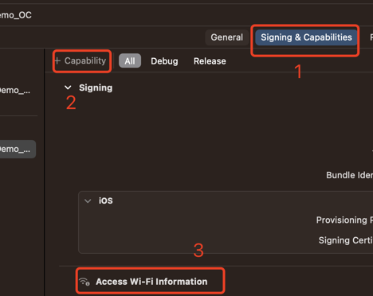

<a id="sdk"></a>

# SDK概述

BKSmartSDK
提供了与远端摄像头设备通讯的接口封装，加速应用开发过程，后面章节统一称为
SDK 。主要包括了以下功能：

- 对设备进行配网
- 获取摄像头实时采集的影像。
- 获取摄像头传来的音频与摄像头设备通话。
- 音频的录制与播放。

**AVDK版本对应:**

| 芯片名称 | 产品类型 | AVDK版本 |
| --- | --- | --- |
| BK7258 | 智能门铃、门锁 | 2.0.1.9\+ |

<a id="id1"></a>

# 开发指南

<a id="id2"></a>

## 快速集成

本文介绍如何将SDK快速集成到您的项目中。SDK 要求 iOS 版本不低于 12.0 ，
**不支持模拟器运行**。

<a id="id3"></a>

### 下载SDK

访问 [Gitlab仓库](https://gitlab.bekencorp.com/armino/app/sdk/smart_sdk/-/tree/release/v2.0.1) 下载SDK即可。

备注

从官网的gitlab下载的为最近的SDK代码，相关账号找项目上审核申请。

<a id="id4"></a>

### 集成

将BKSmartSDK拖入项目中，如下图所示:

<a id="id16"></a>



framework

<a id="id17"></a>



drag\_in

添加依赖库:

- `libz.tbd`
- `libbz2.tbd`
- `libiconv.tbd`
- `VideoToolbox.framework`

如下图所示:

<a id="id18"></a>



dependency

添加配置

Xcode -\> Build Settings -\> Other Linker Flags 添加 -Objc

Xcode \> Build Settings -\> Other C Flags 添加 -DLINUX

至此，BKSmartSDK 已经成功集成，可以开始 使用SDK开发功能了。

备注

由于BKSmartSDK是Objective-C与Swift混编库，如果项目是纯Objective-C开发，集成以后编译可能会报错，需要创建一个Swift文件（空文件即可）在项目中。

<a id="id19"></a>



oc\_error

<a id="id5"></a>

## 设备配网

<a id="id6"></a>

### 版本适配

<a id="ios-13"></a>

#### iOS 13 版本适配

从 iOS 13 版本开始，如果用户没有开启地理位置权限，在已开启 Wi-Fi
权限的前提下， 将获取不到有效的 Wi-Fi SSID 或 BSSID。

<a id="id7"></a>

### 功能说明

**相关类（协议）说明**

| 类名（协议名） | 说明 |
| --- | --- |
| BKSmartWifiTool | wifi工具类 |
| BKSmartActivator | 提供蓝牙配网能力 |
| BKSma rtActivatorDelegate | 配网代 理协议，配网方法的结果反馈都将通过代理方法回调 |
| BKSmartDeviceModel | BK设备 |
| BKSmartP2PLicense | 尚云P2P license信息 |
| BKSmartWifiInfo | wifi信息 |

<a id="id8"></a>

### 配网流程

备注

配网前请在Info.plist中添加蓝牙权限使用说明:`NSBluetoothAlwaysUsageDescription`

**获取当前手机连接SSID**

可通过工具类`BKSmartWifiTool`获取当前手机连接Wiifi的SSID。

导入头文件:`#import <BKSmartUtilKit/BKSmartUtilKit.h>`

```
+ (void)getSSID:(BKSmartWifiToolSSIDCompletionHandler)handler;
```

备注

iOS12以上需要在Capabilities中加入Access WiFi Information权限才能获取Wi-Fi信息。

<a id="id20"></a>



wifi

**监听蓝牙状态**

导入头文件:`#import "BKSmartActivatorKit/BKSmartActivatorKit.h"`

初始化`BKSmartActivator`对象，设置`delegate`即可开始监听状态。

**代理回调**

```
- (void)activator:(BKSmartActivator*)activator didUpdateState:(BOOL)isPowerOn;
```

**扫描设备**

监听状态isPowerOn表示蓝牙状态可用，就可以开始扫描设备了。

**接口说明**

开始扫描设备

```
- (void)startScan;
```

停止扫描设备

```
- (void)stopScan;
```

**代理回调**

扫描到新的设备

```
- (void)activator:(BKSmartActivator*)activator didDiscoverDevice:(BKSmartDeviceModel*)device;
```

**设备配网**

**接口说明**

开始对设备进行配网

```
- (void)activeDevice:(BKSmartDeviceModel*)device p2pConfig:(BKSmartCameraP2PConfig*)p2pConfig;
```

停止配网

```
- (void)stopActiveDevice;
```

**代理回调**

```
//配网进度更新
- (void)activator:(BKSmartActivator*)activator didUpdateActiveProgress:(CGFloat)progress;

//配网进度信息
- (void)activator:(BKSmartActivator*)activator didUpdateActiveInfo:(NSString*)info;

//配网结束: 配网成功error为空，配网失败error不为空。
- (void)activator:(BKSmartActivator*)activator didFinishActiveDevice:(BKSmartDeviceModel*)device
                                 error:(NSError* _Nullable)error;
```

<a id="id9"></a>

### 错误回调

配网过程中如果出现错误，将通过下面接口进行回调，返回对应Error。

```
- (void)activator:(BKSmartActivator*)activator didFinishActiveDevice:(BKSmartDeviceModel*)device
                                 error:(NSError* _Nullable)error;
```

错误码枚举值

| 枚举值 | 值 | 说明 |
| --- | --- | --- |
| BKSmartActivatorErrorBLENotAvailable | 100 | 蓝牙状态不可用（不支持或未开启蓝牙授权等 |
| BKSmartActivatorErrorDeviceNotFound | 101 | 连接时，设备查找失败 |
| BKSmartActivatorErrorDeviceConnectFailed | 102 | 设备连接失败 |
| BKSmartActivatorErrorDeviceDisconnected | 103 | 与设备断开连接 |
| BKSmartActivatorErrorActiveDeviceFailed | 104 | 配网失败 |

<a id="id10"></a>

## 摄像头功能

SDK
提供智能摄像头的实时视频图像获取，摄像头音频数据获取，与摄像头实时通话等基础能力。

**相关类（协议）说明**

| 类名（协议名） | 说明 |
| --- | --- |
| `BKSmartCameraConfig` | 摄像头配置 |
| `BKSmartCamera` | 摄像头 |
| `BKSmartCameraDelegate` | 代理回调 |

导入头文件:`#import <BKSmartCameraKit/BKSmartCameraKit.h>`

<a id="p2p"></a>

### P2P连接

在开始播放视频之前，需要先与设备建立连接。
连接状态需要开发者自己维护，SDK 只负责下发命令和接收摄像机响应结果。

**接口说明**

开始连接p2p通道

```
- (void)connect;
```

断开p2p通道

```
- (void)disconnect;
```

**代理回调**

p2p通道连接成功

```
- (void)cameraDidConnected:(BKSmartCamera*)camera;
```

p2p通道断开连接

```
- (void)cameraDidDisconnected:(BKSmartCamera*)camera;
```

<a id="id11"></a>

### 实时视频

p2p连接成功以后，就可以开始获取实时视频图像数据了。

**接口说明**

开启视频播放

```
- (void)openVideoPreview;
```

开启/关闭视频图像降噪(默认关闭):

```
- (void)denoiseEnable:(BOOL)isEnable;
```

关闭视频播放

```
- (void)closeVideoPreview;
```

**代理回调**

视频播放开启成功

```
- (void)cameraDidOpenVideoPreview:(BKSmartCamera*)camera;
```

视频数据回调

```
//未解包的原始数据
- (void)camera:(BKSmartCamera*)camera didReciveVideoFrameRawData:(NSData*)data;

//解包后的可用数据
- (void)camera:(BKSmartCamera*)camera didReciveVideoFrameUnpackedData:(NSData*)data;

//解包以后的坏数据
- (void)camera:(BKSmartCamera*)camera didReciveVideoFrameUnpackedBadData:(NSData*)data;

//解包以后的数据帧（UIImage），可直接显示
- (void)camera:(BKSmartCamera*)camera didReciveVideoFrame:(BKSmartCameraVideoFrame*)videoFrame;
```

视频播放关闭成功

```
- (void)cameraDidCloseVideoPreview:(BKSmartCamera*)camera;
```

<a id="id12"></a>

### 音频

p2p连接成功以后，就可以开始获取音频数据了。

**接口说明**

开启音频

```
- (void)openAudio;
```

关闭音频

```
- (void)closeAudio;
```

发送对讲录音数据

```
- (void)sendSpeakerData:(NSData*)data;
```

备注

只有在开启音频成功以后，才能发送录音数据

**代理回调**

开启音频成功

```
- (void)cameraDidOpenAudio:(BKSmartCamera*)camera;
```

音频数据回调

```
//收到音频数据 (解码以后的数据)
- (void)camera:(BKSmartCamera*)camera didReciveAudioFrame:(BKSmartCameraAudioFrame*)audioFrame;
//收到音频数据元数据 (未解码的元数据)
- (void)camera:(BKSmartCamera*)camera didReciveAudioFrameRawData:(NSData*)data;
```

关闭音频成功

```
- (void)cameraDidCloseAudio:(BKSmartCamera*)camera;
```

<a id="id13"></a>

### 音频录制与播放

SDK提供了进行音频录制与播放音频的相关功能。在上面音频和对讲打开以后，即可以通过该工具类进行音音频播放和录制。

**相关类（协议）说明**

**接口说明**

| 类名（协议名） | 说明 |
| --- | --- |
| BKSmartAudioIOManager | 音频管理类 |
| BKSmartAudioIOManagerDelegate | 代理类 |

导入头文件:`#import <BKSmartAudioKit/BKSmartAudioKit.h>`

音频播放

**接口说明**

```
//开启音频播放
- (void)startPlay;

//播放音频数据
- (void)play:(NSData*)data;

//关闭音频播放
- (void)stopPlay;
```

音频录制

备注

音频录制需要在Info.plist中添加麦克风权限使用说明:`NSMicrophoneUsageDescription`

**接口说明**

```
//开启音频录制
- (void)startRecord;

//设置AEC状态
- (void)setRecordAECEnable:(BOOL)enable;

//停止音频录制
- (void)stopRecord;
```

**代理回调**

接收录制的音频数据，拿到数据以后即可进行发送。

```
- (void)audioIOManager:(BKSmartAudioIOManager*)manager didRecord:(NSData*)data;
```

<a id="lcd"></a>

### LCD控制

p2p连接成功以后，就可以控制LCD了。

打开LCD

```
- (void)openLCD;
```

关闭LCD

```
- (void)closeLCD;
```

**代理回调**

打开LCD成功

```
- (void)cameraDidOpenLCD:(BKSmartCamera*)camera;
```

关闭LCD成功

```
- (void)cameraDidCloseLCD:(BKSmartCamera*)camera;
```

<a id="id14"></a>

<a id="id15"></a>

### 错误回调

摄像头操作的所有错误反馈都将通过代理方法回调。

**接口说明**

摄像头操作失败回调

```
- (void)camera:(BKSmartCamera*)camera didOccuredError:(NSError*)error whenAction:(BKSmartCameraAction)action;
```

错误码枚举值:

| 枚举值 | 值 | 说明 |
| --- | --- | --- |
| BKSmartCameraErrorP2PLicenseInvalid | 200 | 尚云license无效 |
| BKSmartCameraErrorP2PConnectFailed | 201 | 尚云P2P连接失败 |
| BKSmartCameraErrorP2PDisconnected | 202 | 尚云P2P断开连接 |
| BKSmartCameraErrorOpenVideoFailed | 300 | 开启实时视频失败 |
| BKSmartCameraErrorCloseVideoFailed | 301 | 关闭实时视频失败 |
| BKSmartCameraErrorOpenAudioFailed | 400 | 开启音频失败 |
| BKSmartCameraErrorCloseAudioFailed | 401 | 关闭音频失败 |
| BKSmartCameraErrorOpenLCDFailed | 500 | 打开LCD失败 |
| BKSmartCameraErrorCloseLCDFailed | 501 | 关闭LCD失败 |
