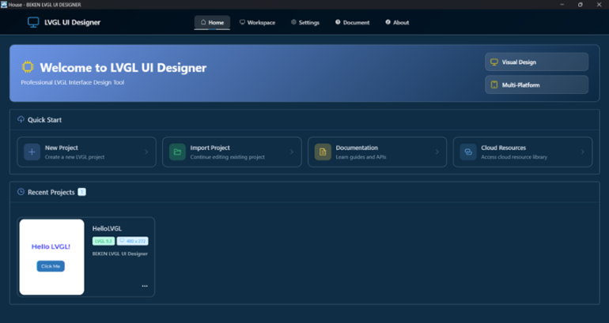
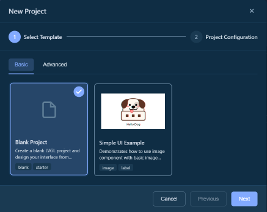
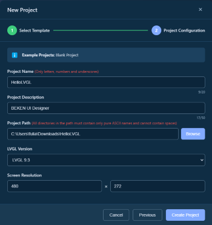
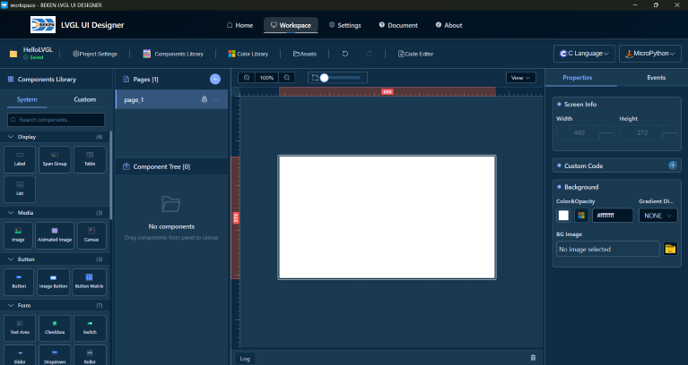
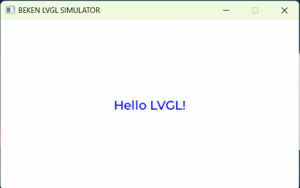

# 快速开始

本指南将帮助您快速上手BEKEN LVGL UI Designer，在 5 分钟内创建您的第一个 UI 项目。

## 🎯 创建第一个项目

### 步骤 1：启动应用

首次启动BEKEN LVGL UI Designer 后，您会看到首页界面，包含以下选项：
\- **新建项目** \- 创建新的 UI 项目
\- **导入项目** \- 导入现有项目
\- **最近项目** \- 快速打开最近使用的项目

### 步骤 2：创建新项目

1. 点击 **"新建项目"** 按钮
2. 在弹出的对话框中选择项目模板：
3. **空白项目** \- 从零开始设计
4. **示例模板** \- 使用预设的示例项目

1. 配置项目信息：
2. **项目名称**：为您的项目命名(项目名称只能包含：数字，字母，下划线)
3. **保存位置**：选择项目保存的文件夹
4. **屏幕尺寸**：设置目标设备的屏幕分辨率（例如：480x272）

1. 点击 **"创建"** 按钮

### 步骤 3：认识工作台

创建项目后，您将进入工作台界面，主要包含 5 个区域：

- **工具栏**：项目信息、保存、撤销/重做、预览等功能
- **组件库**：所有可用的 UI 组件（按钮、标签等）
- **画布**：可视化设计区域，拖拽组件到这里
- **组件树**：显示页面和组件的层级结构
- **属性面板**：编辑选中组件的属性和样式

## 🎨 设计第一个界面

### 添加标签

1. 在 **组件库** 拖拽 **"Label"** 到画布中
2. 在 **属性面板** 找到 **"Text"** 属性
3. 输入文本：`Hello LVGL!`
4. 调整字体大小和颜色：
5. 选择 **"字体"** 分组
6. 设置 **字号** 为 24
7. 设置 **颜色** 为蓝色
8. 调整位置和大小：
9. 在 **画布** 中选中标签，拖拽调整位置
10. 拖拽边缘控制点调整大小
11. 或在 **属性面板** 中精确输入数值

## 💾 保存项目

- 项目会自动保存（查看工具栏的保存状态指示）
- 或按 `Ctrl + S` 手动保存

## 📄 预览并生成代码

### 预览界面

1. 点击工具栏 **「C语言」** 或 **「MicroPython」** 按钮
2. 在下拉菜单中选择操作：
3. **C 语言** \- 适用于标准 LVGL 项目，可选择 **生成代码\+编译\+运行** 等操作
4. **MicroPython** \- 适用于 MicroPython 环境，可选择 **生成代码\+运行** 等操作
5. 执行过程中会自动打开底部 **日志** 面板，显示生成、编译与运行的输出信息
6. 选择 **运行** 或上述组合操作后，可查看界面预览效果
7. 生成的代码保存在项目目录下

---

**相关文档**：[返回文档首页](index.md) \| [工作台使用指南](workspace.md) \| [常见问题](faq.md)
