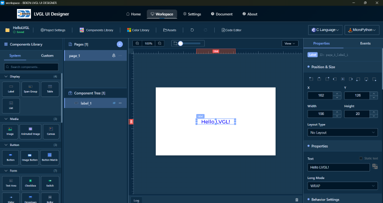

# BEKEN LVGL UI Designer 使用文档

欢迎使用 **BEKEN LVGL UI Designer**！这是一款专业的 LVGL 图形界面可视化设计工具，帮助您快速设计和开发嵌入式设备的用户界面。

## 🎯 核心功能

### 可视化设计

- 拖拽式组件设计
- 实时预览
- 网格和参考线辅助

### 丰富的组件库

- 30\+ 种 LVGL 组件
- 按钮、输入框、滑块等常用控件
- 图表、仪表盘等高级组件
- 自定义组件支持

### 强大的样式系统

- 完整的 LVGL 样式属性支持
- 多状态样式编辑
- 样式库保存和复用

### 项目管理

- 多项目管理
- 项目导入导出
- 示例模板

---

## 📚 文档导航

- **[软件下载](download.md)** \- 下载安装包和安装说明
- **[快速开始](getting-started.md)** \- 5分钟快速上手指南
- **[工作台使用](workspace.md)** \- 详细的工作台功能介绍
- **[待完成功能](roadmap.md)** \- 开发路线图和即将推出的功能
- **[版本更新](release-notes.md)** \- 查看版本更新日志
- **[常见问题](faq.md)** \- 常见问题解答

## 模块导航

- [软件下载](download.md)
- [快速开始](getting-started.md)
- [总览](workspace.md)
- [画布区域](workspace-canvas.md)
- [组件库](workspace-components.md)
- [组件树](workspace-tree.md)
- [属性面板](workspace-properties.md)
- [事件系统](workspace-events.md)
- [AI 设计](workspace-ai-design.md)
- [多语言功能](workspace-i18n.md)
- [自定义代码](workspace-custom-code.md)
- [自定义字符](workspace-custom_character.md)
- [工具栏](workspace-toolbar.md)
- [快捷键](workspace-shortcuts.md)
- [常见问题](faq.md)
- [版本更新](release-notes.md)
