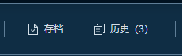
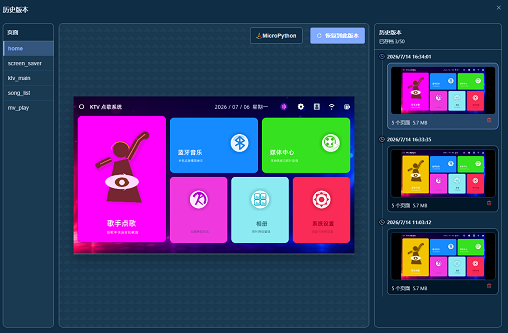

# 存档与历史

存档用于保存当前项目状态，历史用于查看或恢复已保存的版本。

## 功能入口

在工作台顶部工具栏中，可以看到 **存档** 和 **历史（数量）** 两个按钮。

- 点击 **存档**：保存一个历史版本。
- 点击 **历史（数量）**：打开历史弹窗，查看已保存的版本。

## 创建存档

点击工具栏中的 **存档** 按钮即可保存当前项目。

## 查看历史

点击工具栏中的 **历史（数量）** 按钮打开历史弹窗。

右侧列表会按时间显示已保存的历史版本。点击任意版本后，中间区域会显示该版本的预览，左侧可以切换页面。

## 预览页面

选择历史版本后，可以在左侧页面列表中切换页面，中间预览区会显示对应页面效果。

## 运行 MicroPython 预览

选择历史版本后，点击预览区右上角的 **MicroPython** 按钮，可以基于该历史版本运行 MicroPython 预览。

## 恢复历史版本

1. 选择一个历史版本
2. 点击 **恢复到此版本**
3. 在确认弹窗中点击确认

恢复后，当前项目会被所选历史版本覆盖。

## 删除历史版本

在历史版本卡片右下角点击删除图标，可以删除该历史版本。

## 数量上限

每个项目最多保存 **50** 个历史版本。达到上限后，需要先删除旧版本，再创建新的存档。

---

**工作台文档**：[← 返回工作台](workspace.md) \| [工具栏](workspace-toolbar.md) \| [AI设计](workspace-ai-design.md)

## 模块导航

- [首页](index.md)
- [软件下载](download.md)
- [快速开始](getting-started.md)
- [总览](workspace.md)
- [画布区域](workspace-canvas.md)
- [组件库](workspace-components.md)
- [组件树](workspace-tree.md)
- [属性面板](workspace-properties.md)
- [事件系统](workspace-events.md)
- [AI 设计](workspace-ai-design.md)
- [多语言功能](workspace-i18n.md)
- [自定义代码](workspace-custom-code.md)
- [自定义字符](workspace-custom_character.md)
- [工具栏](workspace-toolbar.md)
- [快捷键](workspace-shortcuts.md)
- [常见问题](faq.md)
- [版本更新](release-notes.md)
