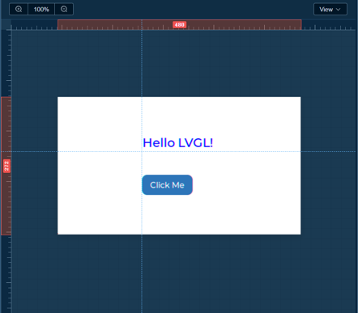
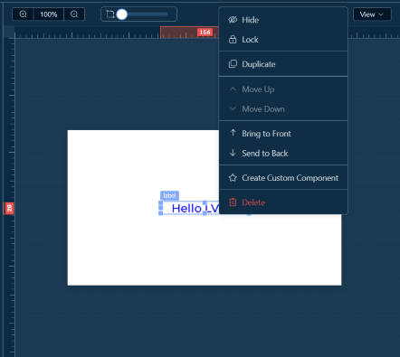

# 🎨 画布区域

画布是可视化设计的核心区域，在这里您可以直观地设计 UI 界面。

### 1.1 画布基础操作

#### 视图控制

**缩放画布**
\- 滚动鼠标滚轮：缩放画布（50% \- 200%）
\- `Ctrl + 滚轮`：更精细的缩放控制
\- 点击缩放比例按钮：重置视图到 100%

**平移画布**
\- 按住鼠标左键拖拽：移动画布视图
\- 点击缩放比例按钮：回到画布中心

**网格显示**
\- 点击画布工具栏 "视图/显示网格" 按钮：切换网格显示

### 1.2 标尺和参考线

#### 标尺系统

- 画布顶部和左侧显示标尺
- 标尺刻度随画布缩放自动调整

#### 参考线功能

**创建参考线**
\- 双击画布区域自动创建参考线
\- 从标尺拖拽创建参考线（水平/垂直）

**调整参考线**
\- 点击并拖拽参考线可移动位置
\- 拖拽参考线到标尺外删除

**参考线管理**
\- 工具栏 "显示参考线" 按钮：显示/隐藏所有参考线
\- 工具栏 "清除参考线" 按钮：删除所有参考线

### 1.3 组件操作

#### 添加组件

1. 从左侧组件库选择组件
2. 拖拽到画布中
3. 松开鼠标完成添加

#### 选择组件

- **单选**：点击画布中的组件
- **快速选择**：在组件树中点击对应组件

#### 移动组件

- **自由移动**：拖拽组件到目标位置
- **数值输入**：在属性面板中输入精确坐标

#### 调整大小

- **拖拽调整**：拖拽组件四角的控制点调整大小
- **等比缩放**：按住 `Shift` 拖拽保等比例缩放
- **精确设置**：在属性面板中输入宽度和高度数值

#### 复制和粘贴

- `Ctrl + C`：复制选中的组件
- `Ctrl + V`：粘贴组件
- 右键菜单：选择 "复制"
- 在组件树组件操作菜单中进行"复制"

#### 删除组件

- 选中组件后按 `Delete` 键
- 右键菜单选择 "删除"
- 在组件树中操作菜单中删除

#### 组件操作

- 选择组件后右键弹出操作菜单

- 组件树中点击组件右边更多操作按钮弹出菜单

### 1.4 组件对齐

选中组件进行拖动时，会显示与其他组件水平/垂直的对齐线

### 1.5 组件层级

**调整层级**（在组件树或右键菜单中）
\- **置于顶层**：将组件移到最上层
\- **置于底层**：将组件移到最下层

**层级规则**
\- 后添加的组件默认在上层
\- 子组件始终在父组件之上
\- 选中组件会显示选择框

### 1.6 组件锁定和隐藏

**锁定组件**
\- 右键选择 "锁定" 或在组件树中点击锁图标
\- 锁定后无法选择和编辑，防止误操作
\- 再次点击解锁

**隐藏组件**
\- 右键选择 "隐藏" 或在组件树中点击眼睛图标
\- 隐藏后组件不可见，但仍存在于组件树中
\- 再次点击显示

---

**工作台文档**：[← 返回工作台](workspace.md) \| [画布](workspace-canvas.md) \| [组件库](workspace-components.md) \| [组件树](workspace-tree.md) \| [属性面板](workspace-properties.md) \| [事件系统](workspace-events.md) \| [AI设计](workspace-ai-design.md) \| [工具栏](workspace-toolbar.md) \| [快捷键](workspace-shortcuts.md)
