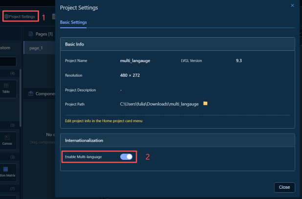
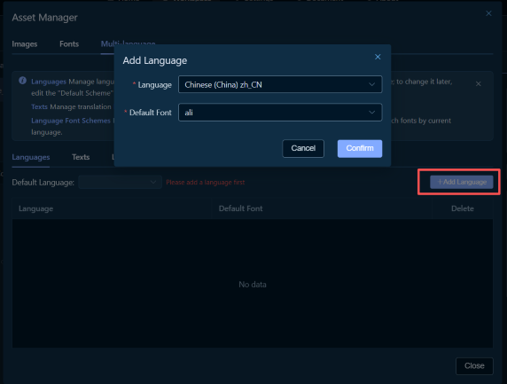
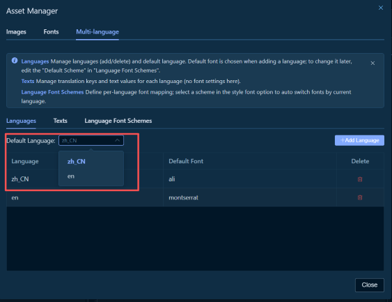
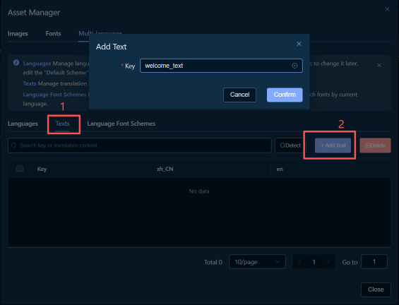
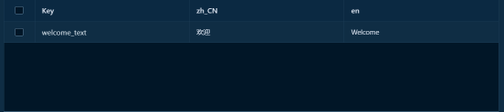
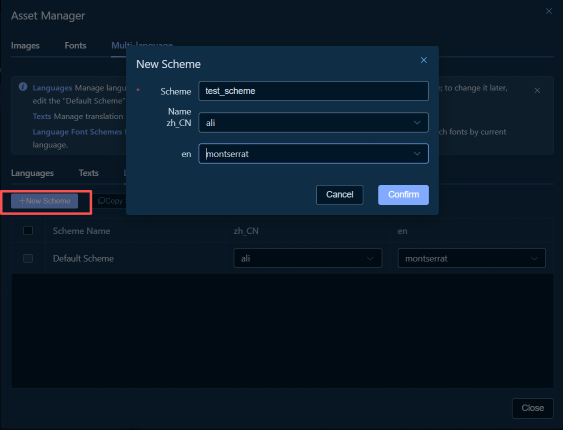
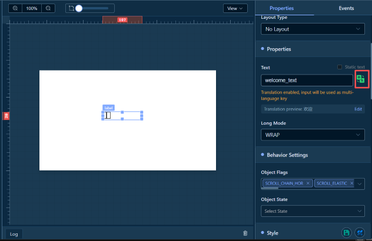
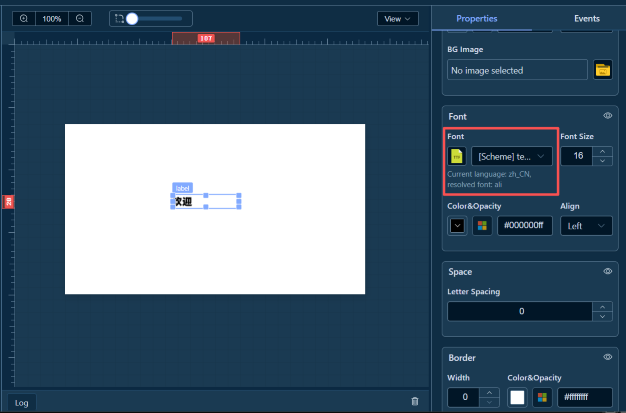
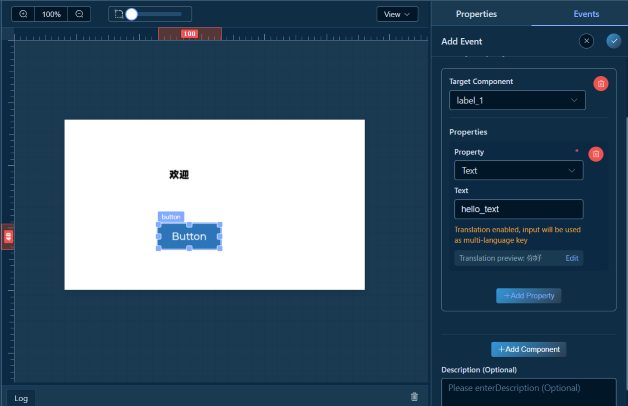
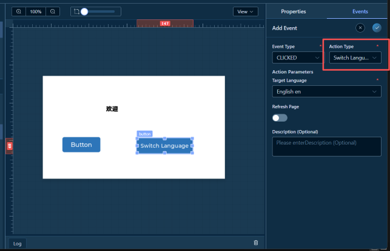

# 🌍 多语言功能

多语言功能允许您为项目配置多种语言支持，实现界面文本的国际化。通过多语言功能，您可以为不同语言提供不同的文本内容和字体方案。

## 📍 访问多语言配置

多语言配置位于**资源管理器**的"多语言"标签页中：

1. 在工具栏中，点击 **"资源管理"** 按钮
2. 在资源管理器对话框中，点击 **"多语言"** 标签页
3. 即可看到多语言配置界面

> **注意**：使用多语言功能前，需要先在项目设置中开启多语言功能。

---

## 🚀 快速开始

### 步骤 1：在项目设置中开启多语言

1. 在工具栏中，点击 **"项目设置"**
2. 在项目设置对话框中，找到 **"国际化"** 分组
3. 开启 **"启用多国语言"** 开关

> **提示**：开启多语言后，资源管理器中的"多语言"标签页才会显示配置界面。

---

## 📚 多语言配置

多语言配置包含三个主要部分：

### 1\. 语言管理

用于管理项目支持的语言列表和默认语言设置。

#### 添加语言

1. 在"语言"标签页中，点击 **"添加语言"** 按钮
2. 在添加语言对话框中：
3. **语言代码**：选择或输入语言代码（如 `zh_CN`、`en_US`）
4. **默认字体**：选择该语言的默认字体
5. 点击 **"确认"** 按钮添加语言

> **提示**：
> \- 首次添加语言时，系统会自动将其设置为默认语言

#### 设置默认语言

1. 在"语言"标签页中，找到 **"默认语言"** 下拉框
2. 从下拉列表中选择要设置为默认的语言

---

### 2\. 文案翻译

用于管理所有需要翻译的文本内容和各语言的翻译。

#### 添加翻译 Key

1. 在"文案翻译"标签页中，点击 **"添加文本"** 按钮
2. 在添加文本对话框中，输入翻译 Key（如 `welcome_text`、`button_ok`）
3. 点击 **"确认"** 按钮添加
4. 在多语言表中，为Key增加对应语言下的翻译

> **提示**：
> \- 翻译 Key 应该使用有意义的名称，便于后续维护
> \- 建议使用下划线命名（如 `welcome_text`、`button_ok`）

---

### 3\. 语言字体方案

用于管理不同语言对应的字体方案，实现按语言自动切换字体。

#### 添加字体方案

1. 在"语言字体方案"标签页中，点击 **"新建方案"** 按钮
2. 在添加方案对话框中，输入方案名称
3. 点击 **"确认"** 按钮添加方案

> **提示**：
> \- 方案名称只能包含字母、数字、下划线
> \- 方案名称不能与字体名称相同

#### 配置语言字体映射

1. 在字体方案列表中，找到要配置的方案
2. 在对应语言列的下拉框中，选择该语言使用的字体

---

## 🎨 在项目中使用多语言

### 示例 1：为 Label 组件的文本启用翻译

#### 步骤 1：添加 Label 组件

1. 在组件库中，找到 **"Label"** 组件
2. 将 Label 组件拖拽到画布中
3. 选中 Label 组件

#### 步骤 2：开启文本翻译

1. 在属性面板中，找到 **"属性"** 标签页
2. 展开 **"属性"** 分组，找到 **"Text"** 属性
3. 在 Text 属性输入框右侧，点击 **"启用翻译"** 按钮
4. 输入翻译 Key（如 `welcome_text`）

> **提示**：
> \- 启用翻译后，输入的内容将作为多语言的 Key
> \- 如果 Key 不存在，系统会提示您添加翻译

#### 步骤 3：选择字体方案

1. 在属性面板中， **"样式"** 中
2. 展开 **"字体"** 样式分组
3. 在 **"字体"** 属性中，选择要使用的字体方案

> **提示**：
> \- 选择字体方案后，字体会根据当前语言自动切换
> \- 如果不选择方案，将使用默认字体

---

### 示例 2：为 Button 组件的事件动作启用多语言

#### 步骤 1：添加 Button 组件

1. 在组件库中，找到 **"Button"** 组件
2. 将 Button 组件拖拽到画布中
3. 选中 Button 组件

#### 步骤 2：添加点击事件

1. 在属性面板中，切换到 **"事件"** 标签页
2. 点击 **"添加事件"** 按钮
3. 选择事件类型：**"LV\_EVENT\_CLICKED"**
4. 选择动作类型：**"修改属性"**

#### 步骤 3：配置修改属性动作

1. 在动作参数配置中：
2. **目标组件**：选择要修改的组件（如之前添加的 Label 组件）
3. 点击 **"添加属性"** 按钮
4. 选择要修改的属性：**"Text"**
5. 输入翻译 Key（如 `hello_text`）

#### 步骤 4：添加翻译内容

1. 如果 Key 不存在，按照示例 1 的步骤 2 添加翻译内容
2. 为不同语言设置不同的翻译文本

### 示例 3：切换语言事件

切换语言事件允许用户通过点击按钮或其他交互方式，动态切换项目的显示语言。

#### 步骤 1：添加 Button 组件

1. 在组件库中，找到 **"Button"** 组件
2. 将 Button 组件拖拽到画布中
3. 选中 Button 组件

#### 步骤 2：添加点击事件

1. 在属性面板中，切换到 **"事件"** 标签页
2. 点击 **"添加事件"** 按钮
3. 选择事件类型：**"LV\_EVENT\_CLICKED"**
4. 选择动作类型：**"切换语言"**

> **注意**：只有在项目设置中开启了多语言功能后，"切换语言"动作类型才会显示在动作列表中。

#### 步骤 3：配置切换语言参数

1. 在动作参数配置中：
2. **目标语言**：从下拉列表中选择要切换到的语言（如 `zh_CN`、`en_US`）
3. **刷新页面**：选择切换语言后是否刷新页面
   - 开启：切换语言后会刷新当前页面，立即显示新语言的文本
   - 关闭：切换语言后不刷新页面，文本会在下次更新时切换

> **提示**：
> \- 目标语言列表来自您在"语言管理"中添加的语言
> \- 如果项目中没有添加语言，目标语言列表将为空
> \- 建议开启"刷新页面"选项，以便用户立即看到语言切换效果

#### 步骤 4：测试切换语言功能

1. 保存项目并运行预览
2. 点击配置了切换语言事件的按钮
3. 观察界面文本是否已切换到目标语言

> **提示**：
> \- 切换语言后，所有使用翻译 Key 的组件文本都会自动更新
> \- 如果组件使用了字体方案，字体也会根据新语言自动切换
> \- 可以在画布中查看切换语言事件的连线，它指向语言块（显示在画布右上角）

---

## 💡 使用技巧

### 1\. 翻译 Key 命名规范

建议使用有意义的命名规范，便于维护：

- **页面级文本**：`page_welcome`、`page_settings`
- **按钮文本**：`button_ok`、`button_cancel`、`button_save`
- **标签文本**：`label_username`、`label_password`
- **提示文本**：`tip_loading`、`tip_success`、`tip_error`

### 2\. 字体方案管理

- **默认方案**：用于设置各语言的默认字体
- **自定义方案**：用于特殊场景的字体配置

### 3\. 翻译预览

在属性面板中，启用翻译后可以查看翻译预览：

1. 在属性输入框下方，会显示当前语言的翻译预览
2. 如果 Key 不存在或翻译为空，会显示提示信息

### 4\. 批量管理翻译

在"文案翻译"标签页中，可以：

- 使用搜索功能快速查找翻译 Key
- 使用【检测】功能检测未翻译的Key

---

## 🔗 相关功能

- **[属性面板](workspace-properties.md)** \- 在属性面板中启用翻译
- **[事件系统](workspace-events.md)** \- 在事件动作中使用多语言
- **[资源管理器](workspace-toolbar.md)** \- 管理多语言配置
- **[项目设置](workspace-toolbar.md)** \- 开启多语言功能

---

**工作台文档**：[← 返回工作台](workspace.md) \| [画布](workspace-canvas.md) \| [组件库](workspace-components.md) \| [组件树](workspace-tree.md) \| [属性面板](workspace-properties.md) \| [事件系统](workspace-events.md) \| [时间轴动画](workspace-animation.md) \| [AI设计](workspace-ai-design.md) \| [工具栏](workspace-toolbar.md) \| [快捷键](workspace-shortcuts.md)
