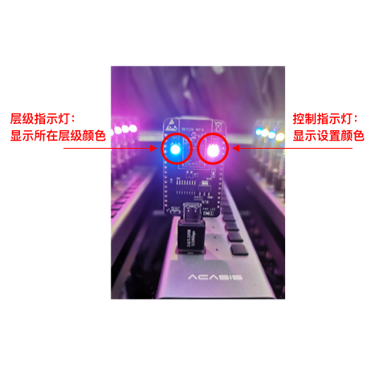

# 3\. 硬件准备

开始使用App之前，需要准备好基于BK7236的LED RGB灯，如下图:

LED

`层级指示灯`: 指示当前设备状态、显示节点所在层级颜色

`控制指示灯`: 指示当前App设置的节点颜色

层级指示灯状态

| 指示灯颜色(闪烁) | 状态 |
| --- | --- |
| 白色 | 空闲节点，进入配网模式，等待配网 |
| 白色（闪烁） | 正在组网中 |
| 层级颜色（闪烁） | 设备异常故障 |

层级指示灯颜色

| 层级 | 颜色 |
| --- | --- |
| 根节点 | 红色 |
| 二层 | 绿色 |
| 三层 | 蓝色 |
| 四层 | 黄色 |
| 五层 | 品红 |
| 六层 | 青色 |

## 模块导航

- [1. 简介](summary.md)
- [2. 下载安装](download.md)
- [4. 新建群组](new_group.md)
- [5. 群组控制](group_control.md)
- [6. 群组拓扑](group_topology.md)
- [7. ota](ota.md)
