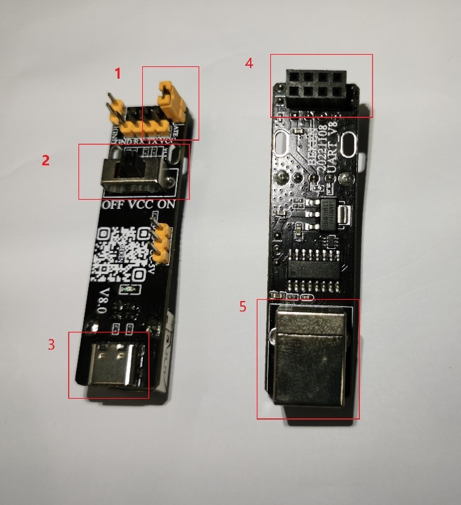
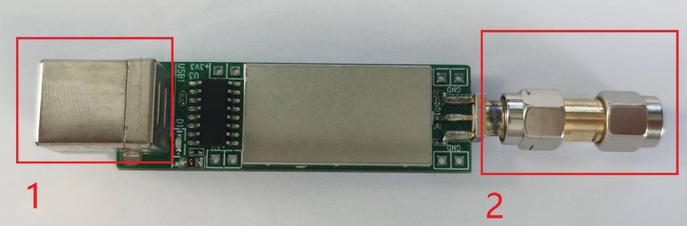
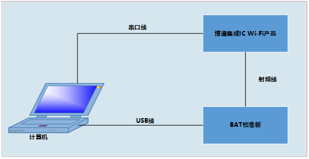
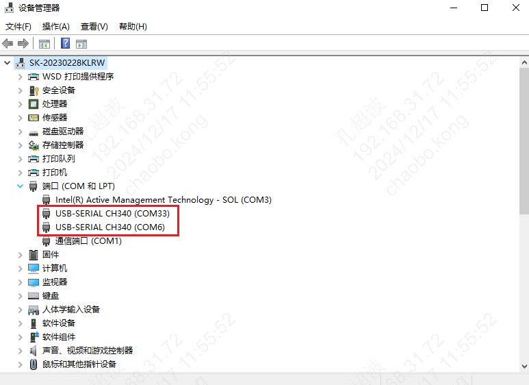
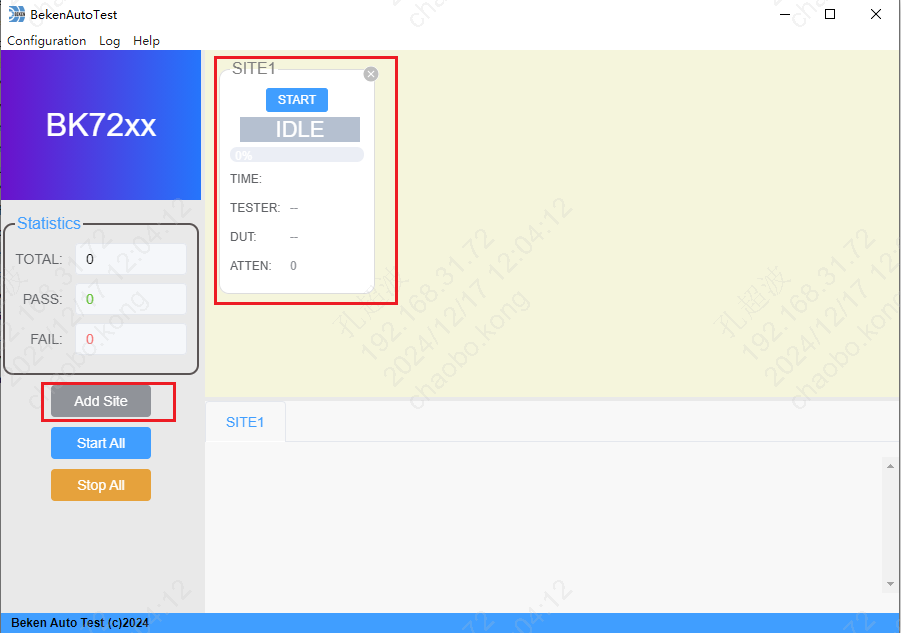
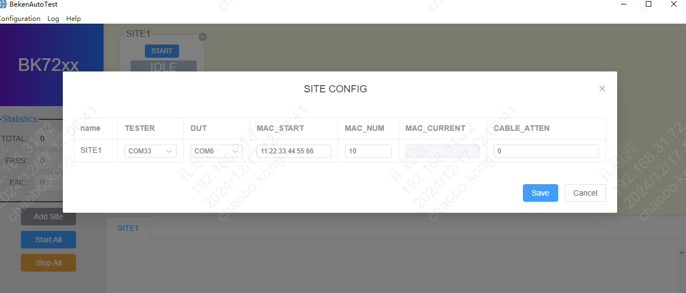
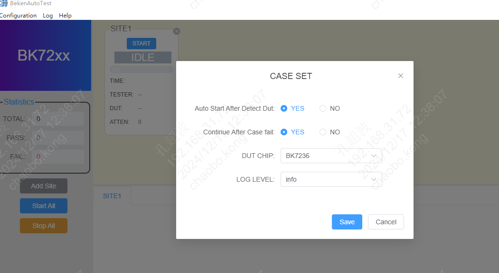
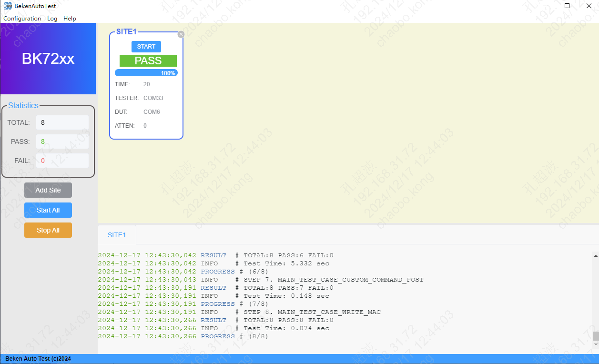

# 快速开始

## 准备硬件

### 串口板

串⼝板主要⽤于 USB 转串⼝。串口板如下图所示，图中标注位置的功能如下:

**位置1**: 需要短接，短接后被测板开机会进入到射频测试模式

**位置2**: 给被测模组供电的开关

**位置3**: 和电脑端USB相连接口

**位置4**: UART连接接口，需要和被测模组的DL UART相连

**位置5**: 和电脑端USB相连接口,功能同位置3

串口板

### 校准板(TESTER)

校准板用于校准被测模组的射频性能。以下简称TESTER。如下图所示，图中标注位置的功能如下:

**位置1**: 和电脑端USB相连接口

**位置2**: 和被测模组SMA头相接接口

校准板

### 被测模组或开发板(DUT)

被测模组或开发板为测试对象，以下简称DUT。如下图所示，图中标注位置的功能如下:

**位置1**: UART接口，用于和串口板\*\*位置4\*\*相连

**位置2**: 射频口，用于和校准板的\*\*位置2\*\*相连

DUT

## 硬件连接

硬件连接示意图如下所示。

硬件连接示意图

### 将串口板、TESTER、DUT相连接

连接后如下图所示。

### 将TESTER和串口板分别连接到电脑的USB口

连接后在设备管理器上可以看到对应的端口，如下图所示

## 软件配置

### 添加测试站点(SITE)

点击”Add Site” 按钮后，在工具窗口的右边会新加一个SITE，如下图所示。

### 配置SITE信息

菜单栏点击 “Configuration” \=\> “SITE” 后，在弹出的SITE配置窗口中配置SITE。

其中包括:

**TESTER**: 串口号选择

**DUT**: 串口号选择

**MAC\_START**: 需要写入DUT的MAC地址

**MAC\_NUM**: 当前SITE需要测试多少块模组。

**MAC\_CURRENT**: 当前测试使用的MAC地址(执行测试时自动生成)

**ATTEN**: 线损值

备注

配置后，首次执行时，MAC\_CURRENT 为 MAC\_START 的值。后面每次执行时，会自动基于MAC\_CURRENT字段的值\+1，如果超出MAC\_START \+ MAC\_NUM 则不再变化

### CASE执行相关配置

菜单栏点击 “Configuration” \=\> “TEST CASE” 后，在弹出窗口中配置。

**Auto Start After Detect Dut**: “YES” 表示连接DUT后会自动开始执行测试

**Continue After Case fail**: “YES” 表示测试过程中其中一条CASE fail后继续执行后面的case

**DUT CHIP**: 选择DUT 芯片名称

**LOG LEVEL**: 选择log等级

## 执行测试

点击”START” 开始执行测试

