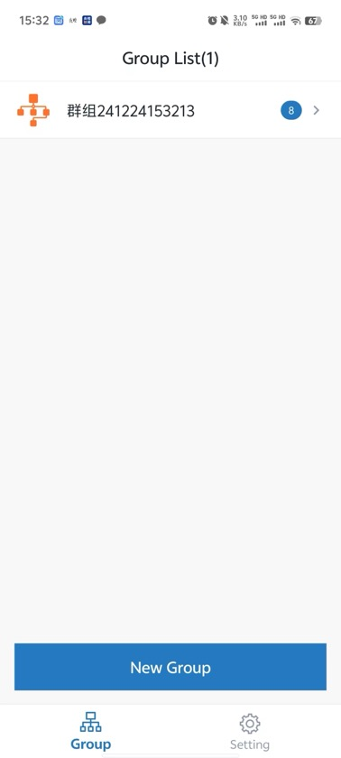
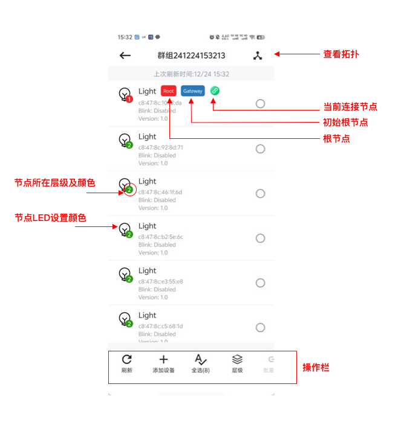

# 5.1. 群组控制概览

群组列表页面会显示当前已创建的所有群组。
点击某个群组进入群组控制页面后，等待群组信息加载成功，即可开始查看群组信息或对群组中的节点进行新增、删除、控制等操作。如下图。

群组列表

群组控制

## 模块导航

- [1. 简介](../summary.md)
- [2. 下载安装](../download.md)
- [3. 硬件准备](../device_prepare.md)
- [4. 新建群组](../new_group.md)
- [5. 群组控制](../group_control.md)
- [5.2. 添加节点](node_add.md)
- [5.3. 灯光控制](light_control.md)
- [5.4. 删除节点](node_delete.md)
- [6. 群组拓扑](../group_topology.md)
- [7. ota](../ota.md)
