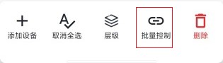
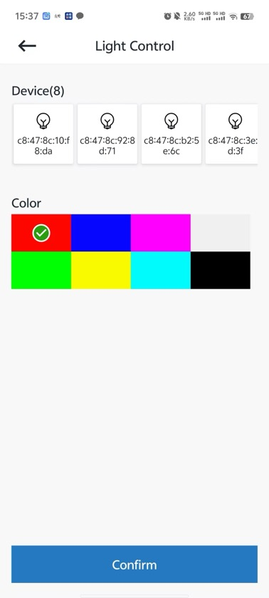

# 5.3. LED控制

在群组页面选择想要控制的节点，在底部的操作视图中，点击 `批量控制` 按钮(如下图)，App会跳转到灯光控制页面。

L灯光控制

在灯光控制页面，选择要设置的灯光颜色后，点击 `Confirm` ，设备的 `控制指示灯` 会修改为设置的颜色。如下图。

LED颜色设置

## 模块导航

- [1. 简介](../summary.md)
- [2. 下载安装](../download.md)
- [3. 硬件准备](../device_prepare.md)
- [4. 新建群组](../new_group.md)
- [5. 群组控制](../group_control.md)
- [5.1. 概览](desc.md)
- [5.2. 添加节点](node_add.md)
- [5.4. 删除节点](node_delete.md)
- [6. 群组拓扑](../group_topology.md)
- [7. ota](../ota.md)
