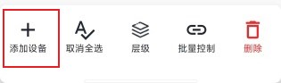
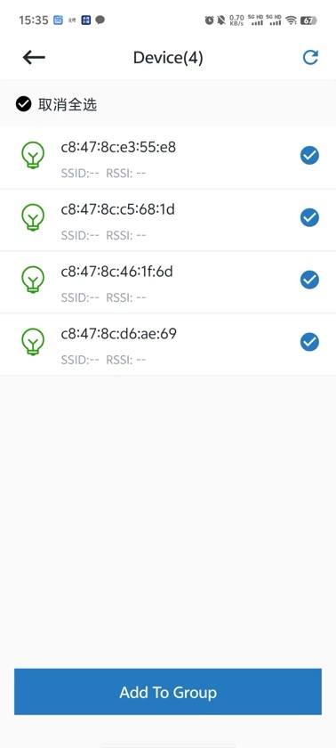

# 5.2. 添加节点

在群组页面底部的操作视图中，点击 `添加节点` 按钮（如下图），App会跳转到空闲节点扫描页面。

添加节点

在扫描结果中，选择需要添加到群组中的节点，点击 `Add To Group` ，选择的节点 `层级指示灯` 将开始闪烁（组网状态）。当全部节点的 `层级指示灯` 停止闪烁并显示对应层级的颜色，表示添加完成。如下图。

空闲节点扫描

## 模块导航

- [1. 简介](../summary.md)
- [2. 下载安装](../download.md)
- [3. 硬件准备](../device_prepare.md)
- [4. 新建群组](../new_group.md)
- [5. 群组控制](../group_control.md)
- [5.1. 概览](desc.md)
- [5.3. 灯光控制](light_control.md)
- [5.4. 删除节点](node_delete.md)
- [6. 群组拓扑](../group_topology.md)
- [7. ota](../ota.md)
