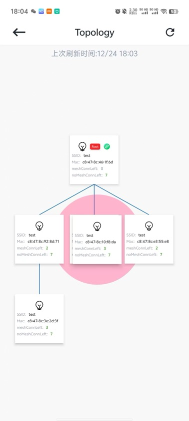

# 6.3. 修改父节点

在群组拓扑图中，选择需要修改父节点的节点（非根节点）。长按该节点以后，可进行拖动。
当该节点拖动到新的父节点以后，底部显示 `粉红色圆圈` ，表示可以修改。放开节点，即可进行修改操作。如下图。

修改父节点

## 模块导航

- [1. 简介](../summary.md)
- [2. 下载安装](../download.md)
- [3. 硬件准备](../device_prepare.md)
- [4. 新建群组](../new_group.md)
- [5. 群组控制](../group_control.md)
- [6. 群组拓扑](../group_topology.md)
- [6.1. 概览](desc.md)
- [6.2. 添加节点](node_add.md)
- [6.4. 灯光控制](light_control.md)
- [6.5. 删除节点](node_delete.md)
- [7. ota](../ota.md)
