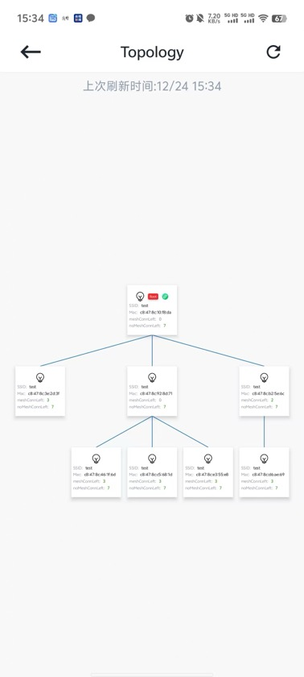

# 6.1. 群组拓扑概览

点击群组控制页面右上角的查看拓扑按钮，将跳转到群组拓扑页面。群组拓扑图可以直观的查看群组节点在群组中的层级以及父子关系， 如下图。

群组拓扑

拓扑结构中同样可以进行节点的添加、删除操作。
此外，拓扑图中还可以修改节点的父节点。

## 模块导航

- [1. 简介](../summary.md)
- [2. 下载安装](../download.md)
- [3. 硬件准备](../device_prepare.md)
- [4. 新建群组](../new_group.md)
- [5. 群组控制](../group_control.md)
- [6. 群组拓扑](../group_topology.md)
- [6.2. 添加节点](node_add.md)
- [6.3. 修改父节点](change.md)
- [6.4. 灯光控制](light_control.md)
- [6.5. 删除节点](node_delete.md)
- [7. ota](../ota.md)
