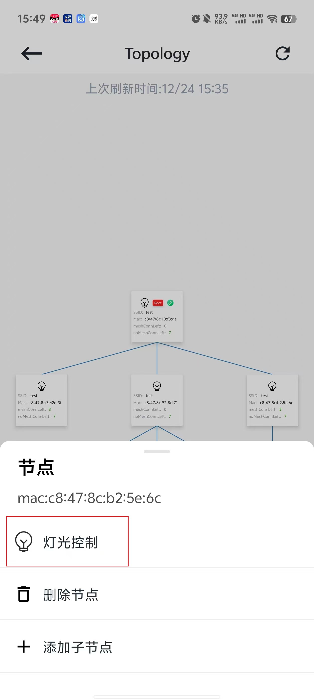

# 6.4. 灯光控制

在拓扑结构中，点击想要控制的节点，在弹出的节点操作弹窗中，选择 `灯光控制` ，App将跳转到灯光控制页面，后续操作同灯光控制,如下图。

灯光控制

## 模块导航

- [1. 简介](../summary.md)
- [2. 下载安装](../download.md)
- [3. 硬件准备](../device_prepare.md)
- [4. 新建群组](../new_group.md)
- [5. 群组控制](../group_control.md)
- [6. 群组拓扑](../group_topology.md)
- [6.1. 概览](desc.md)
- [6.2. 添加节点](node_add.md)
- [6.3. 修改父节点](change.md)
- [6.5. 删除节点](node_delete.md)
- [7. ota](../ota.md)
