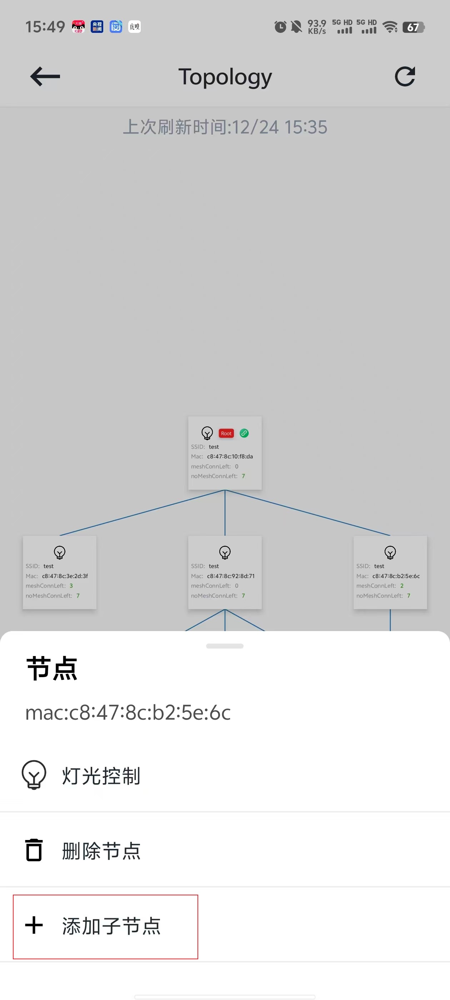

# 6.2. 添加节点

拓扑图每个节点中的meshConnLeft代表该节点剩余的可添加子节点数量。
如果剩余可添加子节点数量不为0，点击该节点，在弹出的节点操作弹窗中，选择 `添加子节点` ，页面将跳转到空闲节点扫描页面。
在空闲节点扫描页面中选择需要添加的节点（选择节点数量不能超过当前节点的剩余连接数），点击确认后，选择的节点将作为目标节点的子节点添加到群组结构中。

添加子节点

## 模块导航

- [1. 简介](../summary.md)
- [2. 下载安装](../download.md)
- [3. 硬件准备](../device_prepare.md)
- [4. 新建群组](../new_group.md)
- [5. 群组控制](../group_control.md)
- [6. 群组拓扑](../group_topology.md)
- [6.1. 概览](desc.md)
- [6.3. 修改父节点](change.md)
- [6.4. 灯光控制](light_control.md)
- [6.5. 删除节点](node_delete.md)
- [7. ota](../ota.md)
