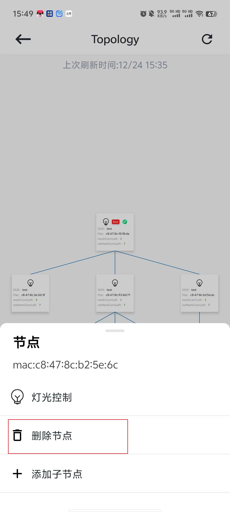

# 6.5. 节点删除

在拓扑结构中，点击想要删除的节点，在弹出的节点操作弹窗中，选择 `删除节点` ，会将该节点从群组中移除。
如果该节点下面有子节点，将进行网络重组，子节点将重新寻找新的父节点。

删除节点

## 模块导航

- [1. 简介](../summary.md)
- [2. 下载安装](../download.md)
- [3. 硬件准备](../device_prepare.md)
- [4. 新建群组](../new_group.md)
- [5. 群组控制](../group_control.md)
- [6. 群组拓扑](../group_topology.md)
- [6.1. 概览](desc.md)
- [6.2. 添加节点](node_add.md)
- [6.3. 修改父节点](change.md)
- [6.4. 灯光控制](light_control.md)
- [7. ota](../ota.md)
