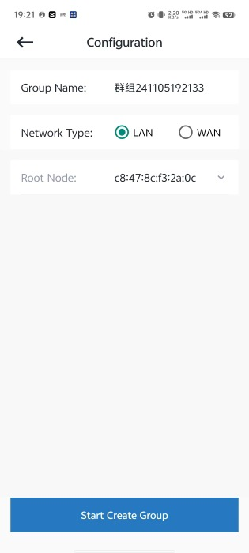
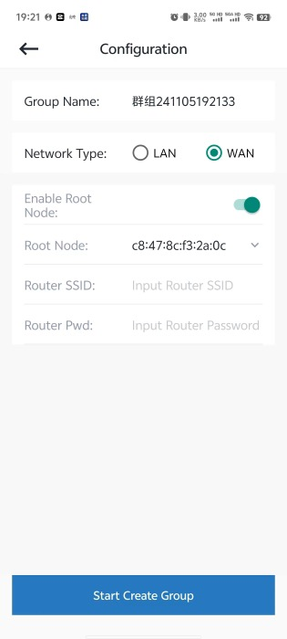

# 4.2. 群组配置

群组配置页面可指定创建群组时的基本配置

`Group Name`: 群组名称 \- 可自定义。

`Network Type` : 网络类型

- LAN: 局域网
- WAN：广域网

`Root Node` ：指定根节点

- LAN 模式下默认开启，用户可切换指定根节点
- WAN 模式下，需要需要先开启 Enable Root Node 后进行指定根节点

`Sap SSID` : Soft AP的名称

`Sap Pwd`: Soft AP的密码

`Max Level`:群组最大层级

`Max Conn Num`：群组中单个节点最大子节点数量

LAN 模式配置如下图。

LAN模式配置

WAN 模式配置如下图。

WAN模式配置

群组配置完成以后，点击页面底部的 `Start Create Group` 按钮，App将跳转到新建页面，开始群组新建流程。

## 模块导航

- [1. 简介](../summary.md)
- [2. 下载安装](../download.md)
- [3. 硬件准备](../device_prepare.md)
- [4. 新建群组](../new_group.md)
- [4.1. 空闲节点扫描](scan.md)
- [4.3. 新建](new.md)
- [5. 群组控制](../group_control.md)
- [6. 群组拓扑](../group_topology.md)
- [7. ota](../ota.md)
