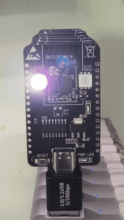
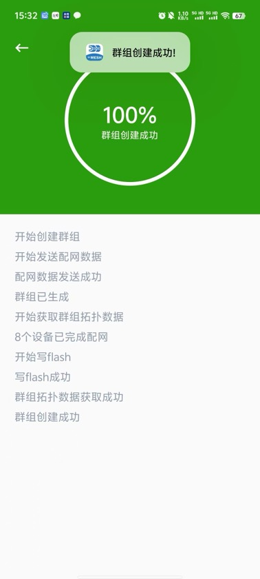

# 4.3. 新建

进入新建群组页面后，App将自动开始新建流程，这时候设备 `层级指示灯` 开始闪烁，当某个节点完成配网后， `层级指示灯` 会显示对应层级的颜色。如下图。

设备组网中

App中会显示当前的流程状态，当所有设备都配网完成，App端提示: `群组创建成功` ，并返回到群组列表页面。如下图。

App配网信息

## 模块导航

- [1. 简介](../summary.md)
- [2. 下载安装](../download.md)
- [3. 硬件准备](../device_prepare.md)
- [4. 新建群组](../new_group.md)
- [4.1. 空闲节点扫描](scan.md)
- [4.2. 群组配置](config.md)
- [5. 群组控制](../group_control.md)
- [6. 群组拓扑](../group_topology.md)
- [7. ota](../ota.md)
