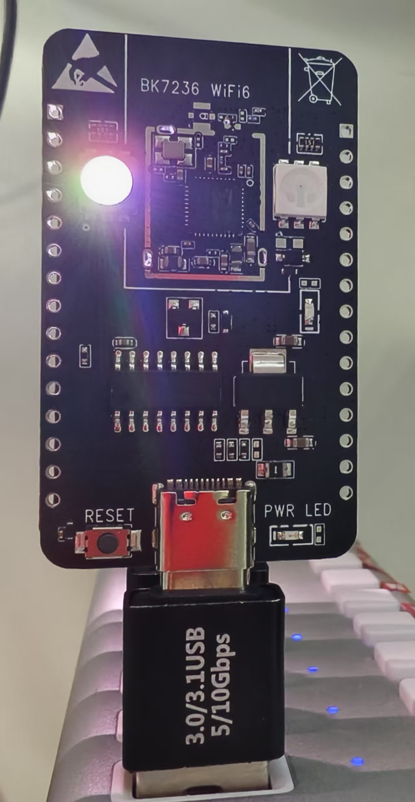
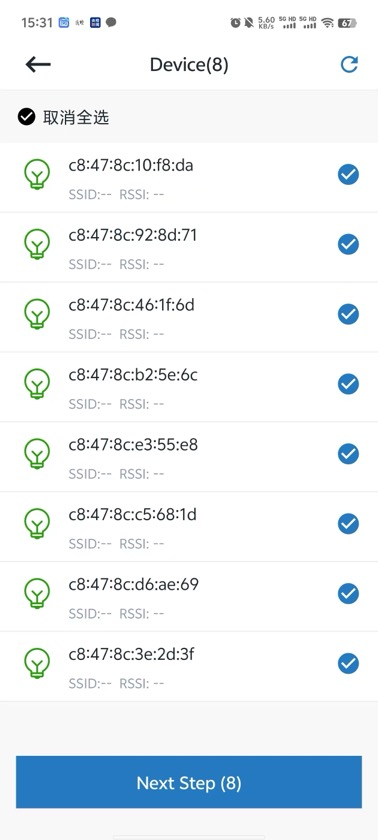

# 4.1. 空闲节点扫描

空闲节点：未进行配网的设备，设备 `层级指示灯` 显示为白色（不闪烁）, `控制指示灯` 为熄灭状态，如下图。

空闲节点

进入Mesh App，点击首页底部的 `New Group` 按钮，进入空闲节点扫描页面，App会自动开始进行扫描，扫描结果将显示在列表中。
如果未找到设备，可以点击页面右上角的刷新按钮，进行重新扫描。如下图。

扫描结果列表

扫描到附近的设备后，选择需要创建群组的设备，点击页面底部的 `Next Step` 按钮进入群组配置页面。

## 模块导航

- [1. 简介](../summary.md)
- [2. 下载安装](../download.md)
- [3. 硬件准备](../device_prepare.md)
- [4. 新建群组](../new_group.md)
- [4.2. 群组配置](config.md)
- [4.3. 新建](new.md)
- [5. 群组控制](../group_control.md)
- [6. 群组拓扑](../group_topology.md)
- [7. ota](../ota.md)
