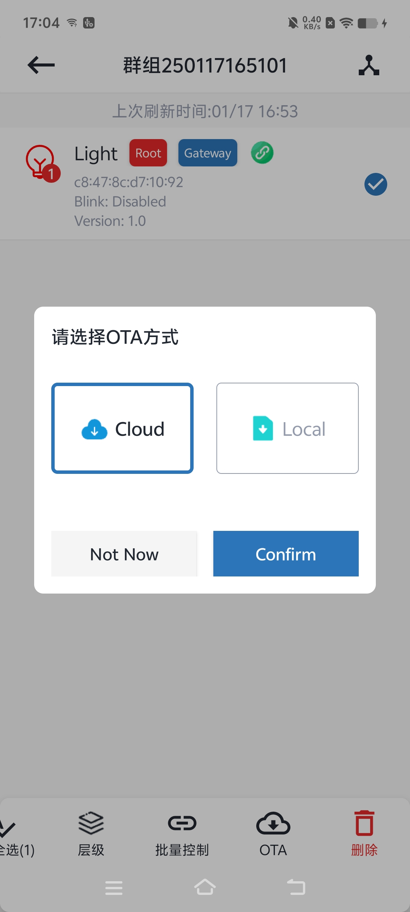
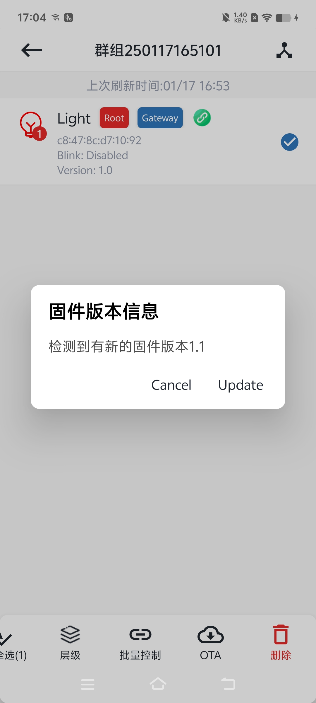

# 7.2. cloud ota

Cloud ota从服务端获取最新的ota文件。

选择ota方式。

版本信息。

开始ota。

ota结束，会检测目标版本与节点版本是否一致，并提示结果。

## 模块导航

- [1. 简介](../summary.md)
- [2. 下载安装](../download.md)
- [3. 硬件准备](../device_prepare.md)
- [4. 新建群组](../new_group.md)
- [5. 群组控制](../group_control.md)
- [6. 群组拓扑](../group_topology.md)
- [7. ota](../ota.md)
- [7.1. local ota](local_ota.md)
